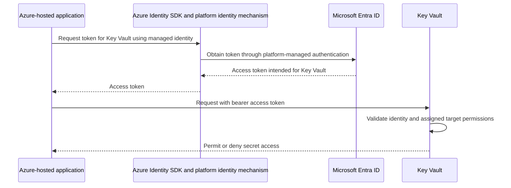
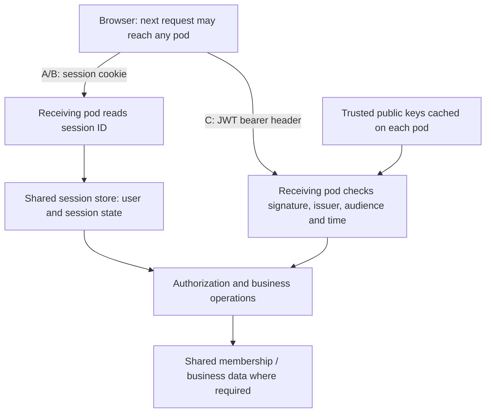
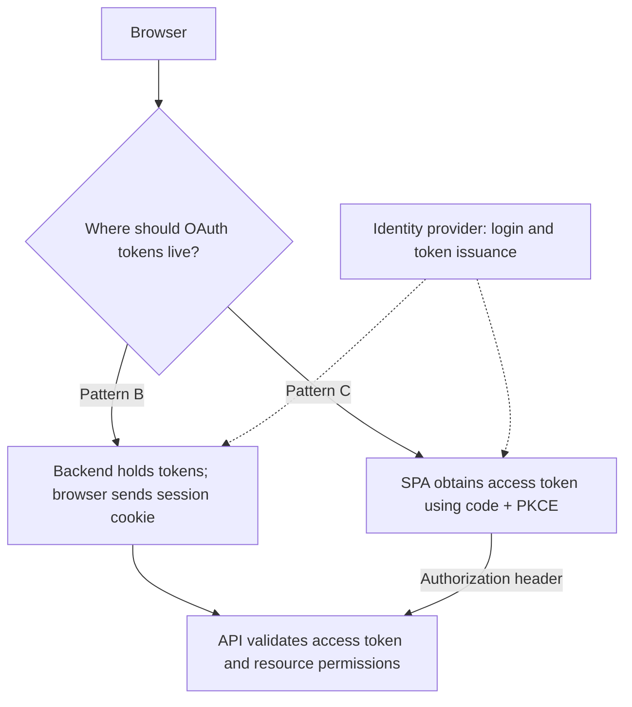
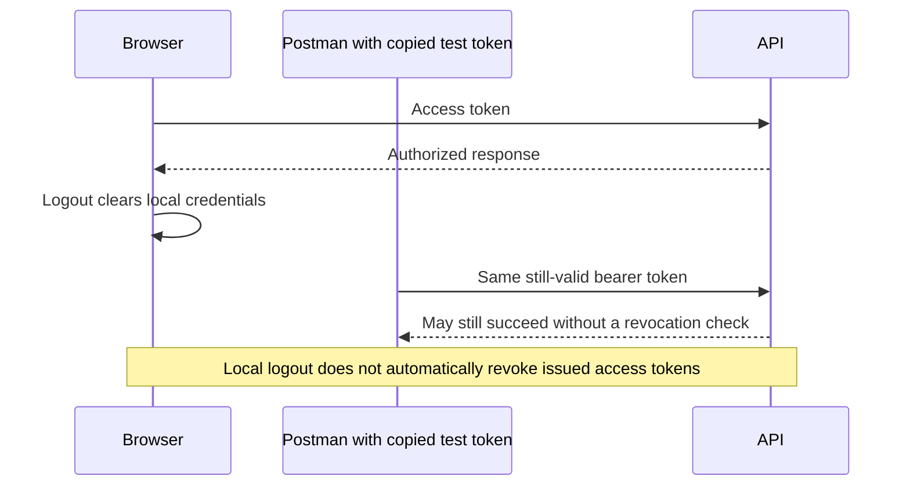
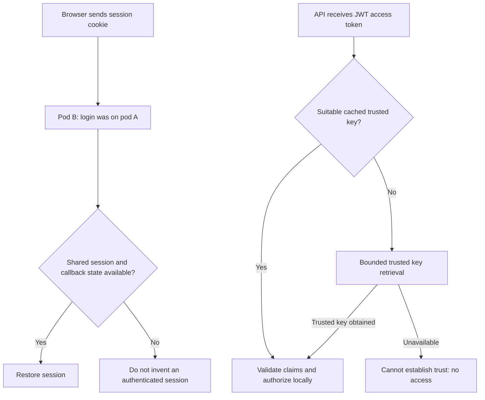
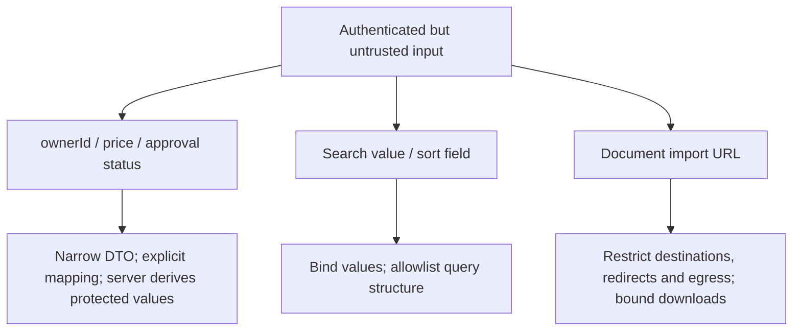
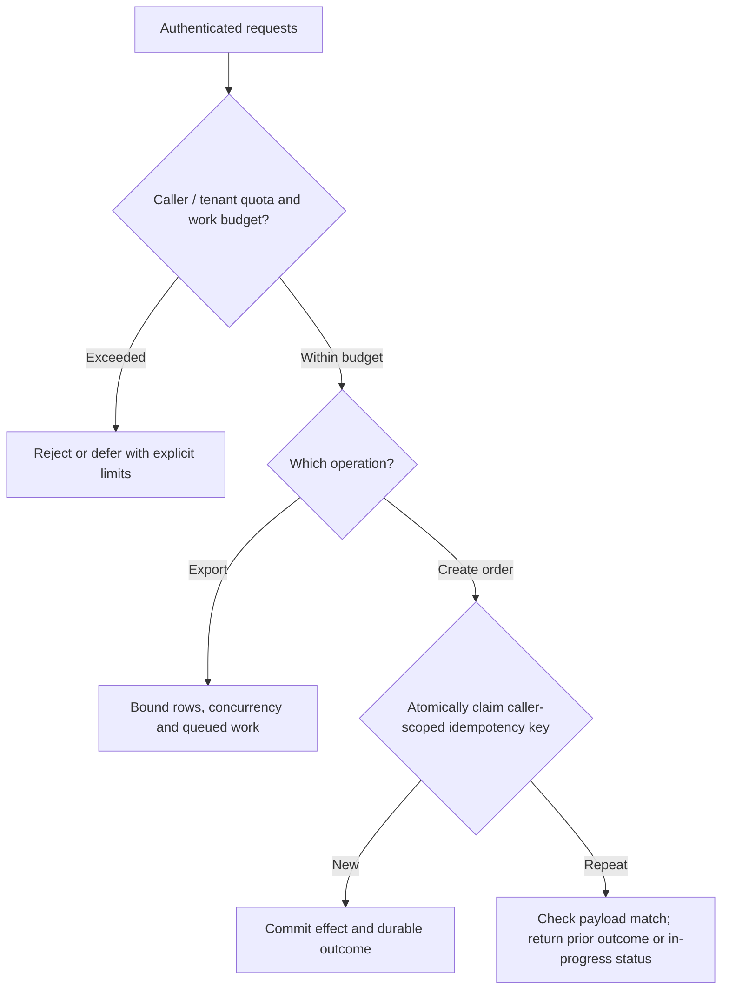
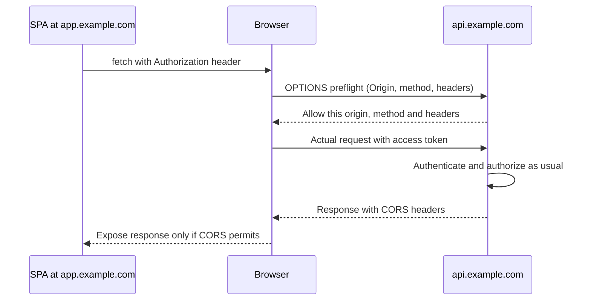
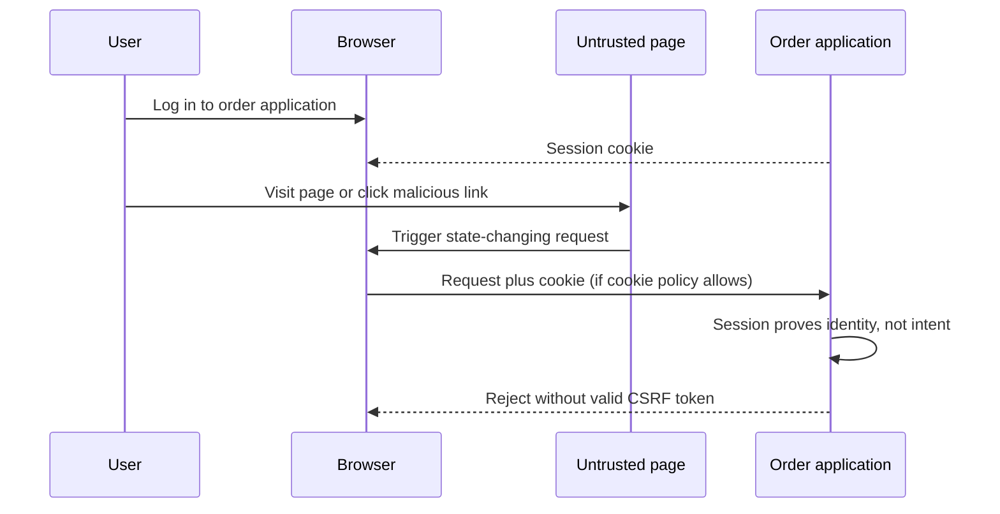
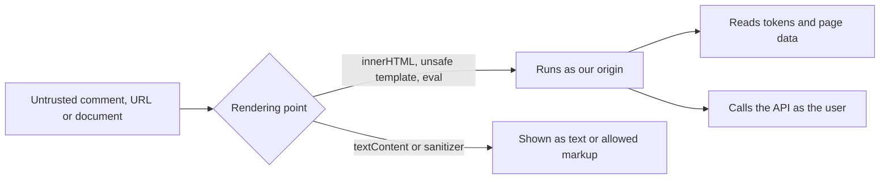

# Authentication and Authorization: Application Patterns

This is the primary security-preparation guide: framework-neutral patterns first, then a [focused scenario-led study plan](#9-focused-study-plan-security-decisions-and-defenses). Decide who owns identity, what evidence crosses each boundary and where access is enforced. Use [Spring Security: Interview Notes, section 8](Spring-Security-Interview-Notes.md#8-spring-integration-map) only for implementation mappings.

The examples are conceptual flows, not deployed applications or claims of production experience.

## 1. Start with responsibilities, not framework classes

Authentication establishes identity. Authorization decides whether that identity may perform an action on a particular resource. A valid identity does not imply access to every record.

```text
Who establishes identity?
    -> What evidence reaches this application?
    -> Why should this application trust it?
    -> Where does authenticated identity live between requests?
    -> Who decides and enforces capability + resource access?
    -> What happens on expiry, revocation, logout or dependency failure?
```

Protocols and trust relationships exist independently of Spring. Spring Security implements substantial validation, context management, attack protection and enforcement machinery for the chosen architecture; it cannot infer business entitlements or choose the architecture automatically.

| Pattern | Authentication owner | Credential presented to the application | Typical fit |
| --- | --- | --- | --- |
| A. Application login + session | Backend and its user store | Session cookie after login | Application-owned accounts |
| B. External OIDC login + backend session/BFF | External identity provider | Application session cookie | Enterprise SSO; browser tokens kept server-side |
| C. SPA calls API directly | Identity provider; SPA is OAuth client | Access token in Authorization header | Browser client accessing a separate resource server |
| D. Service calls service | Authorization server authenticates calling service | Access token in Authorization header | Workers and application-only integrations |

JSON versus HTML does not decide the pattern. A React frontend can use a backend session. A token-consuming API need not implement login or issue tokens. A system can combine patterns at distinct boundaries, but must define which credential each boundary accepts.

## 2. Pattern A: application-owned login and server session

```mermaid
sequenceDiagram
    actor User
    participant Browser
    participant Backend
    participant Users as User store
    participant Sessions as Shared session store
    User->>Browser: Enter application credentials
    Browser->>Backend: Submit login over HTTPS with required CSRF proof
    Backend->>Users: Look up account and verify password hash
    Backend->>Sessions: Establish authenticated session; rotate session ID
    Backend-->>Browser: Set protected session cookie
    Browser->>Backend: Next request with cookie, possibly to another pod
    Backend->>Sessions: Restore identity from session ID
    Backend->>Backend: Check operation and resource permission
    Backend-->>Browser: Permitted response
```

**Example:** an internal order-management tool owns its accounts. After login, the browser sends a session identifier, not the password or an API access token on every request.

The backend owns credential verification, password storage and account lifecycle. Use adaptive password hashing, HTTPS, appropriate cookie protections, session fixation protection, expiration and logout. Browser-automatically attached cookies require appropriate CSRF protection for state-changing requests.

With multiple pods, choose shared session storage or a deliberate routing/session strategy. Routing affinity alone does not preserve a session when its pod disappears.

**Failure scenario:** login succeeds on pod A, but the next request reaches pod B, which has no session state. The symptom looks like intermittent logout; the missing design is session-state availability, not JWT decoding.

| Interviewer follow-up | Practical answer cue |
| --- | --- |
| "After password login, what does the browser send when it loads an order?" | It sends the session cookie, not the password again. The backend uses the cookie's session ID to retrieve the authenticated user; the password database holds an adaptive hash used only for credential verification. |
| "A session exists before login. Why give it a different ID afterward?" | Otherwise an attacker who knows or arranged that pre-login ID might reuse it after the victim authenticates. Rotate the ID at authentication while preserving only appropriate state; this is session fixation protection. |
| "The session cookie works for GET, but creating an order returns 403. What do you inspect?" | Check whether the POST supplied the expected CSRF proof, then whether the user has create permission. A valid session proves identity, not request intent or permission; fix the missing integration instead of disabling the checks. |
| "An administrator disables a user with three active sessions. Is clearing one browser cookie enough?" | No; the other sessions still exist. Invalidate relevant server sessions or enforce current account status on use. Also define idle timeout (time without activity) and absolute lifetime (maximum age even with activity). |

[Spring implementation: section 8.2](Spring-Security-Interview-Notes.md#82-pattern-a-application-owned-login-and-server-session).

## 3. Pattern B: external OIDC login with a backend session

```mermaid
sequenceDiagram
    actor User
    participant Browser
    participant Backend as Application backend / BFF
    participant IdP as Google or enterprise identity provider
    participant API as Downstream API
    Browser->>Backend: Start external login
    Backend->>Backend: Save login correlation and PKCE verifier
    Backend-->>Browser: Redirect to trusted provider
    User->>IdP: Sign in; complete MFA if required
    IdP-->>Browser: Redirect with authorization code and state
    Browser->>Backend: Callback
    Backend->>IdP: Redeem code with verifier and configured client authentication
    IdP-->>Backend: ID token and access token; refresh token if issued
    Backend->>Backend: Validate login evidence; map identity; create session
    Backend-->>Browser: Application session cookie
    Browser->>Backend: Later request with cookie
    Backend->>API: Access token if downstream access is needed
    API-->>Backend: Authorized response
    Backend-->>Browser: Application response
```

**Example:** an employee signs into the order portal using enterprise SSO. The identity provider performs login/MFA. The portal establishes its own session and checks which orders that employee can access.

**Familiar example:** "Sign in with Google" is Pattern B when the callback ends in an application session cookie. Google's cookie and the application's cookie are separate. The button alone does not identify the pattern: browser-held API tokens indicate a Pattern C-style flow.

In a backend-for-frontend (BFF) arrangement, access/refresh tokens stay server-side rather than being exposed to browser JavaScript. The browser still holds a sensitive session cookie; this is not immunity to CSRF, XSS or session theft.

### What does the backend validate?

The backend is not simply handing a token back to an OIDC API and trusting any response. With a typical signed ID token, validation includes:

- Signature using keys belonging to the configured trusted issuer, with an appropriate algorithm policy.
- Expected issuer, intended client audience, expiry and other applicable OIDC claim requirements.
- Correlation with the browser's saved login attempt and the protocol's required checks.

| Mechanism | Purpose |
| --- | --- |
| `state` | Correlate the callback with the saved browser authorization request; defend against login-flow CSRF |
| `nonce` | When used, bind the returned ID token to the authentication request; reject mismatches |
| PKCE | Bind authorization-code redemption to the client instance holding the verifier; protect intercepted codes |

They are complementary, not interchangeable. Use supported library/provider handling rather than building a callback that merely decodes the ID token.

**Failure scenario:** a correctly signed ID token intended for a different client must not establish a portal session. Signature validity alone is insufficient.

### Can the identity provider also manage authorization?

Yes, optionally. It can supply roles, groups, scopes or entitlements, or the system can integrate a separate policy-decision service. OIDC itself does not automatically implement application authorization.

Role assignment can be **application-managed** (verified identity maps to local entitlements), **central** (trusted role claims are mapped into application permissions), or **hybrid** (central capabilities plus application resource rules). Roles need not appear in the JWT. Choose who owns changes and how quickly applications must observe them.

```text
Central role/entitlement or policy decision
    -> application validates and interprets it
    -> application enforces permission on the requested resource
```

The portal may still need current domain data: "can read orders" does not mean "can read another tenant's order." Define freshness and failure policy for cached claims or remote decisions. Local session logout, identity-provider logout and downstream-token revocation are separate operations.

| Interviewer follow-up | Practical answer cue |
| --- | --- |
| "Google login succeeded. Does that give the user access to every order in our app?" | No; Google establishes identity, while our app checks membership and order ownership. Trusted provider roles can contribute to permission checks, but cannot infer our resource relationships. |
| "Google returns the same email as an existing local account. Should we merge them automatically?" | Not merely because the strings match. Identify the external account using the trusted issuer and subject, and require a deliberate account-linking process with appropriate proof of control; email may change or have different assurance across providers. |
| "Login starts on pod A, but the callback reaches B. Why does it fail before the user has an app session?" | B may lack the saved authorization request and verifier that prove this callback belongs to the login A started. Make that correlation state accessible across pods; after login, the application session and server-held API credentials also need the appropriate shared storage. |
| "We cleared the app session, but clicking Sign in immediately logs the user in again. Is logout broken?" | Not necessarily: the provider's separate login session may still be active. Decide whether logout means leaving only this app or also requesting provider logout and credential revocation; clearing one session does not end every layer. |

[Spring implementation: section 8.3](Spring-Security-Interview-Notes.md#83-pattern-b-enterprise-oidc-login-with-a-backend-session).

## 4. Pattern C: SPA obtains a token and calls the resource server

```text
SPA -> identity provider: authorization code + PKCE
    -> SPA obtains access token
    -> SPA calls API with Authorization: Bearer <access-token>
    -> API validates token -> authorizes capability + resource -> business operation
```

**Example:** a browser order dashboard calls an independently exposed order API. The SPA is a public OAuth client and cannot keep a client secret. The API is a resource server, not necessarily a login application.

**Concrete example:** a browser dashboard uses an authentication library to obtain an access token for its order API. The API validates that token directly, without issuing a replacement JWT or establishing a browser login session. This is the generalized shape of the extracted application flow, not a claim that its deployment has been verified.

```mermaid
sequenceDiagram
    actor User
    participant SPA as Browser and OAuth library
    participant IdP as Identity provider
    participant API as Protected API
    participant Keys as Trusted provider JWKS
    User->>SPA: Start sign-in
    SPA->>IdP: Authorization request with code challenge and API scopes
    IdP-->>SPA: Redirect with authorization code
    SPA->>IdP: Redeem code with PKCE verifier
    IdP-->>SPA: API access token
    SPA->>API: Authorization header with bearer access token
    opt Suitable public key is not cached
        API->>Keys: Fetch from configured trusted provider
        Keys-->>API: Public signing keys
    end
    API->>API: Verify signature, issuer, audience and time
    API->>API: Map permissions; enforce resource policy
    API-->>SPA: Response
```

```text
Browser token cache / renewal    !=    backend public-key cache
  holds user credentials              holds public verification keys
  obtains another usable token        avoids repeated key downloads

Neither cache makes an expired token valid or guarantees immediate revocation.
```

An application can also offer password login that issues its own JWT, particularly in isolated development/tests. **That is application-owned token login, not Pattern A as defined here:** A ends in a server session; this variant ends in a browser-held bearer token. Keep development modes explicitly gated, never a fallback after production identity validation fails. A locally issued token needs its own explicit validation policy; do not assume its checks equal those of an external issuer.

Use an access token intended for that API, not an ID token intended for the SPA. Choose browser token storage/lifecycle deliberately: XSS can steal accessible tokens or act through the compromised application. Explicit bearer headers and no ambient-credential fallback differ from authentication cookies for CSRF analysis; token format alone does not decide CSRF policy. Cross-origin browser access also needs a deliberate CORS policy.

### Where does the JWT verification key come from?

```text
Configured trusted issuer
    -> trusted provider metadata
    -> jwks_uri
    -> provider's published public verification keys
Token kid -> select candidate key -> verify signature -> validate claims
```

The issuer keeps its private signing key; APIs receive public verification keys, not that private key. Decoding the token's readable header/payload is not proof of authenticity. A `kid` is a key-selection hint, not a trust decision.

Libraries normally cache keys and refresh as needed, including for rotation. This is not normally a network validation request for every JWT. Do not fetch arbitrary key URLs or accept arbitrary issuers supplied by an untrusted token.

**Key-cache policy** means how long a cached public-key set is eligible for reuse, when an unknown `kid` triggers refresh, how refresh is bounded, and what happens if retrieval fails. It is not a user-session or token-revocation cache. Continue only with a key eligible under the configured policy; otherwise deny access rather than skip verification.

After signature verification, validate expected issuer, intended API audience, timestamps and applicable token/algorithm policy. A valid token with `orders.read` still needs the application's ownership/tenant checks.

**Important connection:** Pattern B commonly also uses published public keys to validate its ID token locally. B versus C is primarily about client placement, token purpose and the browser-to-backend credential, not "remote validation versus local validation."

**Failure scenario:** an identity provider rotates keys. An API with a valid cached old key may still verify existing tokens, while tokens signed by a new unknown key require successful key refresh. Outages do not justify bypassing validation.

| Interviewer follow-up | Practical answer cue |
| --- | --- |
| "Microsoft sign-in succeeds. Did our protected API receive the user's Microsoft password?" | No; the provider handled the password and other login factors. Our API receives an access token and validates it. A separate local password-login mode would make our application responsible for credential verification and token issuance. |
| "The token is signed by the provider. Do all API pods need its private key or our SPA's secret?" | No; the API verifies with the provider's published public keys. The provider alone holds the private signing key, and a browser-delivered SPA cannot keep a client secret confidential. A backend OAuth client may have client credentials for a different purpose. |
| "An API token expires while the dashboard is open. Should every failure redirect to login?" | No; first let the library obtain another usable token through its supported silent flow. Redirect when user interaction is required; surface network/configuration errors and permission denials separately, otherwise the app can loop through login without fixing the cause. |
| "The login screen says success, but GET /orders returns 401; an admin action returns 403. How do you distinguish them?" | For 401, inspect token acceptance: intended API audience, issuer, signature, time and key availability. For 403, inspect mapped permissions and resource rules. A key-fetch outage can appear as 401 in some implementations, so server diagnostics must distinguish unavailable verification from bad credentials without exposing tokens. |
| "Suppose the API caches JWKS for five minutes, while a token expires in one hour. Which lifetime applies?" | Both, to different things. The key-cache policy controls reuse and refresh of public verification keys; the token's expiry controls credential validity. Every request still checks its token, and refreshing keys does not check whether the user logged out. |

[Spring implementation: section 8.4](Spring-Security-Interview-Notes.md#84-pattern-c-spa-obtains-a-token-and-calls-the-resource-server).

## 5. Pattern D: service-to-service client credentials

```mermaid
sequenceDiagram
    participant Worker
    participant IdP as Authorization server
    participant API as Order API
    Worker->>IdP: Authenticate workload; request application access to API
    IdP-->>Worker: Access token for intended API
    Worker->>Worker: Cache token until renewal is needed
    Worker->>API: Authorization header with bearer access token
    API->>API: Validate token and calling application identity
    API->>API: Check application permissions and permitted resources
    API-->>Worker: Authorized response
    Note over Worker,IdP: On expiry, authenticate again for another token
```

**Example:** a reconciliation worker reads orders without a user being logged in. Its token represents application identity, not user delegation.

Provision least-privilege application permissions. Use supported workload/federated credentials or certificates where available; a stored client secret is not mandatory for every deployment. Client-credentials grants normally obtain another access token by authenticating again rather than relying on a user-style refresh-token flow.

**Failure scenario:** service A forwards a token intended only for A to service B. B must reject an unsuitable audience. Use the supported delegation/token-exchange flow when acting for a user, or application credentials when acting as the service; these represent different authority.

| Interviewer follow-up | Practical answer cue |
| --- | --- |
| "A scheduled reconciliation job runs with no user logged in. Whose permissions does it use?" | The calling application's permissions, not a fictional human user's. Give that identity only the operations and tenant/resource access the job needs; successful application authentication is not universal administrator access. |
| "A user asks service A to perform an action in service B. Can A use its broad application token instead?" | That may discard the user's restrictions and create excessive authority. Use supported user delegation/token exchange when the action is on the user's behalf, with a token intended for B; use application authority only when that is the explicit business policy. |
| "Where should the worker keep the credential it uses to obtain tokens?" | Prefer a supported platform/workload identity so no manually managed secret is required. If a secret or certificate is necessary, provision it securely and rotate it; do not commit it or deliver it to browser code. |
| "A worker processes a thousand jobs. Should it request a token for each job?" | Usually no; reuse a protected cached token until renewal is needed. Coordinate renewal to avoid a request burst, and bound retries during provider outages. Client-credentials flows normally obtain a new token by authenticating again, not through a user refresh token. |
| "Both services run in the same private cluster. Can B skip token validation?" | No; network location does not establish the calling application or its rights. Validate identity and audience and enforce least privilege; private routing is an additional barrier, not a replacement. |

[Spring implementation: section 8.5](Spring-Security-Interview-Notes.md#85-pattern-d-service-to-service-client-credentials).

### Managed identity: a practical Pattern D example

**Familiar situation:** an Azure-hosted application reads a secret from Key Vault without a client secret in its configuration. It still uses an access token; the platform manages how the workload proves its identity to obtain one.



This is the same **application acting as itself** model as Pattern D, not a claim that every platform identity mechanism uses identical client-credentials protocol steps.

| Interviewer follow-up | Practical answer cue |
| --- | --- |
| "Managed identity is enabled on our app, but Key Vault still denies secret access. What is missing?" | Enabling identity lets the app prove who it is; it does not grant secret access. Assign the appropriate least-privilege Key Vault role and check that it applies to the actual selected identity and resource scope. |
| "The app has a Key Vault token. Can it send that token to Storage or our order API?" | No; tokens are intended for a particular resource. Ask for the target service's token and configure its permissions separately; sharing the issuer does not make audiences interchangeable. |
| "Our own API is not an Azure resource like Key Vault. Can it authorize a managed identity?" | Yes, if configured to accept the intended Entra access token. Validate the token, identify the calling application and enforce an explicit application-role/access policy; merely enabling Entra login for human users is not enough. |
| "An AKS pod has no client secret. How does it prove its identity to Entra?" | It presents a Kubernetes service-account token under a configured federation: Entra trusts tokens from a specified issuer for a specified service account and intended audience. Entra then issues the resource access token. This differs from using a VM's platform managed-identity endpoint. |
| "Key Vault works on my laptop but fails after deployment. Doesn't the SDK use the same identity?" | Not necessarily. A credential chain can use your developer login locally and the workload identity in production. Inspect the selected principal and target permissions in each environment; your personal access does not prove the app has access. |

**Recall:** managed identity removes the manually managed credential, not the access token or the need for permissions.

### Scaling does not depend on the header alone

**Recall:** Pattern C with locally validated JWTs simplifies horizontal scaling of API authentication. Patterns A/B with server-side sessions need cross-pod access to the session state. This is a JWT-validation advantage, not a property of the `Authorization` header itself.



**The cookie is already sent by the browser.** What pod B must retrieve is the server-side state identified by that cookie, even if pod A created it. With a JWT, each pod can validate the carried evidence locally without a session lookup; all pods still need consistent trust configuration and suitable signing keys.

| Design | Authentication dependency | Scaling trade-off |
| --- | --- | --- |
| A/B: server-side session | Shared session repository, such as Redis or a database | Scales horizontally, but adds a lookup and repository availability dependency |
| C: locally validated JWT | Trusted keys and claim-validation configuration on each pod | No per-request session lookup; login, renewal and key refresh can still have external dependencies |
| C: opaque bearer token | Token authority through introspection, possibly cached | No local session required, but validation depends on authority availability and cache policy |

JWTs do not make the entire application stateless. Current membership, immediate disablement/revocation, distributed quotas and business data may still require shared state. Choose credential placement from browser-security and revocation requirements as well as scaling convenience.

A BFF with shared sessions can deliberately trade a session-store dependency for keeping OAuth tokens out of browser JavaScript. Affinity is routing, not failover-safe persistence. Include authorization-request correlation state and server-side authorized-client tokens when designing OIDC session failover.

## 6. OAuth, OIDC, JWT and opaque tokens: different layers

| Concept | Meaning |
| --- | --- |
| OAuth 2.0 | Framework for obtaining authorized API access; supports user delegation and application-only grants |
| OIDC | Identity/authentication layer over OAuth 2.0, including an ID token |
| Access token | Credential intended for a resource server/API |
| ID token | Authentication information intended for the OIDC client, not a substitute API access token |
| Refresh token | Credential presented to the authorization server to obtain new access tokens |
| JWT | Claims format; commonly signed, not encrypted by default |
| Opaque token | Token the resource server treats as an uninterpreted reference |

Patterns C and D can use JWT or opaque access tokens. The choice changes API validation, not the fundamental client/authorization-server/resource-server roles. A controller that signs a JWT does not thereby implement OAuth/OIDC.

### JWT versus opaque: signed pass versus checked reference

| Question | JWT, locally validated | Opaque, introspected |
| --- | --- | --- |
| Where does the API obtain claims? | Verified token contents | Trusted introspection response |
| Network dependency | Discovery/key retrieval and rotation as configured; not normally per-request token lookup | Introspection calls, potentially cached |
| Revocation freshness | Normally bounded by expiry unless additional state/revocation checks are used | Bounded by issuer propagation and introspection-cache policy |
| Information exposure | Signed claims are normally readable by the token holder | Reference does not itself expose interpretable claims |

Both require protected transport/storage and no token logging. Both require authorization after validation. For introspection, `active=true` alone is not proof that the token is intended for this API; validate the applicable resource/audience and permission policy.

**JWT example:** disabling an account may leave an issued access token accepted by local APIs until expiry.

**Opaque example:** the issuer marks a reference inactive and the next uncached introspection observes that change. A 60-second cache can extend acceptance through that window. An introspection outage is not permission to authenticate successfully. Verify provider support rather than assuming every issuer offers opaque tokens and standard introspection.

[Spring JWT/opaque implementation comparison](Spring-Security-Interview-Notes.md#oauth-oidc-jwt-and-opaque-tokens-spring-integration).

## 9. Focused study plan: security decisions and defenses

Use these six conversations to recall **what goes wrong, why, where we fix it and how we know**. Follow the diagram, explain the normal solution, then defend it against the follow-ups. The running example is an order portal used by multiple tenants. These are preparation scenarios, not claims of production experience or completed tests.

### 9.1 How would you secure a frontend calling our APIs?

**Interview setup:** we are building a browser order portal with enterprise login and a separately deployed API. Should the browser call the API with tokens, or should a backend handle that for it? Explain the credential flow before choosing the framework.



**Why it matters:** choosing where credentials live changes theft exposure, session operations and browser protections. Multiple pods alone do not force a JWT design.

**Normal solution:** use a BFF when keeping OAuth tokens out of browser JavaScript is the priority; use direct SPA tokens when browser-to-API access is a deliberate requirement. Both need server-side authorization. Browser-specific failures and fixes belong in [section 10](#10-browser-security-why-cors-csrf-and-xss-happen), not a duplicate checklist here.

The BFF redeems the login code, stores OAuth tokens server-side and gives the browser a protected session cookie. It returns application data rather than tokens. This reduces token theft through JavaScript, at the cost of a backend hop, session storage and cookie/CSRF integration.

| Interviewer follow-up | Answer cue |
| --- | --- |
| "The SPA needs to stay logged in after reload. Why not keep access and refresh tokens in localStorage?" | It is convenient, but injected same-origin JavaScript can copy those tokens, and persistence leaves them available longer. Memory reduces persistence, not XSS exposure; a BFF moves tokens out of JavaScript but requires a protected server session. |
| "If the BFF keeps tokens on the server, can injected JavaScript still place an order?" | Yes; it can call the BFF from the victim's page and the browser attaches the session cookie. HttpOnly blocks direct cookie reads, not these actions. Safe rendering and appropriate CSRF defenses remain necessary; the BFF principally reduces credential exfiltration. |
| "Why use PKCE instead of putting a client secret in the SPA?" | Anything shipped to the browser can be inspected. PKCE uses a fresh verifier and its challenge so an intercepted authorization code cannot be redeemed without that verifier. It does not protect an already stolen access token or replace login-correlation checks. |
| "Our browser call fails, but the same token works in Postman. Should we relax API authentication?" | No; compare actual credential delivery and inspect CORS/preflight errors. Postman does not enforce browser response-access rules. Fix the allowed-origin/header configuration or frontend request, while keeping API authentication intact. |
| "Our order API also calls a billing API. Can it simply pass through the incoming access token?" | Only if billing is an intended audience and the delegation policy permits that use. Otherwise acquire a suitable downstream token. A service acting as itself uses application authority, which is different from carrying the user's restricted authority. |

**Check the design:** trace the credential on each hop, reject a mismatched login callback, and verify that unauthenticated API calls fail in both designs. Never log the credentials while tracing.

### 9.2 The token is valid. Why a 403, or another customer's data?

Treat these as **two interview cases**, not one diagnosis:

| Setup and symptom | Why it happens and normal fix |
| --- | --- |
| **Case A: legitimate admin denied.** Login works, but an admin-only request returns 403 despite a role claim. | The token may be accepted while its claim is not mapped to the permission the endpoint checks. Inspect validated claims, authority conversion and the actual denial stage; correct mapping rather than bypassing the endpoint policy. |
| **Case B: another tenant's order exposed.** A permitted user changes `/orders/123` to another tenant's order ID and receives it. | The API checks permission to read orders but fetches by ID alone. Constrain the query by the caller's trusted tenant/ownership relationship; apply the same rule to lists and exports. |


**Why it happens:** "valid token", "can read orders" and "can read this order" are three different decisions. A signature alone does not even establish that the token belongs to this API.

**Normal solution:** validate the intended access token, map permissions explicitly, then enforce resource relationships at the shared service/query boundary. Derive tenant access from trusted membership, not a caller-supplied tenant ID.

| Interviewer follow-up | Answer cue |
| --- | --- |
| "The token says ADMIN, but the endpoint still denies it. Does that mean the token is invalid?" | Not necessarily; the API may accept identity but expect a different permission representation. For example, Spring's role check conventionally expects `ROLE_ADMIN`, while default scope conversion produces `SCOPE_...`. Inspect the mapping and denial reason; CSRF can also produce 403. |
| "An ID token is signed by the same provider. Why not accept it as API access?" | The signature proves who signed it, not its intended use. An ID token is login evidence for the OIDC client; the API needs its intended access token and must validate purpose, audience, issuer and time. |
| "Could we fix Case B by using UUIDs or hiding the order link?" | No; a discovered ID or direct request still works without a resource check. Use the authorized relationship in the lookup and all alternate paths. Choose a consistent 403/404 policy if object existence itself is sensitive. |
| "Roles come from the provider, but tenant membership changes in our database. Which source should win?" | Define ownership of each decision: provider claims may grant broad capabilities, while current application data restricts tenant/resource access. Token claims remain stale until replaced unless another check observes changes; choose an acceptable freshness window. |
| "Support admins need cross-tenant access. Should ADMIN bypass every ownership check?" | No; model the exception as explicit, scoped and audited authority. Workers, tool actions and subscriptions must cross the same policy boundary; do not trust a supplied tenant/user argument to grant that exception. |

**Check the design:** test owner, other tenant and scoped admin against GET, update, list and export. Separately test altered, expired and wrong-audience tokens through real validation, not only mocked authentication.

### 9.3 I copied the token into Postman. What happens after logout?

**Interview setup:** a developer copies their own test access token into Postman. Calls succeed before and after logging out of the browser. Is logout broken, and what should the API promise?



**Why it happens:** a bearer token proves possession, not which client is presenting it. Clearing browser state or revoking a refresh token does not automatically invalidate an already issued access JWT.

**Normal solution:** limit access-token lifetime, scope and audience; protect credentials from logs/XSS; define logout and account-disablement freshness separately. Immediate rejection needs enforced server-side state, introspection or another current-policy check, with an availability cost.

Postman success is **not necessarily a bug**: it may match a documented expiry-based policy. It is a bug if the system promises immediate logout/disablement but does not enforce it. Revoke supported refresh credentials to stop renewal; that is separate from rejecting access tokens already issued or ending the provider session.

| Interviewer follow-up | Answer cue |
| --- | --- |
| "A disabled user still has a JWT valid for an hour. How would we cut off access now?" | Local signature/expiry checks cannot observe the account change. Add an enforced account-status or revocation check with a bounded cache window; otherwise state the expiry-based window honestly. That check adds shared state and outage/latency considerations. |
| "Would switching to opaque tokens make logout immediate?" | It can make current status available through introspection, but only if revocation is recorded and the API observes it promptly. An active-result cache delays rejection; define cache lifetime and failure behavior rather than relying on token format. |
| "Why not solve theft with ten-second access tokens?" | Very short lifetimes reduce exposure but increase renewal load and sensitivity to provider outages. Choose a risk-appropriate lifetime and protect renewal credentials; short expiry alone does not eliminate replay. |
| "A stolen refresh token is used after the legitimate client has renewed. What can rotation do?" | Rotation replaces the renewal credential, allowing the provider to detect reuse of an old one and take its configured containment action. Concurrent tabs and retries need supported handling. Already issued access tokens still follow their separate validity/revocation policy. |
| "How could the API reject a copied token even before expiry?" | Sender-constrained tokens can require proof of the matching key: DPoP uses a signed request proof, while mTLS binding uses the client certificate. Copying the token alone is then insufficient. This adds key management and integration complexity; CORS and PKCE do not provide this protection. |

**Check the design:** use test credentials to measure access after logout/disablement and after expiry; test refresh rejection/reuse according to provider policy. Keep tokens out of screenshots, traces and fixtures.

### 9.4 Login fails after a rollout. What if the identity provider is down?

| Separate interview case | Diagnosis and normal fix |
| --- | --- |
| **Case A: intermittent logout.** A session-based portal adds a second pod; requests alternate between logged-in and anonymous. | The receiving pod lacks the session state held by the original pod. Share session state, and share required login-callback state too; sticky routing does not survive pod loss. |
| **Case B: JWT API during a provider outage.** Some existing tokens work, but tokens with a new key ID fail. | Existing requests may use eligible cached keys; a new key requires successful trusted retrieval. Configure rotation overlap, bounded refresh and explicit failure handling; do not skip verification. |



**Why it happens:** in this session design, the cookie references server-side state rather than carrying it. JWT checks can be local, but new login, renewal, unknown signing keys and live entitlement checks may still depend on other services.

**Normal solution:** share required session/login-correlation state across replicas; use supported key caching and rotation overlap, bounded timeouts and explicit unavailable-dependency errors. Do not skip checks or extend token expiry to keep traffic flowing.

| Interviewer follow-up | Answer cue |
| --- | --- |
| "We enabled sticky routing and intermittent logout stopped. Are we done?" | Not if sessions exist only in pod memory: a rollout or crash still destroys them. Affinity chooses a destination, not durable storage. Use a shared repository for required continuity and test pod replacement, not only steady-state routing. |
| "The callback arrives on another pod before login has completed. What state could it be missing?" | The saved login request, state value and PKCE verifier connect the callback to the initiating browser. Without them B cannot safely accept it. Store that correlation through the supported cross-pod integration rather than ignoring the mismatch. |
| "The provider is down. Must every existing JWT request fail?" | No; eligible cached trusted keys can support local signature/claim validation. New login, renewal, unknown-key retrieval and live permissions may still fail. Identify which dependency the request actually needs. |
| "An attacker sends many random key IDs. Will each one download JWKS?" | It should not cause unbounded refresh. A key ID (`kid`) only selects among keys from the configured trusted key set (JWKS); bound refresh frequency and retries. Rotation still needs a supported refresh path and key overlap. |
| "The session store times out. Should we retry forever, return 401, or let the user through?" | Never let the user through without required trust. Bound retries and surface an unavailable-service response where the integration permits, with useful internal diagnostics. Some stacks map key-fetch failures to authentication errors; distinguish outage from invalid credentials operationally. |

**Check the design:** alternate replicas during login and normal use, restart a pod, then interrupt test session/key services. Distinguish cached-known-key, unknown-key, expired-token and unavailable-store behavior.

### 9.5 The user is logged in. Can we trust their payload or URL?

| Concrete interview case | Why it works and where to fix it |
| --- | --- |
| **Over-posting:** the form sends item/quantity, but a caller adds `price: 0` and `status: APPROVED`; both are saved. | Binding the whole request onto a persistence entity makes protected fields writable. Accept a narrow request DTO (a class defining allowed input fields), map explicitly and derive price/status/owner on the server. |
| **Injection:** a search or sort parameter is concatenated into query text. | Data can become query instructions. Bind search values as parameters and map sort choices to an allowlist of known fields; binding values does not protect dynamic query structure. |
| **SSRF:** an import endpoint fetches any submitted document URL, including a forbidden internal destination. | Server-side request forgery uses the server's network access, not the user's browser. Prefer fixed integrations; otherwise restrict destinations/redirects and outbound network access (egress), with bounded downloads. |



**Why it happens:** identity does not make input safe. Three separate failures are hidden here: writing protected fields (over-posting), changing query meaning (injection), and using the server to reach a forbidden destination (SSRF).

**Normal solution:** enforce each boundary where input takes effect. Explicit contracts reduce flexibility, but are easier to defend than binding an entire entity or fetching any supplied URL.

| Interviewer follow-up | Answer cue |
| --- | --- |
| "Our ORM binds ordinary search values. Is arbitrary user-controlled sorting safe too?" | No; values and query structure are different. JPA's query language (JPQL) or native SQL can still be unsafe when constructed by concatenation. Map public sort choices to approved fields instead of accepting arbitrary query fragments. |
| "Would rejecting unknown JSON properties prevent the price/status example?" | It helps only if the input contract excludes those properties. A DTO that includes every entity field still exposes them. Define writable fields explicitly, derive protected values server-side and enforce business transitions. |
| "The import URL uses HTTPS and an approved hostname. What if it redirects?" | HTTPS protects transport, not destination policy. Recheck redirects and the actual resolved destination, and enforce outbound network restrictions so DNS changes or redirects cannot escape the approved boundary. Bound response size and time too. |
| "We accept only PDFs. What if the scanner is unavailable or the file expands during processing?" | A name/type claim does not make content safe. Keep pending files private if required checks cannot finish; bound parsing, extraction and worker resources. Use generated storage IDs and isolated processing, and authorize every download/preview. |
| "All fields pass validation. Why still check ownership and output rendering?" | A valid order ID can belong to another tenant, and valid free text can be rendered unsafely later. Validation checks the input contract; authorization checks rights, and safe rendering keeps data from becoming browser code. |

**Check the design:** protected fields cannot be changed, query fixtures stay literal, and unsupported sort fields fail clearly. Use controlled test destinations for blocked redirects/download limits; never probe real internal metadata services.

### 9.6 The endpoint is authorized. Why overload or duplicate orders?

| Separate interview case | Why it happens and normal fix |
| --- | --- |
| **Expensive export:** a valid user repeatedly starts full-history exports, exhausting workers. | Permission does not bound consumption. Limit caller/tenant submissions, rows, runtime, queued work and concurrent execution. |
| **Retried creation:** an order commits, the response times out, and retry creates another order. | The caller cannot infer commit status from a timeout. Use a caller/operation-scoped idempotency key: a retry identifier stored durably so repeats recover the same outcome instead of repeating the effect. |



**Why it happens:** permission to call is not permission to consume unlimited resources. Separately, a timeout does not tell the caller whether an order was committed, so a retry can repeat the effect.

**Normal solution:** bound request size, pagination, execution and concurrency; enforce caller/tenant quotas. For consequential writes, combine scoped idempotency records with business uniqueness and transactional/outbox design where needed. These controls add coordination/state, but solve different problems.

| Interviewer follow-up | Answer cue |
| --- | --- |
| "A whole customer office shares one IP address. Would an IP limit fairly control exports?" | Not by itself; it may block unrelated legitimate users, while distributed clients evade it. Combine caller/tenant quotas with service-wide limits, retaining appropriate IP/network controls for unauthenticated abuse. |
| "Exports run asynchronously now. Can we accept unlimited jobs?" | No; the backlog can still exhaust storage or delay every tenant. Bound submissions, queue size, job cost and worker concurrency; check permissions again for result access and define how overload is reported. |
| "Two API pods receive the same create-order retry key simultaneously. How do we avoid two orders?" | Claim the key atomically in shared storage, scoped to caller/operation; an in-memory check races. Coordinate the business write and durable outcome so a crash does not leave a completed effect looking new, and define recovery for an in-progress claim. |
| "A client reuses the same key with a different quantity. Should we return the old result?" | Reject conflicting reuse after comparing a stored request fingerprint (a canonical representation or hash of the relevant payload). Reauthorize the caller and scope records so another user cannot retrieve the outcome. Define record retention and late-retry behavior too. |
| "A payment provider charged successfully, but our worker crashed before recording success. What does a retry do?" | Use the provider's idempotency support and a durable workflow that can reconcile uncertain outcomes. An outbox stores work to send alongside the local transaction, but does not make an external charge atomic with our database. Do not promise exactly-once external effects from a header alone. |

**Check the design:** run bounded bursts, concurrent duplicates and commit/timeout/retry cases. Verify one intended business effect, recoverable outcomes, payload-conflict rejection and fair limits across tenants.

### 9.7 Before calling the design secure

| Practical closing question | Evidence to look for |
| --- | --- |
| "Authentication tests pass. What would you inspect before exposing the deployment publicly?" | Check the deployed routes, management endpoints and effective configuration, not just source defaults. Confirm service identities have only required privileges and protected endpoints cannot be reached through an overlooked route. |
| "Support wants the full Authorization header to diagnose failures. What would you record instead?" | Record safe correlation IDs and validation/denial categories, not bearer credentials. Sensitive actions need an audit of actor, action, resource and outcome with controlled access/retention; user-facing errors should not expose internal details. |
| "A scanner reports a vulnerable library. Is that enough to accept or dismiss the finding?" | No; check the actual version, use and exposure, then remediate or document a reasoned assessment. Keep supported patched dependencies and reviewed build inputs; neither a clean scan nor a library's mere presence proves deployed safety. |

Use [OWASP Top 10](https://owasp.org/www-project-top-ten/), [API Security Top 10](https://owasp.org/www-project-api-security/) and [Cheat Sheets](https://cheatsheetseries.owasp.org/) to find missed failure modes, not memorize rankings. Use [ASVS](https://owasp.org/www-project-application-security-verification-standard/) for concrete verification requirements, noting the edition when expanding a topic.

## 10. Browser security: why CORS, CSRF and XSS happen

Read this section as **cause → consequence → usual fix**, not as definitions. All three problems come from things the browser does *automatically* on the user's behalf:

| Browser behaviour | Problem it creates | What we normally do | Short recall |
| --- | --- | --- | --- |
| Blocks scripts from reading responses from another origin (same-origin policy) | Our own frontend on another origin cannot read our API | **CORS**: the API allowlists the origins that may read it | "Who may *read* my responses?" |
| Attaches cookies automatically to matching requests | Another site can make the user's browser *act* with their session | **CSRF defenses**: require proof the request came from our app | "Cookie proves *who*, not *intent*" |
| Runs any script that ends up in the page as our origin | Untrusted content becomes code running *as our app* | **XSS defenses**: keep data as data when rendering | "Data must never become code" |

**Ordering insight:** XSS defeats the other two. Injected script is already same-origin, so CORS does not apply to it and it can read CSRF tokens or browser-held bearer tokens. Prevent XSS first.

**Outside the browser none of this applies.** Postman, curl and backend services do not enforce CORS and do not attach cookies automatically. That is why copying a bearer token into Postman works: it is token replay, and only authentication, authorization, token lifetime and audience limit it.

Running example:

```text
Browser frontend: https://app.example.com
Order API:        https://api.example.com
Untrusted site:   https://untrusted.example.net
```

An **origin** is scheme + host + port, so `app` and `api` above are different origins. They are still the same *site* (same registrable domain), which matters for SameSite cookies. CORS works on origins and SameSite works on sites; they are not interchangeable.

### 10.1 CORS: why our own frontend cannot read our own API

**Recall:** the browser protects users by not letting one origin's script read another origin's data. CORS is the API *opting in* to let specific origins read it. It loosens a browser restriction; it does not protect the server.

**Why the situation arises in real apps:**

| Situation | Example |
| --- | --- |
| Frontend and API deployed separately | SPA on a CDN at `app.example.com`, API on AKS at `api.example.com` |
| Local development | React on `localhost:3000`, Spring Boot on `localhost:8080` (different ports mean different origins) |
| One API, many frontends | Customer app, admin portal and partner portal all call one API |
| Browser calls third-party APIs | Maps, payments, search |

**Why the browser blocks it by default:** without the same-origin policy, script on any site you visit could call your bank's API with your cookies and *read* the answer.

**How it plays out:**



A request with JSON content type, an `Authorization` header or a method such as `PUT`/`DELETE` requires preflight. A request meeting the browser's CORS-safelisted conditions needs no preflight: **it can reach the server and execute before the browser blocks JavaScript from reading the response**.

```http
OPTIONS /orders/123 HTTP/1.1
Origin: https://app.example.com
Access-Control-Request-Method: GET
Access-Control-Request-Headers: authorization

HTTP/1.1 204 No Content
Access-Control-Allow-Origin: https://app.example.com
Access-Control-Allow-Methods: GET
Access-Control-Allow-Headers: Authorization
Vary: Origin
```

**What we normally do:**

1. **Avoid the need:** serve the SPA and API from one origin through a gateway/ingress (`/` → SPA, `/api` → backend), or use a dev-server proxy locally. No CORS is needed. This is common with the BFF approach (Pattern B).
2. **Otherwise allowlist explicitly:** exact origins, required methods and headers only.

```java
@Bean
CorsConfigurationSource corsConfigurationSource() {
    CorsConfiguration cors = new CorsConfiguration();
    cors.setAllowedOrigins(List.of("https://app.example.com"));
    cors.setAllowedMethods(List.of("GET", "POST", "OPTIONS"));
    cors.setAllowedHeaders(List.of("Authorization", "Content-Type"));
    UrlBasedCorsConfigurationSource source =
            new UrlBasedCorsConfigurationSource();
    source.registerCorsConfiguration("/api/**", cors);
    return source;
}
```

Activate with `http.cors(Customizer.withDefaults())` (Boot 3.5 / Security 6.5 Servlet). This bearer-oriented example does not enable cookie credentials.

**What you see at work:** a browser console error saying "blocked by CORS policy" while the same call works in Postman. The fix belongs on the server's allowlist, not in disabling security.

**Common mistakes:**

- Treating CORS as access control. Any non-browser client ignores it.
- Combining `Access-Control-Allow-Origin: *` with credentialed requests: browsers reject that combination. "Fixing" it by reflecting arbitrary origins while allowing credentials is dangerous because it permits untrusted sites to read credentialed responses. Use an explicit trusted-origin allowlist.
- Forgetting the CORS headers on the actual response, or authentication rejecting the `OPTIONS` preflight.

**Verify:** an allowed origin gets headers on both the preflight and the actual response, and still needs valid credentials. A disallowed origin's preflighted request is never sent.

### 10.2 CSRF: why a logged-in user's browser can be used against them

**Recall:** the browser attaches cookies automatically, so a cookie proves *who* the user is, not that *our app* sent the request. CSRF defenses add proof of intent that another site cannot obtain.

**Why it happens:** the user is logged in to the order app. An untrusted page induces a request through a form or link; the browser attaches the session cookie **only if its cookie and request policies permit it**. An image URL can trigger a GET too, but cross-site image requests do not carry SameSite=Lax cookies. The attacker need not see the response: an unintended business side effect is enough.



**The malicious-link variant:** if a `GET` changes state (for example, `/orders/123/cancel`), clicking a link is enough. `SameSite=Lax` still sends cookies on top-level `GET` navigation, so safe methods must never change state.

**Who is exposed depends on the credential model:**

| Credential model | CSRF risk | Usual approach |
| --- | --- | --- |
| Session cookie (Patterns A and B) | Yes, because the browser sends the cookie automatically | Keep CSRF protection on and send the token from the frontend |
| Bearer token added by JavaScript (Pattern C) | Low, because another site cannot make the browser add our header | CSRF protection is commonly disabled for that API, as a reasoned decision |
| JWT stored in a cookie | Yes again, because it is a cookie | Treat it as a cookie-based session |

The token format is irrelevant. What matters is whether the browser supplies the credential **automatically**.

**What we normally do (session-based SPA):**

```text
1. Browser establishes the session.
2. Frontend obtains the CSRF token from the backend's supported mechanism.
3. Frontend sends it in a header (for example X-CSRF-TOKEN or X-XSRF-TOKEN).
4. Backend checks session + CSRF token, then authorization.
5. After login/logout, the frontend fetches the renewed token.
```

```javascript
async function createOrder(order, csrfToken) {
    const response = await fetch("/orders", {
        method: "POST",
        credentials: "same-origin",
        headers: {
            "Content-Type": "application/json",
            "X-CSRF-TOKEN": csrfToken
        },
        body: JSON.stringify(order)
    });
    if (!response.ok) {
        throw new Error(`Order creation failed: ${response.status}`);
    }
    return response.json();
}
```

`csrfToken` must come from the backend's CSRF integration; header name and masking behaviour are framework/version specific. Another origin cannot read this token because of the same-origin policy, unless XSS or an unsafe CORS rule leaks it. Layer `SameSite` cookies and origin checks on top.

**What you see at work:** a security scan reports "CSRF protection disabled". Usually someone hit a `403` on `POST` from the frontend and turned CSRF off instead of sending the token. Ask: *what property of this credential model makes CSRF unnecessary?* If the answer is "nothing, we use cookies", the finding is real.

**Common mistakes:**

- Disabling CSRF globally to fix a frontend `403`.
- Allowing state changes on `GET`.
- Assuming `SameSite` alone is enough. Sibling subdomains are same-site, and older or misconfigured cookies may lack it.

**Verify:** a cookie-authenticated `POST` without a valid token is rejected with no side effect. A valid token on an unauthorized resource is still rejected, because CSRF proof is not permission.

### 10.3 XSS: why untrusted content can run as our app

**Recall:** XSS happens when untrusted data reaches a place where the browser interprets it as code. That code runs with our origin's full privileges. The fix is to keep data as data at every rendering point.

**Why it is so damaging:** the browser cannot tell our script from injected script on our page. The injected code can read the page, read any token JavaScript can access, read CSRF tokens and call our API as the user. CORS and CSRF defenses do not stop it, because it is same-origin.



**How it gets in:**

| Route | How it plays out |
| --- | --- |
| Stored | Attacker saves a comment containing script; every user who views it runs it |
| Reflected | A crafted link puts input into the server's response unsafely; the victim clicks it |
| DOM-based | Frontend JavaScript moves URL or input data into an unsafe DOM sink, without the server being involved |

Unsafe DOM manipulation is one route, but the underlying problem is **data crossing into code**. Server templates, attributes, URLs (`javascript:`) and inline scripts can cross that boundary too; XSS is not defined by which layer performed the rendering.

**What we normally do:**

1. Insert text as text. Frameworks such as React and Angular escape by default; the danger is the escape hatches (`innerHTML`, `dangerouslySetInnerHTML`, `bypassSecurityTrust...`).

```javascript
commentElement.textContent = commentText;
```

2. If rich content is a real requirement, use a maintained sanitizer with a narrow allowlist. A Markdown-to-HTML converter creates markup; a sanitizer such as DOMPurify separately restricts unsafe content before insertion.

```javascript
commentElement.innerHTML = DOMPurify.sanitize(commentHtml, {
    ALLOWED_TAGS: ["p", "strong", "em", "ul", "ol", "li", "br"],
    ALLOWED_ATTR: []
});
```

3. Encode for the right context (HTML, attribute, URL, JavaScript), which templating engines do when used normally.
4. Add a **Content-Security-Policy** as a second line of defense, limiting script sources and blocking inline script.
5. Reduce what a successful XSS can steal: `HttpOnly` session cookies, and a BFF instead of tokens held in the browser.

**What you see at work:** scanners flag `innerHTML` use, missing CSP headers or reflected parameters. Review where untrusted data meets a rendering sink.

**Common mistakes:**

- Thinking `HttpOnly` prevents XSS. It only stops cookie theft; injected script can still send requests with the cookie.
- Thinking a BFF makes XSS harmless. It removes token theft, not actions taken as the user.
- Sanitizing once and then concatenating more untrusted strings.

**Verify:** harmless test payloads in comments, URLs and documents render as text or allowed markup, with no event handlers or `javascript:` links surviving.

### 10.4 Cookie attributes: which problem each one addresses

| Attribute | What it does | Helps with | Does not stop |
| --- | --- | --- | --- |
| `HttpOnly` | JavaScript cannot read the cookie | Cookie theft through XSS | XSS sending requests as the user |
| `Secure` | Sent only over HTTPS | Network interception | XSS, CSRF |
| `SameSite=Lax` | Not sent on cross-site subrequests; sent on top-level `GET` navigation | Most cross-site CSRF | State-changing `GET`, same-site sibling subdomains |
| `SameSite=Strict` | Not sent on any cross-site request | CSRF, more strongly | Usability, because links from other sites arrive logged out |
| `__Host-` prefix | Requires `Secure`, `Path=/` and no `Domain` | Cookie injection from subdomains | XSS on the same host |

### 10.5 Put it together

```text
Legitimate SPA on another origin
    -> CORS lets it read the intended responses
    -> authentication establishes who the user is
    -> CSRF proof is required if the credential arrives automatically (cookie)
    -> authorization decides whether this user may act on this resource
    -> safe rendering keeps returned content from becoming code
```

No step replaces another. CORS cannot authorize order ownership, a CSRF token is not a permission, and a valid JWT does not make unsafe HTML safe.

**One-minute interview answer:** "CORS, CSRF and XSS all come from automatic browser behaviour. Same-origin policy blocks cross-origin reads, so we use CORS to allowlist our own frontends; it is not access control. Browsers attach cookies automatically, so cookie-based apps need CSRF tokens; bearer tokens sent by JavaScript in a header avoid that. XSS means untrusted data runs as our origin, which defeats both, so we render safely, sanitize rich content, add CSP and keep tokens out of JavaScript's reach."

## References

- [OpenID Connect Core](https://openid.net/specs/openid-connect-core-1_0.html)
- [OAuth 2.0](https://www.rfc-editor.org/rfc/rfc6749)
- [PKCE](https://www.rfc-editor.org/rfc/rfc7636)
- [OAuth 2.0 Security Best Current Practice](https://www.rfc-editor.org/rfc/rfc9700)
- [Token introspection](https://www.rfc-editor.org/rfc/rfc7662)
- [JSON Web Key](https://www.rfc-editor.org/rfc/rfc7517)
- [Spring implementation notes](Spring-Security-Interview-Notes.md)
