# Authentication and Authorization: Application Patterns

This is the primary security-preparation guide: framework-neutral patterns first, then a [focused scenario-led study plan](#9-focused-study-plan-security-decisions-and-defenses). Decide who owns identity, what evidence crosses each boundary and where access is enforced. Use [Spring Security: Interview Notes, section 8](Spring-Security-Interview-Notes.md#8-spring-integration-map) only for implementation mappings.

The examples are conceptual flows, not deployed applications or claims of production experience.

## 1. Start with responsibilities, not framework classes

Authentication establishes identity. Authorization decides whether that identity may perform an action on a particular resource. A valid identity does not imply access to every record.

```text
Who establishes identity?
    -> What evidence reaches this application?
    -> Why should this application trust it?
    -> Where does authenticated identity live between requests?
    -> Who decides and enforces capability + resource access?
    -> What happens on expiry, revocation, logout or dependency failure?
```

Protocols and trust relationships exist independently of Spring. Spring Security implements substantial validation, context management, attack protection and enforcement machinery for the chosen architecture; it cannot infer business entitlements or choose the architecture automatically.

| Pattern | Authentication owner | Credential presented to the application | Typical fit |
| --- | --- | --- | --- |
| A. Application login + session | Backend and its user store | Session cookie after login | Application-owned accounts |
| B. External OIDC login + backend session/BFF | External identity provider | Application session cookie | Enterprise SSO; browser tokens kept server-side |
| C. SPA calls API directly | Identity provider; SPA is OAuth client | Access token in Authorization header | Browser client accessing a separate resource server |
| D. Service calls service | Authorization server authenticates calling service | Access token in Authorization header | Workers and application-only integrations |

JSON versus HTML does not decide the pattern. A React frontend can use a backend session. A token-consuming API need not implement login or issue tokens. A system can combine patterns at distinct boundaries, but must define which credential each boundary accepts.

## 2. Pattern A: application-owned login and server session

```mermaid
sequenceDiagram
    actor User
    participant Browser
    participant Backend
    participant Users as User store
    participant Sessions as Shared session store
    User->>Browser: Enter application credentials
    Browser->>Backend: Submit login over HTTPS with required CSRF proof
    Backend->>Users: Look up account and verify password hash
    Backend->>Sessions: Establish authenticated session; rotate session ID
    Backend-->>Browser: Set protected session cookie
    Browser->>Backend: Next request with cookie, possibly to another pod
    Backend->>Sessions: Restore identity from session ID
    Backend->>Backend: Check operation and resource permission
    Backend-->>Browser: Permitted response
```

**Example:** an internal order-management tool owns its accounts. After login, the browser sends a session identifier, not the password or an API access token on every request.

The backend owns credential verification, password storage and account lifecycle. Use adaptive password hashing, HTTPS, appropriate cookie protections, session fixation protection, expiration and logout. Browser-automatically attached cookies require appropriate CSRF protection for state-changing requests.

With multiple pods, choose shared session storage or a deliberate routing/session strategy. Routing affinity alone does not preserve a session when its pod disappears.

**Failure scenario:** login succeeds on pod A, but the next request reaches pod B, which has no session state. The symptom looks like intermittent logout; the missing design is session-state availability, not JWT decoding.

| Interviewer follow-up | Practical answer cue |
| --- | --- |
| "Does the browser keep sending the password?" | No; it sends the session cookie. Store an adaptive password hash, not recoverable plaintext. |
| "Why change the session ID at login?" | Prevent an attacker-chosen pre-login ID from becoming the authenticated session: session fixation protection. |
| "Why does login work but POST fail?" | Check CSRF delivery and authorization separately. A valid session bypasses neither; do not disable protection merely to clear a 403. |
| "How does logout or account disablement take effect?" | Invalidate relevant server sessions and enforce current account policy. Clearing one cookie does not invalidate a copied session; distinguish idle and absolute lifetime. |

[Spring implementation: section 8.2](Spring-Security-Interview-Notes.md#82-pattern-a-application-owned-login-and-server-session).

## 3. Pattern B: external OIDC login with a backend session

```mermaid
sequenceDiagram
    actor User
    participant Browser
    participant Backend as Application backend / BFF
    participant IdP as Google or enterprise identity provider
    participant API as Downstream API
    Browser->>Backend: Start external login
    Backend->>Backend: Save login correlation and PKCE verifier
    Backend-->>Browser: Redirect to trusted provider
    User->>IdP: Sign in; complete MFA if required
    IdP-->>Browser: Redirect with authorization code and state
    Browser->>Backend: Callback
    Backend->>IdP: Redeem code with verifier and configured client authentication
    IdP-->>Backend: ID token and access token; refresh token if issued
    Backend->>Backend: Validate login evidence; map identity; create session
    Backend-->>Browser: Application session cookie
    Browser->>Backend: Later request with cookie
    Backend->>API: Access token if downstream access is needed
    API-->>Backend: Authorized response
    Backend-->>Browser: Application response
```

**Example:** an employee signs into the order portal using enterprise SSO. The identity provider performs login/MFA. The portal establishes its own session and checks which orders that employee can access.

**Familiar example:** "Sign in with Google" is Pattern B when the callback ends in an application session cookie. Google's cookie and the application's cookie are separate. The button alone does not identify the pattern: browser-held API tokens indicate a Pattern C-style flow.

In a backend-for-frontend (BFF) arrangement, access/refresh tokens stay server-side rather than being exposed to browser JavaScript. The browser still holds a sensitive session cookie; this is not immunity to CSRF, XSS or session theft.

### What does the backend validate?

The backend is not simply handing a token back to an OIDC API and trusting any response. With a typical signed ID token, validation includes:

- Signature using keys belonging to the configured trusted issuer, with an appropriate algorithm policy.
- Expected issuer, intended client audience, expiry and other applicable OIDC claim requirements.
- Correlation with the browser's saved login attempt and the protocol's required checks.

| Mechanism | Purpose |
| --- | --- |
| `state` | Correlate the callback with the saved browser authorization request; defend against login-flow CSRF |
| `nonce` | When used, bind the returned ID token to the authentication request; reject mismatches |
| PKCE | Bind authorization-code redemption to the client instance holding the verifier; protect intercepted codes |

They are complementary, not interchangeable. Use supported library/provider handling rather than building a callback that merely decodes the ID token.

**Failure scenario:** a correctly signed ID token intended for a different client must not establish a portal session. Signature validity alone is insufficient.

### Can the identity provider also manage authorization?

Yes, optionally. It can supply roles, groups, scopes or entitlements, or the system can integrate a separate policy-decision service. OIDC itself does not automatically implement application authorization.

Role assignment can be **application-managed** (verified identity maps to local entitlements), **central** (trusted role claims are mapped into application permissions), or **hybrid** (central capabilities plus application resource rules). Roles need not appear in the JWT. Choose who owns changes and how quickly applications must observe them.

```text
Central role/entitlement or policy decision
    -> application validates and interprets it
    -> application enforces permission on the requested resource
```

The portal may still need current domain data: "can read orders" does not mean "can read another tenant's order." Define freshness and failure policy for cached claims or remote decisions. Local session logout, identity-provider logout and downstream-token revocation are separate operations.

| Interviewer follow-up | Practical answer cue |
| --- | --- |
| "Does Google decide which orders I can access?" | It establishes identity; application membership/ownership still decides access. Provider roles contribute only if deliberately mapped. |
| "Can we link an existing account just by matching email?" | Do not blindly merge identities. Use trusted issuer/subject identity and a deliberate verified account-linking flow; email can change or carry different assurance. |
| "What must survive a pod switch during login?" | Saved correlation/verifier, then session and server-held authorized-client tokens. The callback can fail before normal API use begins. |
| "Why am I signed in again after logout?" | The app session ended but the provider session may remain. Decide which login and credential layers to end. |

[Spring implementation: section 8.3](Spring-Security-Interview-Notes.md#83-pattern-b-enterprise-oidc-login-with-a-backend-session).

## 4. Pattern C: SPA obtains a token and calls the resource server

```text
SPA -> identity provider: authorization code + PKCE
    -> SPA obtains access token
    -> SPA calls API with Authorization: Bearer <access-token>
    -> API validates token -> authorizes capability + resource -> business operation
```

**Example:** a browser order dashboard calls an independently exposed order API. The SPA is a public OAuth client and cannot keep a client secret. The API is a resource server, not necessarily a login application.

**Connection to your extracted flow:** the external-login path has this shape: the browser's authentication library obtains an API access token; the backend validates it directly, without issuing a replacement JWT or establishing a browser login session. This is a generalized recall example, not a reproduction of internal configuration or a live verification of that application.

```mermaid
sequenceDiagram
    actor User
    participant SPA as Browser and OAuth library
    participant IdP as Identity provider
    participant API as Protected API
    participant Keys as Trusted provider JWKS
    User->>SPA: Start sign-in
    SPA->>IdP: Authorization request with code challenge and API scopes
    IdP-->>SPA: Redirect with authorization code
    SPA->>IdP: Redeem code with PKCE verifier
    IdP-->>SPA: API access token
    SPA->>API: Authorization header with bearer access token
    opt Suitable public key is not cached
        API->>Keys: Fetch from configured trusted provider
        Keys-->>API: Public signing keys
    end
    API->>API: Verify signature, issuer, audience and time
    API->>API: Map permissions; enforce resource policy
    API-->>SPA: Response
```

```text
Browser token cache / renewal    !=    backend public-key cache
  holds user credentials              holds public verification keys
  obtains another usable token        avoids repeated key downloads

Neither cache makes an expired token valid or guarantees immediate revocation.
```

An application can also offer password login that issues its own JWT, particularly in isolated development/tests. **That is application-owned token login, not Pattern A as defined here:** A ends in a server session; this variant ends in a browser-held bearer token. Keep development modes explicitly gated, never a fallback after production identity validation fails. A locally issued token needs its own explicit validation policy; do not assume its checks equal those of an external issuer.

Use an access token intended for that API, not an ID token intended for the SPA. Choose browser token storage/lifecycle deliberately: XSS can steal accessible tokens or act through the compromised application. Explicit bearer headers and no ambient-credential fallback differ from authentication cookies for CSRF analysis; token format alone does not decide CSRF policy. Cross-origin browser access also needs a deliberate CORS policy.

### Where does the JWT verification key come from?

```text
Configured trusted issuer
    -> trusted provider metadata
    -> jwks_uri
    -> provider's published public verification keys
Token kid -> select candidate key -> verify signature -> validate claims
```

The issuer keeps its private signing key; APIs receive public verification keys, not that private key. Decoding the token's readable header/payload is not proof of authenticity. A `kid` is a key-selection hint, not a trust decision.

Libraries normally cache keys and refresh as needed, including for rotation. This is not normally a network validation request for every JWT. Do not fetch arbitrary key URLs or accept arbitrary issuers supplied by an untrusted token.

After signature verification, validate expected issuer, intended API audience, timestamps and applicable token/algorithm policy. A valid token with `orders.read` still needs the application's ownership/tenant checks.

**Important connection:** Pattern B commonly also uses published public keys to validate its ID token locally. B versus C is primarily about client placement, token purpose and the browser-to-backend credential, not "remote validation versus local validation."

**Failure scenario:** an identity provider rotates keys. An API with a valid cached old key may still verify existing tokens, while tokens signed by a new unknown key require successful key refresh. Outages do not justify bypassing validation.

| Interviewer follow-up | Practical answer cue |
| --- | --- |
| "Where does the user's password go?" | To the provider in external login, not the protected API. Local password-token login is a separate issuer/trust design. |
| "Do we need the private key or a client secret?" | APIs use public verification keys, never the issuer's private signing key. Browser clients cannot keep a confidential secret. |
| "How do we recover an expired browser token?" | Let the library attempt supported silent acquisition; redirect when interaction is required. Surface other failures rather than creating redirect loops or retrying every 403 as login. |
| "Why successful login followed by 401 or 403?" | Wrong audience/issuer or expiry can cause 401; a trusted identity without mapped permission can cause 403. Diagnose the actual failing stage; key retrieval errors can also be surfaced as authentication errors in some implementations. |
| "Does a five-minute key cache mean a five-minute token?" | No. Key-cache policy and token expiry are independent; each request still needs validation. Local signature checks do not ask the provider about logout on every call. |

[Spring implementation: section 8.4](Spring-Security-Interview-Notes.md#84-pattern-c-spa-obtains-a-token-and-calls-the-resource-server).

## 5. Pattern D: service-to-service client credentials

```mermaid
sequenceDiagram
    participant Worker
    participant IdP as Authorization server
    participant API as Order API
    Worker->>IdP: Authenticate workload; request application access to API
    IdP-->>Worker: Access token for intended API
    Worker->>Worker: Cache token until renewal is needed
    Worker->>API: Authorization header with bearer access token
    API->>API: Validate token and calling application identity
    API->>API: Check application permissions and permitted resources
    API-->>Worker: Authorized response
    Note over Worker,IdP: On expiry, authenticate again for another token
```

**Example:** a reconciliation worker reads orders without a user being logged in. Its token represents application identity, not user delegation.

Provision least-privilege application permissions. Use supported workload/federated credentials or certificates where available; a stored client secret is not mandatory for every deployment. Client-credentials grants normally obtain another access token by authenticating again rather than relying on a user-style refresh-token flow.

**Failure scenario:** service A forwards a token intended only for A to service B. B must reject an unsuitable audience. Use the supported delegation/token-exchange flow when acting for a user, or application credentials when acting as the service; these represent different authority.

| Interviewer follow-up | Practical answer cue |
| --- | --- |
| "Which user's permissions does the worker have?" | None inherently: it represents an application. Grant explicit application permissions and resource limits; do not invent a human user. |
| "What if it must act on behalf of a user?" | Use supported delegation/token exchange for the downstream audience. Client credentials changes identity and is not an equivalent shortcut. |
| "Must we keep a client secret?" | Prefer supported workload/federated identity or certificates where suitable. Otherwise provision and rotate secrets securely, outside frontend code and the repository. |
| "Should every job obtain a new token?" | Reuse a protected token within validity; coordinate renewal and bound retries. Normally reacquire rather than use user-style refresh tokens. |
| "Is an internal network enough to trust callers?" | No. Validate service identity/audience and enforce least privilege. Network controls complement authentication and authorization. |

[Spring implementation: section 8.5](Spring-Security-Interview-Notes.md#85-pattern-d-service-to-service-client-credentials).

### Managed identity: a practical Pattern D example

**Familiar situation:** an Azure-hosted application reads a secret from Key Vault without a client secret in its configuration. It still uses an access token; the platform manages how the workload proves its identity to obtain one.

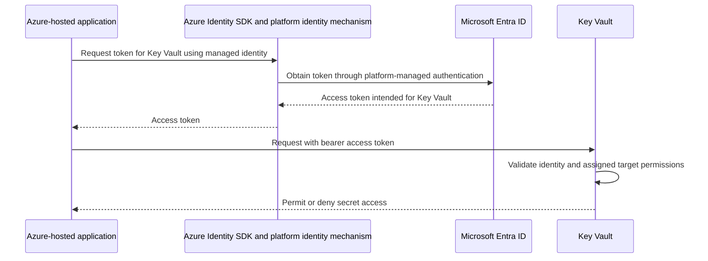

This is the same **application acting as itself** model as Pattern D, not a claim that every platform identity mechanism uses identical client-credentials protocol steps.

| Interviewer follow-up | Practical answer cue |
| --- | --- |
| "Does enabling managed identity grant access?" | No. Assign least-privilege target permissions, such as an appropriate Key Vault RBAC role. Authentication and authorization remain separate. |
| "Can we reuse that token for Storage or our API?" | Request a token for the intended resource. A Key Vault token is not valid API access evidence for a different audience. |
| "Can our custom API accept this identity?" | Configure trusted Entra token validation and explicitly authorize the application identity through suitable app roles or a deliberate access policy. |
| "How does this relate to AKS Workload Identity?" | A Kubernetes service-account token is exchanged through a configured federation with an Entra application or user-assigned managed identity. Unlike a VM's managed-identity endpoint, the trust rests on the federated issuer, subject and audience configuration. |
| "Which identity is used on my laptop?" | A credential chain may select a developer login rather than the deployed managed identity. Check the selected principal and its permissions; local success does not prove production access is configured. |

**Recall:** managed identity removes the manually managed credential, not the access token or the need for permissions.

### Scaling does not depend on the header alone

**Recall:** Pattern C with locally validated JWTs simplifies horizontal scaling of API authentication. Patterns A/B with server-side sessions need cross-pod access to the session state. This is a JWT-validation advantage, not a property of the `Authorization` header itself.

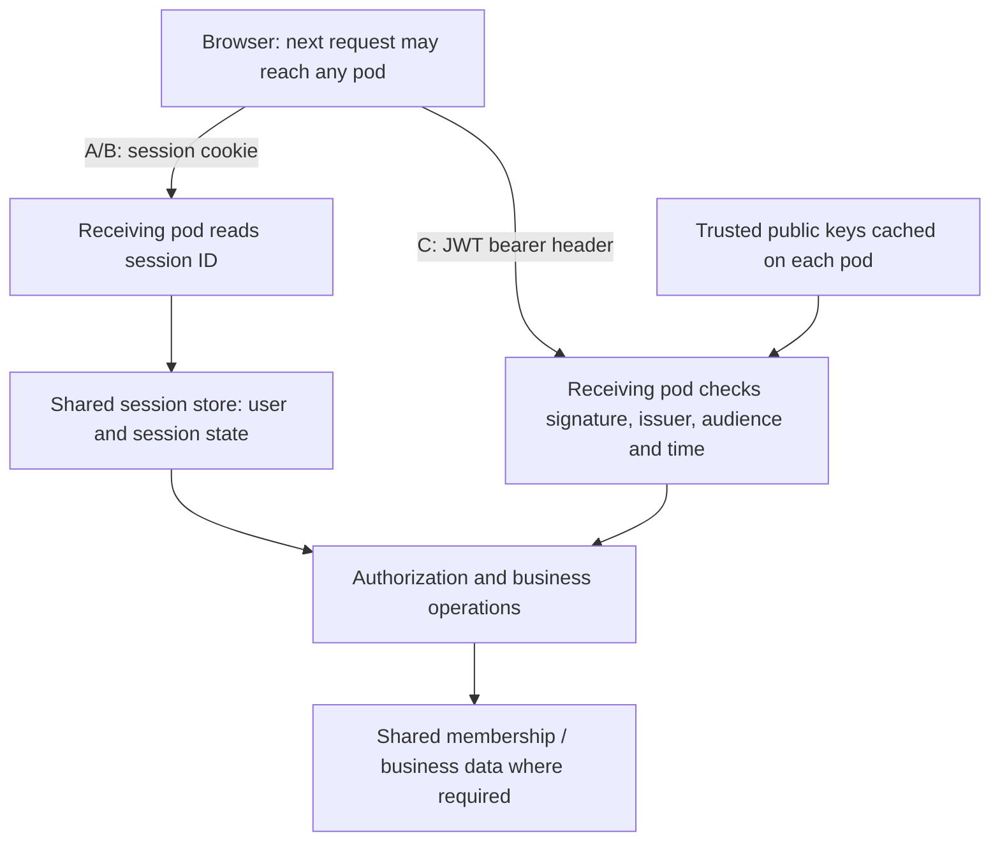

**The cookie is already sent by the browser.** What pod B must retrieve is the server-side state identified by that cookie, even if pod A created it. With a JWT, each pod can validate the carried evidence locally without a session lookup; all pods still need consistent trust configuration and suitable signing keys.

| Design | Authentication dependency | Scaling trade-off |
| --- | --- | --- |
| A/B: server-side session | Shared session repository, such as Redis or a database | Scales horizontally, but adds a lookup and repository availability dependency |
| C: locally validated JWT | Trusted keys and claim-validation configuration on each pod | No per-request session lookup; login, renewal and key refresh can still have external dependencies |
| C: opaque bearer token | Token authority through introspection, possibly cached | No local session required, but validation depends on authority availability and cache policy |

JWTs do not make the entire application stateless. Current membership, immediate disablement/revocation, distributed quotas and business data may still require shared state. Choose credential placement from browser-security and revocation requirements as well as scaling convenience.

A BFF with shared sessions can deliberately trade a session-store dependency for keeping OAuth tokens out of browser JavaScript. Affinity is routing, not failover-safe persistence. Include authorization-request correlation state and server-side authorized-client tokens when designing OIDC session failover.

## 6. OAuth, OIDC, JWT and opaque tokens: different layers

| Concept | Meaning |
| --- | --- |
| OAuth 2.0 | Framework for obtaining authorized API access; supports user delegation and application-only grants |
| OIDC | Identity/authentication layer over OAuth 2.0, including an ID token |
| Access token | Credential intended for a resource server/API |
| ID token | Authentication information intended for the OIDC client, not a substitute API access token |
| Refresh token | Credential presented to the authorization server to obtain new access tokens |
| JWT | Claims format; commonly signed, not encrypted by default |
| Opaque token | Token the resource server treats as an uninterpreted reference |

Patterns C and D can use JWT or opaque access tokens. The choice changes API validation, not the fundamental client/authorization-server/resource-server roles. A controller that signs a JWT does not thereby implement OAuth/OIDC.

### JWT versus opaque: signed pass versus checked reference

| Question | JWT, locally validated | Opaque, introspected |
| --- | --- | --- |
| Where does the API obtain claims? | Verified token contents | Trusted introspection response |
| Network dependency | Discovery/key retrieval and rotation as configured; not normally per-request token lookup | Introspection calls, potentially cached |
| Revocation freshness | Normally bounded by expiry unless additional state/revocation checks are used | Bounded by issuer propagation and introspection-cache policy |
| Information exposure | Signed claims are normally readable by the token holder | Reference does not itself expose interpretable claims |

Both require protected transport/storage and no token logging. Both require authorization after validation. For introspection, `active=true` alone is not proof that the token is intended for this API; validate the applicable resource/audience and permission policy.

**JWT example:** disabling an account may leave an issued access token accepted by local APIs until expiry.

**Opaque example:** the issuer marks a reference inactive and the next uncached introspection observes that change. A 60-second cache can extend acceptance through that window. An introspection outage is not permission to authenticate successfully. Verify provider support rather than assuming every issuer offers opaque tokens and standard introspection.

[Spring JWT/opaque implementation comparison](Spring-Security-Interview-Notes.md#oauth-oidc-jwt-and-opaque-tokens-spring-integration).

## 9. Focused study plan: security decisions and defenses

Use these six conversations to recall **what goes wrong, why, where we fix it and how we know**. Follow the diagram, explain the normal solution, then defend it against the follow-ups. The running example is an order portal used by multiple tenants. These are preparation scenarios, not claims of production experience or completed tests.

### 9.1 How would you secure a frontend calling our APIs?

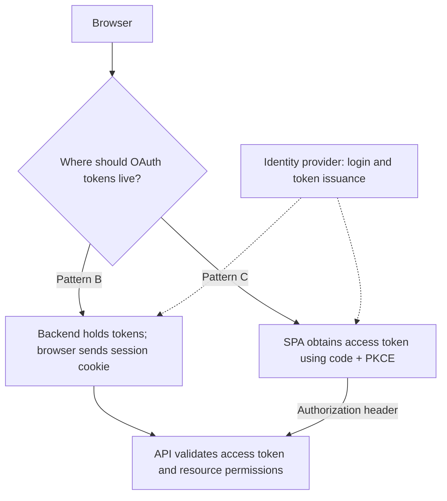

**Why it matters:** choosing where credentials live changes theft exposure, session operations and browser protections. Multiple pods alone do not force a JWT design.

**Normal solution:** use a BFF when keeping OAuth tokens out of browser JavaScript is the priority; use direct SPA tokens when browser-to-API access is a deliberate requirement. Both need server-side authorization. Browser-specific failures and fixes belong in [section 10](#10-browser-security-why-cors-csrf-and-xss-happen), not a duplicate checklist here.

| Interviewer follow-up | Answer cue |
| --- | --- |
| "Why not store everything in localStorage?" | Any successful same-origin script injection can read it; persistence extends exposure. Memory reduces persistence, not XSS access. A BFF changes token placement but adds session operations. |
| "Does a BFF eliminate XSS and CSRF?" | No. HttpOnly prevents direct session-cookie reads, not malicious authenticated actions. Cookie-authenticated actions still need appropriate CSRF defenses. |
| "Why code + PKCE? Can the SPA keep a client secret?" | Browser-delivered secrets are not confidential. PKCE binds code redemption to the initiating client's verifier; it does not protect a stolen access token or replace supported state/nonce checks. |
| "Why does Postman work while our frontend fails?" | Investigate browser CORS/preflight and credential delivery. Do not loosen authentication to fix a response-access problem. |
| "Can the API forward that token to another service?" | Only if the token is intended for that service and delegation is appropriate. Otherwise obtain a downstream token; a worker acting as itself uses client credentials/workload identity, not a user's login token. |

**Check the design:** trace the credential on each hop, reject a mismatched login callback, and verify that unauthenticated API calls fail in both designs. Never log the credentials while tracing.

### 9.2 The token is valid. Why a 403, or another customer's data?

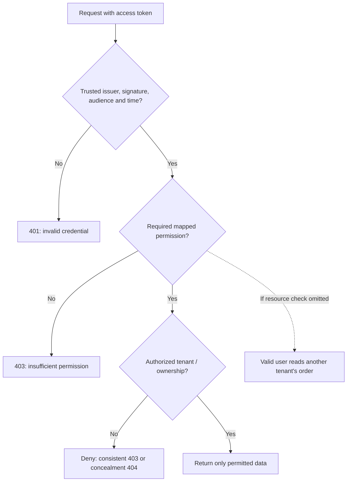

**Why it happens:** "valid token", "can read orders" and "can read this order" are three different decisions. A signature alone does not even establish that the token belongs to this API.

**Normal solution:** validate the intended access token, map permissions explicitly, then enforce resource relationships at the shared service/query boundary. Derive tenant access from trusted membership, not a caller-supplied tenant ID.

| Interviewer follow-up | Answer cue |
| --- | --- |
| "The JWT contains ADMIN. Why still 403?" | Check actual authority mapping (`ROLE_`/`SCOPE_` in Spring), required operation and resource policy. Also distinguish CSRF rejection from an authorization failure; 403 alone does not diagnose the cause. |
| "Can't we use an ID token? It has the same signature." | It is login evidence for the OIDC client, not API access permission. Enforce token purpose and intended audience as well as issuer/signature/time. |
| "Would UUIDs or hiding the button solve the data leak?" | Neither is authorization. Constrain resource lookup by the authorized relationship, including lists and exports. |
| "Who owns roles: the provider or our application?" | Either, or a hybrid. Central claims supply coarse permissions; current application data often supplies ownership and tenant membership. Cached token claims have a staleness window. |
| "What about admins, workers or AI tools?" | Give explicit scoped entitlements, audit exceptional cross-tenant access, and reuse the domain rule at every entry point. A tool argument or WebSocket subscription cannot grant itself identity or access. |

**Check the design:** test owner, other tenant and scoped admin against GET, update, list and export. Separately test altered, expired and wrong-audience tokens through real validation, not only mocked authentication.

### 9.3 I copied the token into Postman. What happens after logout?

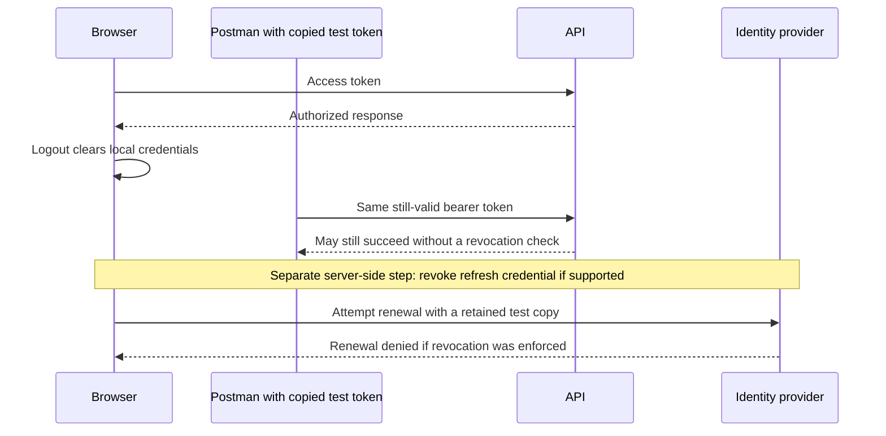

**Why it happens:** a bearer token proves possession, not which client is presenting it. Clearing browser state or revoking a refresh token does not automatically invalidate an already issued access JWT.

**Normal solution:** limit access-token lifetime, scope and audience; protect credentials from logs/XSS; define logout and account-disablement freshness separately. Immediate rejection needs enforced server-side state, introspection or another current-policy check, with an availability cost.

| Interviewer follow-up | Answer cue |
| --- | --- |
| "Can we promise immediate disablement with local JWT checks?" | Not from signature/time alone. Add an enforced current-status/revocation check or document a bounded validity window. Short expiry reduces, not eliminates, the window. |
| "Does an opaque token guarantee instant revocation?" | Only if the authority's status changes and the API's introspection/cache policy observes it soon enough. Format alone guarantees nothing. |
| "Why not make access tokens last a few seconds?" | More renewal traffic, outage coupling and concurrency complexity. Choose lifetime from risk and usability, not an arbitrary minimum. |
| "What does refresh-token rotation solve?" | It can detect reuse and contain renewal after theft, depending on provider policy. Concurrent tabs/retries need supported handling; it does not revoke all access tokens by itself. |
| "Would CORS or PKCE stop my copied token?" | No. CORS is a browser rule; PKCE protects code redemption. DPoP/mTLS-bound tokens require the matching key as well, but add client/infrastructure complexity. |

**Check the design:** use test credentials to measure access after logout/disablement and after expiry; test refresh rejection/reuse according to provider policy. Keep tokens out of screenshots, traces and fixtures.

### 9.4 Login fails after a rollout. What if the identity provider is down?

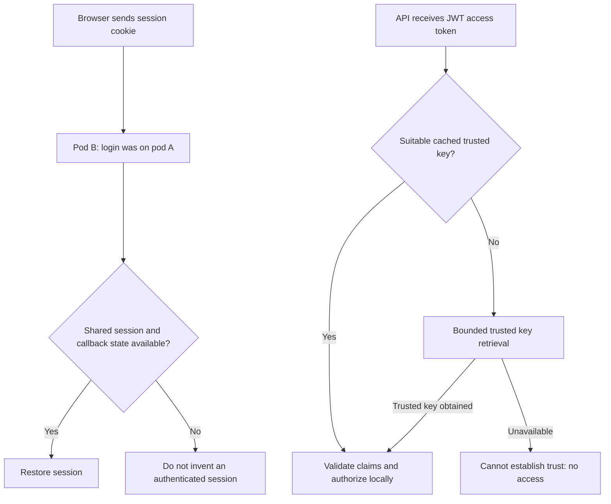

**Why it happens:** in this session design, the cookie references server-side state rather than carrying it. JWT checks can be local, but new login, renewal, unknown signing keys and live entitlement checks may still depend on other services.

**Normal solution:** share required session/login-correlation state across replicas; use supported key caching and rotation overlap, bounded timeouts and explicit unavailable-dependency errors. Do not skip checks or extend token expiry to keep traffic flowing.

| Interviewer follow-up | Answer cue |
| --- | --- |
| "Would sticky sessions fix it?" | They can reduce cross-pod misses, but pod loss/rollouts still lose local state. Affinity is not durable session storage. |
| "Why does the login callback fail before a session exists?" | The saved authorization request, state and PKCE verifier may also be local to the initiating pod. Share the required correlation state through the supported integration. |
| "Does every JWT request call the identity provider?" | No, not with a suitable cached trusted key and local claim validation. Introspection and live permission checks are separate dependencies. |
| "What happens during signing-key rotation?" | Retrieve from configured trusted JWKS, cache appropriately and support rotation overlap. Use `kid` to select within trusted keys, not arbitrary token-supplied URLs; rate-limit refresh attempts. |
| "Should dependency failure become a 401 or a retry?" | Do not claim a good credential is invalid just because storage is unavailable. Use deliberate unavailable-service handling where appropriate, bounded retries and alerts; never grant access on failure. |

**Check the design:** alternate replicas during login and normal use, restart a pod, then interrupt test session/key services. Distinguish cached-known-key, unknown-key, expired-token and unavailable-store behavior.

### 9.5 The user is logged in. Can we trust their payload or URL?

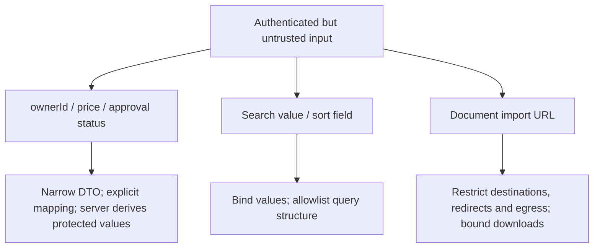

**Why it happens:** identity does not make input safe. Three separate failures are hidden here: writing protected fields (over-posting), changing query meaning (injection), and using the server to reach a forbidden destination (SSRF).

**Normal solution:** enforce each boundary where input takes effect. Explicit contracts reduce flexibility, but are easier to defend than binding an entire entity or fetching any supplied URL.

| Interviewer follow-up | Answer cue |
| --- | --- |
| "We use JPA. Can SQL injection still happen?" | Bound values stay data; concatenated JPQL/native SQL or unchecked dynamic identifiers can still change query structure. Sort fields need an allowlist, not value binding alone. |
| "Why not bind JSON directly to the entity?" | It can expose writable owner, price or status fields. Use a narrow request DTO and explicit mapping; derive privileged values and enforce business rules server-side. |
| "Our URL starts with HTTPS. Isn't that safe?" | HTTPS says nothing about destination trust. Restrict destinations, resolve/check addresses safely, revalidate redirects and enforce network egress policy; one string check misses DNS/redirect changes. |
| "What if we accept a file instead of a URL?" | Bound size and actual type; use safe names, isolated non-executable storage, authorized retrieval and suitable scanning/parser isolation. A `.pdf` extension is not proof of safe content. |
| "Can validation replace authorization or output escaping?" | No. Valid input can name someone else's object, and stored text can later reach an unsafe rendering context. Apply resource policy and section 10's rendering controls separately. |

**Check the design:** protected fields cannot be changed, query fixtures stay literal, and unsupported sort fields fail clearly. Use controlled test destinations for blocked redirects/download limits; never probe real internal metadata services.

### 9.6 The endpoint is authorized. Why overload or duplicate orders?

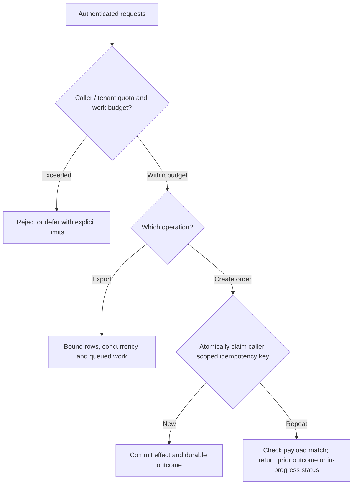

**Why it happens:** permission to call is not permission to consume unlimited resources. Separately, a timeout does not tell the caller whether an order was committed, so a retry can repeat the effect.

**Normal solution:** bound request size, pagination, execution and concurrency; enforce caller/tenant quotas. For consequential writes, combine scoped idempotency records with business uniqueness and transactional/outbox design where needed. These controls add coordination/state, but solve different problems.

| Interviewer follow-up | Answer cue |
| --- | --- |
| "Why not rate-limit by IP only?" | Shared networks can group legitimate users; distributed clients evade a single-IP limit. Combine suitable caller/tenant and service limits, and protect unauthenticated login/reset flows too. |
| "We moved exports to a queue. Problem solved?" | An unbounded queue just moves the overload. Bound submissions, backlog, worker concurrency and per-job cost; authorize access to job status/results. |
| "Two pods receive the same idempotency key together?" | Use a shared atomic claim/unique constraint scoped to caller and operation. An in-memory check-then-insert races. |
| "Same key but a different payload?" | Compare a stored request fingerprint and reject conflicting reuse. Reauthorize callers and avoid returning another caller's result. |
| "The payment succeeded, but storing the response failed?" | A local transaction cannot atomically commit an external payment. Use downstream idempotency, durable workflow/outbox state and reconciliation; do not promise exactly-once effects from a retry header. |

**Check the design:** run bounded bursts, concurrent duplicates and commit/timeout/retry cases. Verify one intended business effect, recoverable outcomes, payload-conflict rejection and fair limits across tenants.

### 9.7 Before calling the design secure

| Practical closing question | Evidence to look for |
| --- | --- |
| "What did we actually expose?" | Deployed route/management-endpoint inventory, effective configuration and least-privilege service identities. |
| "Can support diagnose failures without leaking secrets?" | Redacted errors/traces; audit actor, action, resource and outcome with protected access/retention. Never log bearer tokens. |
| "Who maintains the security dependencies?" | Supported patched versions, advisory review and reviewed/reproducible build inputs; a scanner result is a lead, not proof of safety or exploitability. |

Use [OWASP Top 10](https://owasp.org/www-project-top-ten/), [API Security Top 10](https://owasp.org/www-project-api-security/) and [Cheat Sheets](https://cheatsheetseries.owasp.org/) to find missed failure modes, not memorize rankings. Use [ASVS](https://owasp.org/www-project-application-security-verification-standard/) for concrete verification requirements, noting the edition when expanding a topic.

## 10. Browser security: why CORS, CSRF and XSS happen

Read this section as **cause → consequence → usual fix**, not as definitions. All three problems come from things the browser does *automatically* on the user's behalf:

| Browser behaviour | Problem it creates | What we normally do | Short recall |
| --- | --- | --- | --- |
| Blocks scripts from reading responses from another origin (same-origin policy) | Our own frontend on another origin cannot read our API | **CORS**: the API allowlists the origins that may read it | "Who may *read* my responses?" |
| Attaches cookies automatically to matching requests | Another site can make the user's browser *act* with their session | **CSRF defenses**: require proof the request came from our app | "Cookie proves *who*, not *intent*" |
| Runs any script that ends up in the page as our origin | Untrusted content becomes code running *as our app* | **XSS defenses**: keep data as data when rendering | "Data must never become code" |

**Ordering insight:** XSS defeats the other two. Injected script is already same-origin, so CORS does not apply to it and it can read CSRF tokens or browser-held bearer tokens. Prevent XSS first.

**Outside the browser none of this applies.** Postman, curl and backend services do not enforce CORS and do not attach cookies automatically. That is why copying a bearer token into Postman works: it is token replay, and only authentication, authorization, token lifetime and audience limit it.

Running example:

```text
Browser frontend: https://app.example.com
Order API:        https://api.example.com
Untrusted site:   https://untrusted.example.net
```

An **origin** is scheme + host + port, so `app` and `api` above are different origins. They are still the same *site* (same registrable domain), which matters for SameSite cookies. CORS works on origins and SameSite works on sites; they are not interchangeable.

### 10.1 CORS: why our own frontend cannot read our own API

**Recall:** the browser protects users by not letting one origin's script read another origin's data. CORS is the API *opting in* to let specific origins read it. It loosens a browser restriction; it does not protect the server.

**Why the situation arises in real apps:**

| Situation | Example |
| --- | --- |
| Frontend and API deployed separately | SPA on a CDN at `app.example.com`, API on AKS at `api.example.com` |
| Local development | React on `localhost:3000`, Spring Boot on `localhost:8080` (different ports mean different origins) |
| One API, many frontends | Customer app, admin portal and partner portal all call one API |
| Browser calls third-party APIs | Maps, payments, search |

**Why the browser blocks it by default:** without the same-origin policy, script on any site you visit could call your bank's API with your cookies and *read* the answer.

**How it plays out:**

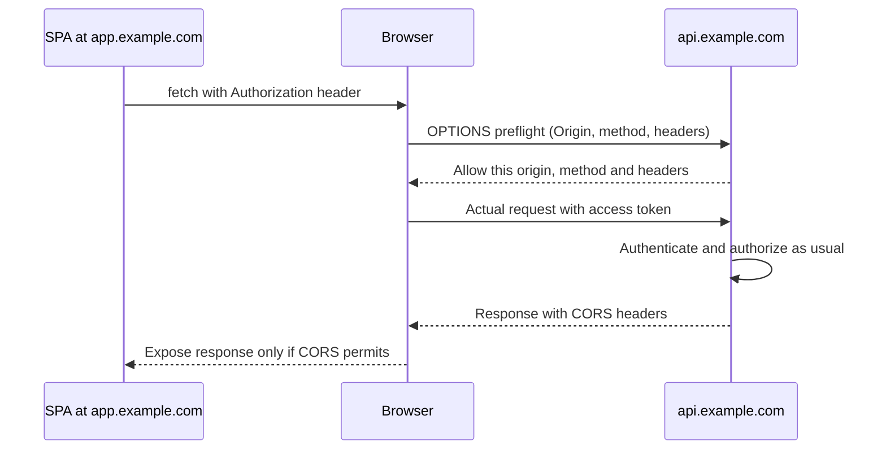

A JSON body, an `Authorization` header or methods like `PUT`/`DELETE` trigger the preflight. Simple requests skip it. In that case **the server may already have executed the request** before the browser blocks the response.

```http
OPTIONS /orders/123 HTTP/1.1
Origin: https://app.example.com
Access-Control-Request-Method: GET
Access-Control-Request-Headers: authorization

HTTP/1.1 204 No Content
Access-Control-Allow-Origin: https://app.example.com
Access-Control-Allow-Methods: GET
Access-Control-Allow-Headers: Authorization
Vary: Origin
```

**What we normally do:**

1. **Avoid the need:** serve the SPA and API from one origin through a gateway/ingress (`/` → SPA, `/api` → backend), or use a dev-server proxy locally. No CORS is needed. This is common with the BFF approach (Pattern B).
2. **Otherwise allowlist explicitly:** exact origins, required methods and headers only.

```java
@Bean
CorsConfigurationSource corsConfigurationSource() {
    CorsConfiguration cors = new CorsConfiguration();
    cors.setAllowedOrigins(List.of("https://app.example.com"));
    cors.setAllowedMethods(List.of("GET", "POST", "OPTIONS"));
    cors.setAllowedHeaders(List.of("Authorization", "Content-Type"));
    UrlBasedCorsConfigurationSource source =
            new UrlBasedCorsConfigurationSource();
    source.registerCorsConfiguration("/api/**", cors);
    return source;
}
```

Activate with `http.cors(Customizer.withDefaults())` (Boot 3.5 / Security 6.5 Servlet). This bearer-oriented example does not enable cookie credentials.

**What you see at work:** a browser console error saying "blocked by CORS policy" while the same call works in Postman. The fix belongs on the server's allowlist, not in disabling security.

**Common mistakes:**

- Treating CORS as access control. Any non-browser client ignores it.
- Using `*`, or reflecting any `Origin` back, together with credentials (cookies). This lets any site read the user's data.
- Forgetting the CORS headers on the actual response, or authentication rejecting the `OPTIONS` preflight.

**Verify:** an allowed origin gets headers on both the preflight and the actual response, and still needs valid credentials. A disallowed origin's preflighted request is never sent.

### 10.2 CSRF: why a logged-in user's browser can be used against them

**Recall:** the browser attaches cookies automatically, so a cookie proves *who* the user is, not that *our app* sent the request. CSRF defenses add proof of intent that another site cannot obtain.

**Why it happens:** the user is logged in to the order app (session cookie). They open an untrusted page, which submits a form, loads an image URL or sends a link to the order app. The browser attaches the session cookie. The attacker never sees the response and does not need to: the side effect is the attack.

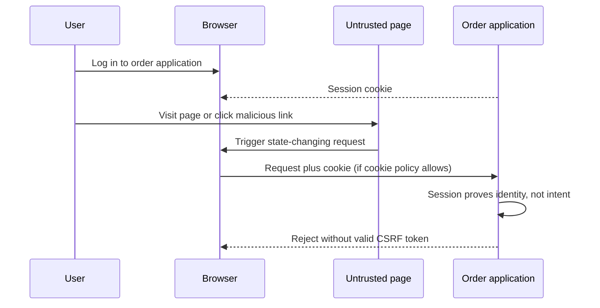

**The malicious-link variant:** if a `GET` changes state (for example, `/orders/123/cancel`), clicking a link is enough. `SameSite=Lax` still sends cookies on top-level `GET` navigation, so safe methods must never change state.

**Who is exposed depends on the credential model:**

| Credential model | CSRF risk | Usual approach |
| --- | --- | --- |
| Session cookie (Patterns A and B) | Yes, because the browser sends the cookie automatically | Keep CSRF protection on and send the token from the frontend |
| Bearer token added by JavaScript (Pattern C) | Low, because another site cannot make the browser add our header | CSRF protection is commonly disabled for that API, as a reasoned decision |
| JWT stored in a cookie | Yes again, because it is a cookie | Treat it as a cookie-based session |

The token format is irrelevant. What matters is whether the browser supplies the credential **automatically**.

**What we normally do (session-based SPA):**

```text
1. Browser establishes the session.
2. Frontend obtains the CSRF token from the backend's supported mechanism.
3. Frontend sends it in a header (for example X-CSRF-TOKEN or X-XSRF-TOKEN).
4. Backend checks session + CSRF token, then authorization.
5. After login/logout, the frontend fetches the renewed token.
```

```javascript
async function createOrder(order, csrfToken) {
    const response = await fetch("/orders", {
        method: "POST",
        credentials: "same-origin",
        headers: {
            "Content-Type": "application/json",
            "X-CSRF-TOKEN": csrfToken
        },
        body: JSON.stringify(order)
    });
    if (!response.ok) {
        throw new Error(`Order creation failed: ${response.status}`);
    }
    return response.json();
}
```

`csrfToken` must come from the backend's CSRF integration; header name and masking behaviour are framework/version specific. Another origin cannot read this token because of the same-origin policy, unless XSS or an unsafe CORS rule leaks it. Layer `SameSite` cookies and origin checks on top.

**What you see at work:** a security scan reports "CSRF protection disabled". Usually someone hit a `403` on `POST` from the frontend and turned CSRF off instead of sending the token. Ask: *what property of this credential model makes CSRF unnecessary?* If the answer is "nothing, we use cookies", the finding is real.

**Common mistakes:**

- Disabling CSRF globally to fix a frontend `403`.
- Allowing state changes on `GET`.
- Assuming `SameSite` alone is enough. Sibling subdomains are same-site, and older or misconfigured cookies may lack it.

**Verify:** a cookie-authenticated `POST` without a valid token is rejected with no side effect. A valid token on an unauthorized resource is still rejected, because CSRF proof is not permission.

### 10.3 XSS: why untrusted content can run as our app

**Recall:** XSS happens when untrusted data reaches a place where the browser interprets it as code. That code runs with our origin's full privileges. The fix is to keep data as data at every rendering point.

**Why it is so damaging:** the browser cannot tell our script from injected script on our page. The injected code can read the page, read any token JavaScript can access, read CSRF tokens and call our API as the user. CORS and CSRF defenses do not stop it, because it is same-origin.

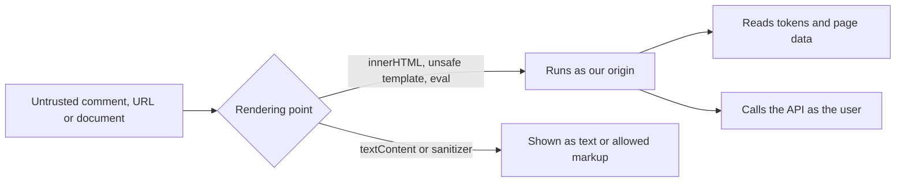

**How it gets in:**

| Route | How it plays out |
| --- | --- |
| Stored | Attacker saves a comment containing script; every user who views it runs it |
| Reflected | A crafted link puts input into the server's response unsafely; the victim clicks it |
| DOM-based | Frontend JavaScript moves URL or input data into an unsafe DOM sink, without the server being involved |

DOM manipulation is the most common delivery route, but the underlying problem is **data crossing into code**, which can also happen in server templates, attributes, URLs (`javascript:`) and inline scripts.

**What we normally do:**

1. Insert text as text. Frameworks such as React and Angular escape by default; the danger is the escape hatches (`innerHTML`, `dangerouslySetInnerHTML`, `bypassSecurityTrust...`).

```javascript
commentElement.textContent = commentText;
```

2. If rich content is a real requirement, use a maintained sanitizer with a narrow allowlist. Markdown conversion alone is not sanitization; this reader PWA uses marked + DOMPurify for that reason.

```javascript
commentElement.innerHTML = DOMPurify.sanitize(commentHtml, {
    ALLOWED_TAGS: ["p", "strong", "em", "ul", "ol", "li", "br"],
    ALLOWED_ATTR: []
});
```

3. Encode for the right context (HTML, attribute, URL, JavaScript), which templating engines do when used normally.
4. Add a **Content-Security-Policy** as a second line of defense, limiting script sources and blocking inline script.
5. Reduce what a successful XSS can steal: `HttpOnly` session cookies, and a BFF instead of tokens held in the browser.

**What you see at work:** scanners flag `innerHTML` use, missing CSP headers or reflected parameters. Review where untrusted data meets a rendering sink.

**Common mistakes:**

- Thinking `HttpOnly` prevents XSS. It only stops cookie theft; injected script can still send requests with the cookie.
- Thinking a BFF makes XSS harmless. It removes token theft, not actions taken as the user.
- Sanitizing once and then concatenating more untrusted strings.

**Verify:** harmless test payloads in comments, URLs and documents render as text or allowed markup, with no event handlers or `javascript:` links surviving.

### 10.4 Cookie attributes: which problem each one addresses

| Attribute | What it does | Helps with | Does not stop |
| --- | --- | --- | --- |
| `HttpOnly` | JavaScript cannot read the cookie | Cookie theft through XSS | XSS sending requests as the user |
| `Secure` | Sent only over HTTPS | Network interception | XSS, CSRF |
| `SameSite=Lax` | Not sent on cross-site subrequests; sent on top-level `GET` navigation | Most cross-site CSRF | State-changing `GET`, same-site sibling subdomains |
| `SameSite=Strict` | Not sent on any cross-site request | CSRF, more strongly | Usability, because links from other sites arrive logged out |
| `__Host-` prefix | Requires `Secure`, `Path=/` and no `Domain` | Cookie injection from subdomains | XSS on the same host |

### 10.5 Put it together

```text
Legitimate SPA on another origin
    -> CORS lets it read the intended responses
    -> authentication establishes who the user is
    -> CSRF proof is required if the credential arrives automatically (cookie)
    -> authorization decides whether this user may act on this resource
    -> safe rendering keeps returned content from becoming code
```

No step replaces another. CORS cannot authorize order ownership, a CSRF token is not a permission, and a valid JWT does not make unsafe HTML safe.

**One-minute interview answer:** "CORS, CSRF and XSS all come from automatic browser behaviour. Same-origin policy blocks cross-origin reads, so we use CORS to allowlist our own frontends; it is not access control. Browsers attach cookies automatically, so cookie-based apps need CSRF tokens; bearer tokens sent by JavaScript in a header avoid that. XSS means untrusted data runs as our origin, which defeats both, so we render safely, sanitize rich content, add CSP and keep tokens out of JavaScript's reach."

## References

- [OpenID Connect Core](https://openid.net/specs/openid-connect-core-1_0.html)
- [OAuth 2.0](https://www.rfc-editor.org/rfc/rfc6749)
- [PKCE](https://www.rfc-editor.org/rfc/rfc7636)
- [OAuth 2.0 Security Best Current Practice](https://www.rfc-editor.org/rfc/rfc9700)
- [Token introspection](https://www.rfc-editor.org/rfc/rfc7662)
- [JSON Web Key](https://www.rfc-editor.org/rfc/rfc7517)
- [Spring implementation notes](Spring-Security-Interview-Notes.md)
