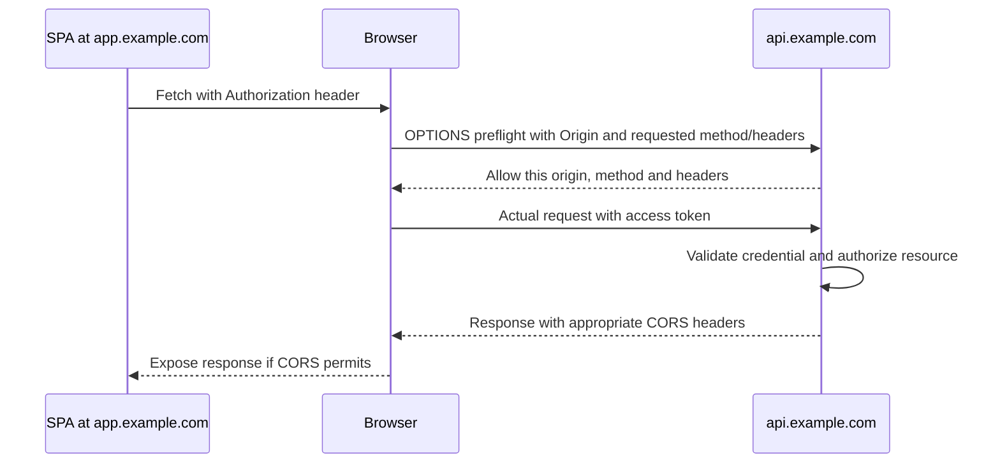
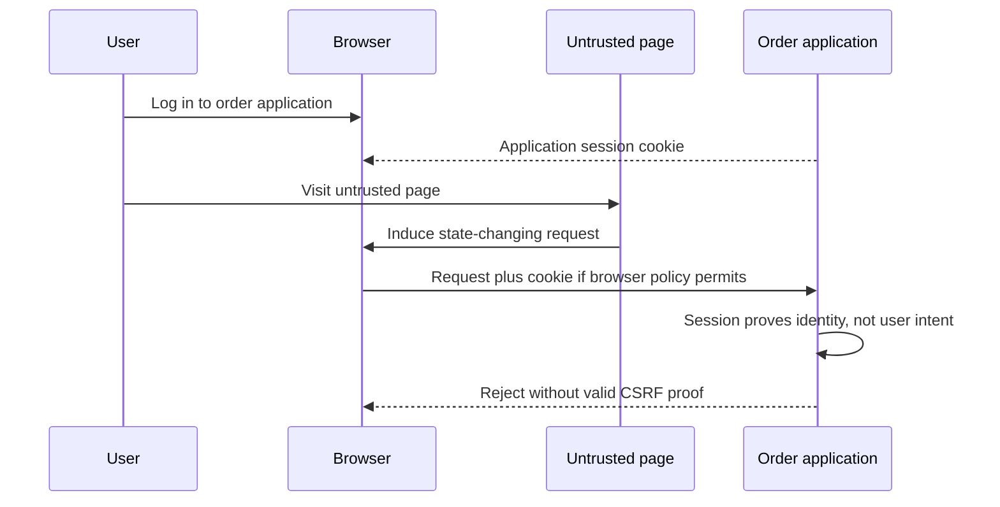
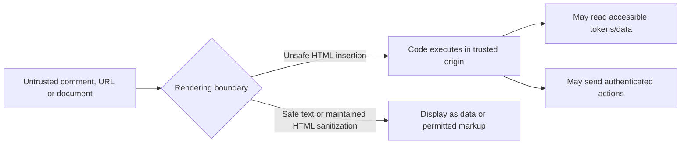

# Authentication and Authorization: Application Patterns

This is the primary security-preparation guide: framework-neutral patterns first, then a [focused scenario-led study plan](#9-focused-study-plan-security-decisions-and-defenses). Decide who owns identity, what evidence crosses each boundary and where access is enforced. Use [Spring Security: Interview Notes, section 8](Spring-Security-Interview-Notes.md#8-spring-integration-map) only for implementation mappings.

The examples are conceptual flows, not deployed applications or claims of production experience.

## 1. Start with responsibilities, not framework classes

Authentication establishes identity. Authorization decides whether that identity may perform an action on a particular resource. A valid identity does not imply access to every record.

```text
Who establishes identity?
    -> What evidence reaches this application?
    -> Why should this application trust it?
    -> Where does authenticated identity live between requests?
    -> Who decides and enforces capability + resource access?
    -> What happens on expiry, revocation, logout or dependency failure?
```

Protocols and trust relationships exist independently of Spring. Spring Security implements substantial validation, context management, attack protection and enforcement machinery for the chosen architecture; it cannot infer business entitlements or choose the architecture automatically.

| Pattern | Authentication owner | Credential presented to the application | Typical fit |
| --- | --- | --- | --- |
| A. Application login + session | Backend and its user store | Session cookie after login | Application-owned accounts |
| B. External OIDC login + backend session/BFF | External identity provider | Application session cookie | Enterprise SSO; browser tokens kept server-side |
| C. SPA calls API directly | Identity provider; SPA is OAuth client | Access token in Authorization header | Browser client accessing a separate resource server |
| D. Service calls service | Authorization server authenticates calling service | Access token in Authorization header | Workers and application-only integrations |

JSON versus HTML does not decide the pattern. A React frontend can use a backend session. A token-consuming API need not implement login or issue tokens. A system can combine patterns at distinct boundaries, but must define which credential each boundary accepts.

## 2. Pattern A: application-owned login and server session

```text
Browser submits credentials -> backend verifies password against user store
    -> establishes authenticated server session
    -> browser receives session cookie
Later request + cookie -> restore identity -> authorize -> business operation
```

**Example:** an internal order-management tool owns its accounts. After login, the browser sends a session identifier, not the password or an API access token on every request.

The backend owns credential verification, password storage and account lifecycle. Use adaptive password hashing, HTTPS, appropriate cookie protections, session fixation protection, expiration and logout. Browser-automatically attached cookies require appropriate CSRF protection for state-changing requests.

With multiple pods, choose shared session storage or a deliberate routing/session strategy. Routing affinity alone does not preserve a session when its pod disappears.

**Failure scenario:** login succeeds on pod A, but the next request reaches pod B, which has no session state. The symptom looks like intermittent logout; the missing design is session-state availability, not JWT decoding.

[Spring implementation: section 8.2](Spring-Security-Interview-Notes.md#82-pattern-a-application-owned-login-and-server-session).

## 3. Pattern B: external OIDC login with a backend session

```text
Browser -> backend -> redirect to trusted identity provider
    -> user authenticates there, possibly with MFA
    -> provider redirects authorization code to backend callback
    -> backend exchanges code and validates ID token + login correlation
    -> backend establishes its own authenticated session
Browser -> backend with application session cookie
Backend -> downstream API with access token, when required
```

**Example:** an employee signs into the order portal using enterprise SSO. The identity provider performs login/MFA. The portal establishes its own session and checks which orders that employee can access.

In a backend-for-frontend (BFF) arrangement, access/refresh tokens stay server-side rather than being exposed to browser JavaScript. The browser still holds a sensitive session cookie; this is not immunity to CSRF, XSS or session theft.

### What does the backend validate?

The backend is not simply handing a token back to an OIDC API and trusting any response. With a typical signed ID token, validation includes:

- Signature using keys belonging to the configured trusted issuer, with an appropriate algorithm policy.
- Expected issuer, intended client audience, expiry and other applicable OIDC claim requirements.
- Correlation with the browser's saved login attempt and the protocol's required checks.

| Mechanism | Purpose |
| --- | --- |
| `state` | Correlate the callback with the saved browser authorization request; defend against login-flow CSRF |
| `nonce` | When used, bind the returned ID token to the authentication request; reject mismatches |
| PKCE | Bind authorization-code redemption to the client instance holding the verifier; protect intercepted codes |

They are complementary, not interchangeable. Use supported library/provider handling rather than building a callback that merely decodes the ID token.

**Failure scenario:** a correctly signed ID token intended for a different client must not establish a portal session. Signature validity alone is insufficient.

### Can the identity provider also manage authorization?

Yes, optionally. It can supply roles, groups, scopes or entitlements, or the system can integrate a separate policy-decision service. OIDC itself does not automatically implement application authorization.

Role assignment can be **application-managed** (verified identity maps to local entitlements), **central** (trusted role claims are mapped into application permissions), or **hybrid** (central capabilities plus application resource rules). Roles need not appear in the JWT. Choose who owns changes and how quickly applications must observe them.

```text
Central role/entitlement or policy decision
    -> application validates and interprets it
    -> application enforces permission on the requested resource
```

The portal may still need current domain data: "can read orders" does not mean "can read another tenant's order." Define freshness and failure policy for cached claims or remote decisions. Local session logout, identity-provider logout and downstream-token revocation are separate operations.

[Spring implementation: section 8.3](Spring-Security-Interview-Notes.md#83-pattern-b-enterprise-oidc-login-with-a-backend-session).

## 4. Pattern C: SPA obtains a token and calls the resource server

```text
SPA -> identity provider: authorization code + PKCE
    -> SPA obtains access token
    -> SPA calls API with Authorization: Bearer <access-token>
    -> API validates token -> authorizes capability + resource -> business operation
```

**Example:** a browser order dashboard calls an independently exposed order API. The SPA is a public OAuth client and cannot keep a client secret. The API is a resource server, not necessarily a login application.

Use an access token intended for that API, not an ID token intended for the SPA. Choose browser token storage/lifecycle deliberately: XSS can steal accessible tokens or act through the compromised application. Explicit bearer headers and no ambient-credential fallback differ from authentication cookies for CSRF analysis; token format alone does not decide CSRF policy. Cross-origin browser access also needs a deliberate CORS policy.

### Where does the JWT verification key come from?

```text
Configured trusted issuer
    -> trusted provider metadata
    -> jwks_uri
    -> provider's published public verification keys
Token kid -> select candidate key -> verify signature -> validate claims
```

The issuer keeps its private signing key; APIs receive public verification keys, not that private key. Decoding the token's readable header/payload is not proof of authenticity. A `kid` is a key-selection hint, not a trust decision.

Libraries normally cache keys and refresh as needed, including for rotation. This is not normally a network validation request for every JWT. Do not fetch arbitrary key URLs or accept arbitrary issuers supplied by an untrusted token.

After signature verification, validate expected issuer, intended API audience, timestamps and applicable token/algorithm policy. A valid token with `orders.read` still needs the application's ownership/tenant checks.

**Important connection:** Pattern B commonly also uses published public keys to validate its ID token locally. B versus C is primarily about client placement, token purpose and the browser-to-backend credential, not "remote validation versus local validation."

**Failure scenario:** an identity provider rotates keys. An API with a valid cached old key may still verify existing tokens, while tokens signed by a new unknown key require successful key refresh. Outages do not justify bypassing validation.

[Spring implementation: section 8.4](Spring-Security-Interview-Notes.md#84-pattern-c-spa-obtains-a-token-and-calls-the-resource-server).

## 5. Pattern D: service-to-service client credentials

```text
Worker authenticates its application identity to authorization server
    -> receives access token for intended API
    -> calls order API
    -> API validates token and application permissions
    -> authorizes operation + resource
```

**Example:** a reconciliation worker reads orders without a user being logged in. Its token represents application identity, not user delegation.

Provision least-privilege application permissions. Use supported workload/federated credentials or certificates where available; a stored client secret is not mandatory for every deployment. Client-credentials grants normally obtain another access token by authenticating again rather than relying on a user-style refresh-token flow.

**Failure scenario:** service A forwards a token intended only for A to service B. B must reject an unsuitable audience. Use the supported delegation/token-exchange flow when acting for a user, or application credentials when acting as the service; these represent different authority.

[Spring implementation: section 8.5](Spring-Security-Interview-Notes.md#85-pattern-d-service-to-service-client-credentials).

### Scaling does not depend on the header alone

Locally validated access tokens remove the need for a pod-local authentication-session lookup. Shared-session applications also scale horizontally; their availability depends on the session repository. Opaque bearer tokens can require introspection. Authorization freshness and business data may still require shared state in all three arrangements.

A BFF with shared sessions can deliberately trade a session-store dependency for keeping OAuth tokens out of browser JavaScript. Affinity is routing, not failover-safe persistence. Include authorization-request correlation state and server-side authorized-client tokens when designing OIDC session failover.

## 6. OAuth, OIDC, JWT and opaque tokens: different layers

| Concept | Meaning |
| --- | --- |
| OAuth 2.0 | Framework for obtaining authorized API access; supports user delegation and application-only grants |
| OIDC | Identity/authentication layer over OAuth 2.0, including an ID token |
| Access token | Credential intended for a resource server/API |
| ID token | Authentication information intended for the OIDC client, not a substitute API access token |
| Refresh token | Credential presented to the authorization server to obtain new access tokens |
| JWT | Claims format; commonly signed, not encrypted by default |
| Opaque token | Token the resource server treats as an uninterpreted reference |

Patterns C and D can use JWT or opaque access tokens. The choice changes API validation, not the fundamental client/authorization-server/resource-server roles. A controller that signs a JWT does not thereby implement OAuth/OIDC.

### JWT versus opaque: signed pass versus checked reference

| Question | JWT, locally validated | Opaque, introspected |
| --- | --- | --- |
| Where does the API obtain claims? | Verified token contents | Trusted introspection response |
| Network dependency | Discovery/key retrieval and rotation as configured; not normally per-request token lookup | Introspection calls, potentially cached |
| Revocation freshness | Normally bounded by expiry unless additional state/revocation checks are used | Bounded by issuer propagation and introspection-cache policy |
| Information exposure | Signed claims are normally readable by the token holder | Reference does not itself expose interpretable claims |

Both require protected transport/storage and no token logging. Both require authorization after validation. For introspection, `active=true` alone is not proof that the token is intended for this API; validate the applicable resource/audience and permission policy.

**JWT example:** disabling an account may leave an issued access token accepted by local APIs until expiry.

**Opaque example:** the issuer marks a reference inactive and the next uncached introspection observes that change. A 60-second cache can extend acceptance through that window. An introspection outage is not permission to authenticate successfully. Verify provider support rather than assuming every issuer offers opaque tokens and standard introspection.

[Spring JWT/opaque implementation comparison](Spring-Security-Interview-Notes.md#oauth-oidc-jwt-and-opaque-tokens-spring-integration).

## 7. Lifecycle and optional gateway hybrid

Logging out of an application session, ending the identity-provider session, revoking a refresh token and revoking an issued access token are separate operations. Deleting a browser token does not invalidate stolen copies.

Refresh-token format is an authorization-server choice, not necessarily opaque. Storage, rotation/reuse detection where applicable, expiry and revocation policy matter more than shape. APIs should not accept refresh tokens or ID tokens as access tokens.

A supported phantom-token arrangement can present opaque tokens externally and exchange/resolve them at a trusted gateway into short-lived internal JWTs:

```text
External opaque token -> trusted gateway/token service
    -> internal JWT for intended API -> API validates -> resource checks
```

This needs explicit infrastructure support, authenticated/protected internal routing and enforcement against untrusted identity injection. Prevent external clients bypassing required edge policy. Cache policy and internal-token lifetime still bound revocation freshness. Configuring two token types does not create this architecture automatically.

## 8. Interview recall

Start with the application's trust boundaries and credential flow, then name the framework mechanism:

> "The API accepts access tokens for its audience from a configured issuer. It verifies signatures using published public keys and validates claims, then checks the operation and tenant/resource relationship. Spring Resource Server supplies the token-validation pipeline; application authorization supplies the domain rules."

OAuth describes how access is obtained; OIDC adds login identity; JWT/opaque describes token representation and validation. Remember the flow and invariants before memorizing internal classes.

## 9. Focused study plan: security decisions and defenses

**Goal:** explain a plausible design, its limits and evidence of enforcement, without memorizing framework internals or presenting a proposed solution as past production experience. This is a plan for later topic-by-topic study, not a claim that the controls have been implemented or verified.

Use one running example: a multi-tenant order portal with enterprise login, an order API, a reconciliation worker and optional document-upload/notification features. Change one requirement at a time rather than introducing a different domain for every question.

### 9.1 The practice contract

For every scenario, prepare the same five-part explanation:

| Step | What to articulate |
| --- | --- |
| Attack/failure | What can go wrong, which asset is affected and under which assumptions? |
| Trust boundary | Which input, credential, service, browser or tenant boundary is being crossed? |
| Control | Where is the invariant enforced, using which trusted evidence? |
| Trade-off | What latency, availability, usability, freshness or operational cost does the choice introduce? |
| How to verify | Which positive, negative and failure-path checks would demonstrate the claimed boundary? |

Then defend the design against a changed assumption: "What if the token is stolen?", "What if the next request reaches another pod?", or "What if this dependency is down?"

**Session output:** one flow diagram, an explicit allow/deny invariant, the five-part explanation, an alternative with a reason for rejecting it, and proposed verification cases. Add configuration or code only when needed to make the enforcement point concrete. Do not invent test results.

### 9.2 Study order and completion criteria

| Pass | Focus | Ready to move on when you can... |
| --- | --- | --- |
| 1 | Identity, protocols and trust: scenarios A-B | Choose A/B/C/D, distinguish ID/access/refresh tokens and explain validation without class names |
| 2 | Authorization: scenario C | Separate role ownership, capability checks and object/tenant enforcement |
| 3 | Browser and credential lifecycle: scenarios D-F | Explain CSRF versus CORS versus XSS, theft exposure and revocation limits |
| 4 | Input and downstream boundaries: scenarios G-H | Locate injection/SSRF/upload controls beyond the authentication layer |
| 5 | Operations and resilience: scenarios I-K | Defend failover, outage, abuse and deployment choices without failing open |
| 6 | Optional AI/messages extension: scenario L | Preserve the same identity/resource rules across non-HTTP entry points |

Finish each pass with a short design explanation and one counterexample that your first design would not handle. Only then consult the Spring companion for the integration points relevant to that pass.

### 9.3 Scenario A: choose browser session/BFF or direct API tokens

**Concepts:** authentication ownership, credential placement, browser trust and horizontal scaling.

**Attack/failure:** browser-accessible tokens are stolen, or pod B cannot restore the session established on A.

**Trust boundary:** browser to backend; backend to identity provider/API; pod to session store.

**Control:** choose a flow explicitly. A BFF retains OAuth tokens server-side and uses protected application sessions with CSRF defenses. A direct SPA uses supported code + PKCE and access tokens for the intended API. Use shared session storage when cross-pod restoration is required.

**Trade-off:** BFF adds session/token-storage operations and does not eliminate XSS actions. Direct tokens simplify independent API authentication but add browser credential exposure/lifecycle concerns. Shared sessions scale; locally validated JWTs remove one lookup, not all shared state.

**How to verify:** trace which credential crosses each hop; route successive requests and the login callback across pods; restart one pod; test logout and session-store failure. For direct tokens, verify missing/invalid tokens are rejected on every replica.

**Design defense:** "Why not choose JWT solely because there are multiple pods?" Explain the actual state/availability requirement and browser-security choice.

### 9.4 Scenario B: a correctly signed token belongs to another API

**Concepts:** issuer/audience trust, token purpose, public keys, login correlation and delegation.

**Attack/failure:** an API accepts an ID token, a wrong-audience access token or claims decoded without validation. A callback is unrelated to the browser's saved login attempt.

**Trust boundary:** externally supplied credential to trusted application identity.

**Control:** use a configured trust source, signature/algorithm and required claim checks, including intended audience and time. Validate OIDC login correlation with supported state/nonce/PKCE handling as applicable. Never choose trust from arbitrary token-supplied key URLs. Obtain appropriately delegated downstream tokens instead of forwarding any incoming token.

**Trade-off:** discovery/key caches and rotation introduce dependencies; delegation adds provider integration and permission design. A signature is necessary evidence for a signed token, not sufficient authorization.

**How to verify:** use isolated fixture keys and send valid, expired, wrong-issuer/audience, altered and wrong-purpose tokens. Test callback correlation mismatches and PKCE verifier rejection in a controlled provider setup. Separate mocked-policy tests from the real validation path.

**Design defense:** explain why Pattern B can validate ID-token signatures locally just as Pattern C validates JWT access tokens, while their token purpose and browser credential differ.

### 9.5 Scenario C: a permitted user reads another tenant's order

**Concepts:** broken object/function-level authorization, role ownership, least privilege and trusted tenant identity.

**Attack/failure:** a user changes an order ID, submits another tenant ID, or invokes an administrator-only operation despite holding a valid token.

**Trust boundary:** authenticated caller to a specific action/resource; request input to authoritative entitlement data.

**Control:** deny by default; check capability and current resource/tenant relationship at a service/query boundary every relevant entry point crosses. Resolve identities using the issuer/subject and account model. Choose application-managed, central or hybrid roles deliberately; a token claim needs interpretation, not blind acceptance.

**Trade-off:** live entitlement checks improve freshness but add state/latency; cached claims need bounded staleness. Consistent 404/403 disclosure policy and administrative exceptions require explicit decisions. UUIDs reduce guessing, not authorization obligations.

**How to verify:** build a caller/action/resource matrix including owner, same-tenant non-owner, other tenant, admin, suspended user and background worker. Test reads, writes, lists, exports and alternate entry points, not only one GET.

**Design defense:** show why `orders.read`, an `ADMIN` claim or frontend-hidden buttons alone cannot enforce the full policy.

### 9.6 Scenario D: a browser performs an unintended state change

**Concepts:** CSRF, CORS, ambient credentials and safe HTTP methods.

**Attack/failure:** a malicious site induces an authenticated browser to submit a state-changing request. Separately, a legitimate SPA cannot read a cross-origin response.

**Trust boundary:** another origin to a browser-authenticated backend; JavaScript response access versus server-side action.

**Control:** keep GET/read-only semantics; apply appropriate CSRF proof and cookie/origin protections for automatically attached credentials. Configure explicit CORS origins/methods/headers for legitimate cross-origin access. Reassess whenever an authentication-cookie fallback is introduced.

**Trade-off:** SPA token delivery/renewal and cross-site deployments add complexity. SameSite behavior is useful defense in depth, not a universal substitute for CSRF analysis. An explicit bearer-only model changes CSRF assumptions but leaves token theft/XSS risks.

**How to verify:** test unsafe cookie-authenticated requests with missing/incorrect/correct CSRF proof; test real browser preflight and simple-request behavior for allowed/disallowed origins. Postman alone cannot verify browser enforcement.

**Design defense:** explain why CORS failure does not prove a state-changing request never executed, and why JWT format does not justify disabling CSRF.

For diagrams, request examples and the SPA integration flow, see [the browser-security walkthrough](#10-browser-security-visualize-cors-csrf-and-xss).

### 9.7 Scenario E: stored content executes in another user's browser

**Concepts:** XSS, output context, safe rendering and credential exposure.

**Attack/failure:** an order comment or rendered document introduces executable content into a trusted origin.

**Trust boundary:** untrusted text/HTML to executable browser content.

**Control:** context-appropriate output encoding, safe DOM APIs, maintained sanitization where rich HTML is genuinely needed, and a restrictive Content Security Policy as defense in depth. Protect authentication cookies and minimize accessible token exposure.

**Trade-off:** rich content is harder to secure than plain text; CSP has integration costs and does not repair unsafe rendering. HttpOnly prevents direct cookie reads, not authenticated actions by malicious same-origin script.

**How to verify:** in an isolated test page, use harmless rendering fixtures across text, attribute, link and permitted rich-content contexts; assert unsafe schemes/event handlers are removed or inert while legitimate formatting survives. Inspect CSP violations and authentication-cookie attributes.

**Design defense:** distinguish preventing script execution from limiting damage after execution. Neither CORS nor JWT signatures solve XSS.

For rendering examples and the connection between XSS, cookies and CSRF, see [the browser-security walkthrough](#10-browser-security-visualize-cors-csrf-and-xss).

### 9.8 Scenario F: credentials are stolen or a user is disabled

**Concepts:** password hashing, bearer possession, refresh lifecycle and revocation freshness.

**Attack/failure:** a token leaks through logs, a session is copied, or an account is disabled while credentials remain valid.

**Trust boundary:** credential storage/telemetry to anyone possessing the credential; central account change to cached application decisions.

**Control:** TLS, secure storage, log redaction, least-privilege scope/audience, appropriate expiry and explicit session/refresh/access-token revocation policy. Use adaptive password hashing for password verifiers; use managed secret/workload identity facilities where appropriate. Require stronger/renewed authentication for sensitive actions as needed.

**Trade-off:** short lifetimes increase renewal traffic; introspection or revocation checks add availability/latency dependencies. JWT local validation normally cannot promise immediate disablement. Refresh-token rotation/reuse handling depends on provider capabilities.

**How to verify:** check logs/traces for test-secret redaction, copy a test credential and observe the documented post-logout/disablement window, and verify refresh-token rejection/reuse handling where supported. Never use live credentials in fixtures.

**Design defense:** specify an acceptable freshness window rather than claiming "logout revokes everything" or "opaque means instant revocation."

### 9.9 Scenario G: untrusted input changes a query or binds privileged fields

**Concepts:** injection, allowlist validation, over-posting and business invariants.

**Attack/failure:** concatenated query input changes query meaning, or a create-order payload supplies `ownerId`, price or approval status that the caller must not control.

**Trust boundary:** request fields to query structure, persistence updates and privileged business decisions.

**Control:** parameterized queries, allowlisted dynamic identifiers/sort fields, narrow request DTOs, explicit field mapping and server-derived privileged values. Enforce business rules and object/property permissions; authentication alone is irrelevant to query safety.

**Trade-off:** explicit mapping takes work but exposes the writable contract. ORM/JPA helps bind values, not arbitrary concatenated query structure or authorization.

**How to verify:** harmless boundary inputs remain literal data; unsupported sort fields and unauthorized properties cannot affect results/state. Test that permitted fields still work and validation failures cause no partial forbidden update.

**Design defense:** explain why "we use JPA" and "the caller is authenticated" are insufficient answers.

### 9.10 Scenario H: URL fetching or uploads cross a server boundary

**Concepts:** SSRF, untrusted files, egress policy and resource limits.

**Attack/failure:** a user-supplied document URL targets an internal service, or an upload is oversized, executable, misleadingly typed or unsafe to parse.

**Trust boundary:** untrusted URL/file to server network access, storage and parser execution.

**Control:** prefer fixed destination integrations; otherwise restrict schemes/destinations, handle DNS resolution and redirects safely, enforce network egress limits and avoid forwarding user credentials. For uploads, constrain size/type, validate actual content, use safe names and isolated non-executable storage, authorize retrieval and apply suitable scanning/parser isolation.

**Trade-off:** flexible URL imports have a larger boundary than fixed connectors; scanning/processing adds latency and does not guarantee harmless content. Extension checks alone are insufficient.

**How to verify:** use controlled local test destinations, never real metadata/internal targets. Exercise denied destinations/redirects and bounded downloads; test oversized/mismatched files and unauthorized retrieval without executing uploaded content.

**Design defense:** show where application validation and network/storage controls reinforce each other rather than relying on one regex.

### 9.11 Scenario I: identity infrastructure or shared state is unavailable

**Concepts:** fail-closed behavior, key rotation, caches, sessions and resilience.

**Attack/failure:** key refresh, introspection or shared-session retrieval fails during a rollout/outage.

**Trust boundary:** dependency availability to the application's ability to establish trust.

**Control:** bounded timeouts, appropriate caches/rotation overlap, secure shared-state access and explicit failure semantics. A still-valid JWT with a suitable cached trusted key can be validated locally; unknown keys may require retrieval. Reject when required trust cannot be established; do not extend expiry to mask an outage.

**Trade-off:** stronger freshness needs can increase dependency coupling. Retries without limits amplify outages; stale identity/permission policy needs explicit bounds, not silent fallback.

**How to verify:** interrupt test dependencies, rotate isolated keys, restart replicas and measure the actual behavior for cached-known-key, unknown-key, expired-token and missing-session cases. Verify recovery and alerts without logging credentials.

**Design defense:** avoid both blanket claims that JWTs always survive an outage and that every JWT request requires the identity provider.

### 9.12 Scenario J: authorized requests cause abuse or resource exhaustion

**Concepts:** resource consumption, sensitive business flows, rate/concurrency limits and replay safety.

**Attack/failure:** a valid user repeatedly invokes expensive exports, login/reset flows or order creation; retries duplicate a consequential action.

**Trust boundary:** permission to invoke an operation to permission to consume unlimited resources or repeat its effect.

**Control:** suitable per-caller/tenant and service-level quotas, bounded payloads/pagination/work, concurrency controls and abuse monitoring. Add business uniqueness/idempotency and reconciliation where repeated actions can cause harm.

**Trade-off:** strict limits can block legitimate bursts or shared clients; distributed enforcement and idempotency records add state. An idempotency key is not authorization and does not prevent every form of abuse.

**How to verify:** bounded load tests, concurrent duplicates and timeout/retry cases demonstrate the promised work/effect limits and recovery. Confirm ordinary users remain usable and denial responses do not leak account existence.

**Design defense:** explain why authenticated traffic can still be abusive and why retries need business-level reasoning.

### 9.13 Scenario K: configuration, dependencies or telemetry expose the service

**Concepts:** secure defaults, software supply chain, error handling and auditability.

**Attack/failure:** a public management endpoint, vulnerable renderer/dependency, secret-bearing trace or overly detailed error bypasses an otherwise sound login design.

**Trust boundary:** deployment/tooling configuration and third-party code to the running application's exposed privileges/data.

**Control:** deliberate endpoint inventory, minimal permissions, supported patched dependencies, reproducible/reviewed build inputs, protected secret provisioning, sanitized error contracts and security-event auditing. Review dependency advisories and deployment configuration, not just application annotations.

**Trade-off:** useful diagnostics must not expose credentials or excessive personal data; audit retention/access and noisy alerts need policy. Scanning is evidence input, not proof of exploitability or safety.

**How to verify:** inspect the deployed public surface and effective configuration; use synthetic redaction/error cases; verify build/dependency controls and alert delivery with safe test events. Check audit completeness for sensitive actions and appropriate access to the records.

**Design defense:** distinguish a framework dependency being present from the actual control being configured and enforced.

### 9.14 Scenario L: AI tools or persistent connections request extra authority

**Concepts:** untrusted instructions/messages, per-operation authorization and long-lived identity.

**Attack/failure:** a model requests another tenant's documents or a WebSocket client subscribes to an unauthorized order topic.

**Trust boundary:** prompt/tool/message input to trusted caller identity and service/resource access.

**Control:** derive identity outside untrusted arguments; constrain retrieval before returning data to the model; authorize tool actions and subscriptions using shared domain policy. Validate messages, restrict destinations and reconsider authorization freshness on long-lived connections; require explicit approval for consequential actions where appropriate.

**Trade-off:** per-operation checks add cost but connection authentication or model instructions cannot grant blanket authority. Human approval complements, not replaces, access control.

**How to verify:** run controlled cross-tenant tool/subscription attempts, forged identity arguments, revoked entitlements and reconnects. Confirm denied data never reaches the model/client and denied actions have no effect.

**Design defense:** explain why MCP/WebSockets are integration/transport mechanisms, not replacements for authentication and authorization.

### 9.15 Use OWASP as a coverage lens, not a memorized ranking

Use the official [OWASP Top 10](https://owasp.org/www-project-top-ten/), [API Security Top 10](https://owasp.org/www-project-api-security/) and relevant [Cheat Sheets](https://cheatsheetseries.owasp.org/) when expanding each scenario. Record the edition used at that time; this plan intentionally avoids edition-dependent ranks/IDs and is not an exhaustive compliance checklist.

| Topic family to revisit | Scenarios |
| --- | --- |
| Authentication, access control and API object/function/property permissions | A-C, F-G, L |
| Browser/script injection and request forgery | D-E |
| Injection and server-side request forgery | G-H |
| Cryptographic/credential handling | B, F |
| Resource consumption and sensitive-flow abuse | J |
| Misconfiguration, dependency/supply-chain integrity, logging and exceptional failure paths | I-K |

When detail is needed, select concrete verification requirements from the [OWASP Application Security Verification Standard](https://owasp.org/www-project-application-security-verification-standard/) rather than treating a Top 10 category name as an implementation requirement.

### 9.16 First worked explanation: cross-tenant order access

> **Attack/failure:** a valid user changes the order ID and receives another tenant's order.
>
> **Trust boundary:** a caller-selected identifier is crossing into another tenant's data; token validity does not prove that relationship.
>
> **Control:** resolve the caller and permitted tenant membership from trusted identity/entitlements, check the operation, then constrain the order query by the authorized relationship. Apply the same rule to exports and background/tool paths.
>
> **Trade-off:** current membership checks improve revocation freshness but add dependency cost. If cached, specify the acceptable staleness. Choose a consistent not-found/forbidden disclosure policy.
>
> **How to verify:** caller A can read its permitted order; the same caller cannot read tenant B's order via direct GET, list/export or a forged tenant parameter. Missing/invalid credentials fail independently. Changing membership produces the documented result within the chosen freshness window.

**Counter-question:** "What if an administrator needs cross-tenant access?" Model that as a deliberate, constrained and audited entitlement, not an unconditional bypass inferred from a label.

The Spring mapping comes last: a request/method capability check plus the authoritative service/query resource rule. An annotation alone does not establish tenant isolation.

## 10. Browser security: visualize CORS, CSRF and XSS

These are different boundaries, not three names for the same attack. Use the order portal as the running example:

```text
Browser frontend: https://app.example.com
Order API:        https://api.example.com
Untrusted site:   https://untrusted.example.net
```

An **origin** is scheme + host + port. The frontend and API above are cross-origin but ordinarily same-site because they share the scheme and registrable domain. SameSite cookie rules and CORS origin rules are therefore not interchangeable. Cookie attachment also depends on cookie attributes, request credentials mode and browser policy.

| Mechanism | Main question | Not a substitute for |
| --- | --- | --- |
| CORS | May JavaScript at this origin read this cross-origin response? | Authentication, resource authorization or general CSRF protection |
| CSRF defenses | Is this browser-credentialed state change accompanied by the expected request proof? | XSS prevention or resource authorization |
| XSS defenses | Can untrusted content become executable code in our trusted origin? | Server-side authorization |

### 10.1 CORS: permission to read a cross-origin response

**Problem:** the legitimate frontend calls the API, but the browser refuses to expose the response to JavaScript. Postman succeeds because it does not enforce browser CORS.



This depicts a preflighted request. An explicit `Authorization` header triggers preflight for a cross-origin fetch; some other requests do not need preflight.

Illustrative preflight exchange:

```http
OPTIONS /orders/123 HTTP/1.1
Origin: https://app.example.com
Access-Control-Request-Method: GET
Access-Control-Request-Headers: authorization

HTTP/1.1 204 No Content
Access-Control-Allow-Origin: https://app.example.com
Access-Control-Allow-Methods: GET
Access-Control-Allow-Headers: Authorization
Vary: Origin
```

The actual response also needs the applicable CORS headers. Preflight approval does not authenticate the subsequent request. If preflight fails, the browser does not send that actual request; for a request that does **not** require preflight, the server may already have processed it before the browser blocks response access.

**Spring integration fragment** (Boot 3.5 / Security 6.5 Servlet):

```java
@Bean
CorsConfigurationSource corsConfigurationSource() {
    CorsConfiguration cors = new CorsConfiguration();
    cors.setAllowedOrigins(List.of("https://app.example.com"));
    cors.setAllowedMethods(List.of("GET", "POST", "OPTIONS"));
    cors.setAllowedHeaders(List.of("Authorization", "Content-Type"));
    UrlBasedCorsConfigurationSource source =
            new UrlBasedCorsConfigurationSource();
    source.registerCorsConfiguration("/api/**", cors);
    return source;
}
```

Activate with `http.cors(Customizer.withDefaults())` in the relevant security chain. The example's route prefix is `/api/**`; match it to the real routes. It is bearer-oriented and does not enable cookie credentials. For credentialed cross-origin sessions, deliberately configure credentials on both client and server, explicit origins rather than `*`, the CSRF header and browser-compatible cookie policy.

**Trade-off/defense:** allow only required origins/methods/headers, but do not mistake that list for a firewall. Non-browser callers remain free to send requests and must face authentication/authorization.

### 10.2 CSRF: the browser has credentials, but who intended the action?

**Problem:** a user is logged in. An untrusted page causes their browser to send an unwanted state-changing request. The attacker need not read the response.



The cookie step is conditional: SameSite and other browser rules can block it in some situations. Do not rely on every deployment being protected by that condition, especially with same-site sibling origins or deliberately cross-site cookies.

For a session-based SPA, the legitimate flow is:

```text
1. Browser establishes application session.
2. Frontend obtains the CSRF token through the supported integration.
3. Frontend explicitly submits the token in the configured header/form field.
4. Browser attaches the session cookie according to its rules.
5. Backend validates session + CSRF proof, then capability + resource policy.
6. After login/logout, frontend obtains renewed proof as the integration requires.
```

Illustrative request shape, not a complete token-delivery implementation:

```javascript
async function createOrder(order, csrfToken) {
    const response = await fetch("/orders", {
        method: "POST",
        credentials: "same-origin",
        headers: {
            "Content-Type": "application/json",
            "X-CSRF-TOKEN": csrfToken
        },
        body: JSON.stringify(order)
    });
    if (!response.ok) {
        throw new Error(`Order creation failed: ${response.status}`);
    }
    return response.json();
}
```

Here `csrfToken` must come from the backend's supported CSRF integration; the expected header may instead be `X-XSRF-TOKEN`. Do not invent a constant or assume any cookie value can simply be echoed: repository, request-handler and version-specific masking/renewal behavior must agree. Keep the authentication cookie HttpOnly; a separate readable CSRF cookie can be appropriate.

This same-origin fragment needs no CORS. A separate frontend origin requires a deliberate credentialed-CORS and cookie configuration; `credentials: "include"` alone cannot override cookie policy or authorize an origin.

**Why the attacker cannot ordinarily supply the proof:** another origin cannot simply read the application's CSRF token under the browser's same-origin policy, provided the application has not exposed it through unsafe CORS, XSS or another leak. Replaying only the automatically attached authentication cookie is not enough.

**Bearer contrast:** a client that explicitly attaches an access token, with no automatically supplied authentication fallback, has different CSRF assumptions. Putting that same JWT into an authentication cookie changes the analysis. JWT format is not the defense.

**Trade-off/defense:** preserve anti-CSRF checks for the chosen credential model, keep safe methods free of intended state changes and use appropriate cookie/origin protections as additional layers. Do not disable CSRF merely because a legitimate SPA has not yet wired token submission.

### 10.3 XSS: untrusted content becomes trusted-origin code

**Problem:** the application displays an order comment or rendered document as executable content rather than data. The browser now sees code running under the application's origin, not under the attacker's separate origin.



Three common routes into the same boundary:

| Route | Example |
| --- | --- |
| Stored XSS | A persisted comment is rendered unsafely for another user |
| Reflected XSS | Request input is echoed into an unsafe response context |
| DOM-based XSS | Frontend code moves URL/input data into an unsafe DOM sink |

Prefer text insertion when rich HTML is unnecessary:

```javascript
// commentElement is an existing DOM element; commentText is untrusted text.
commentElement.textContent = commentText;
```

For an actual rich-content requirement, use a maintained sanitizer and a deliberately restricted policy:

```javascript
// DOMPurify must be loaded from a maintained, trusted dependency.
commentElement.innerHTML = DOMPurify.sanitize(commentHtml, {
    ALLOWED_TAGS: ["p", "strong", "em", "ul", "ol", "li", "br"],
    ALLOWED_ATTR: []
});
```

These are alternatives, not an instruction to treat every comment as HTML. The narrow sanitizer example intentionally excludes links, images and attributes. If those become requirements, design their URL/context policies explicitly. Do not concatenate unsanitized fragments after sanitization. Markdown conversion alone is not sanitization.

**Context matters:** HTML text encoding is not automatically suitable inside JavaScript, CSS, URLs or arbitrary attributes. Prefer APIs/templates that keep data separate from executable structure; avoid embedding untrusted strings in code.

**Defense in depth:** use a suitable Content Security Policy, maintained dependencies, secure cookies and minimized browser token exposure. CSP is not a replacement for safe rendering.

**Why HttpOnly is not complete XSS protection:** it prevents direct JavaScript reads of the authentication cookie. Malicious same-origin script may still send requests with that cookie and read accessible page data or CSRF proof. A BFF reduces direct OAuth-token exposure but does not make XSS harmless.

### 10.4 Put the three controls together

```text
Legitimate SPA from a different origin
    -> CORS permits intended response access
    -> authentication establishes identity
    -> CSRF proof required if the credential model needs it
    -> capability + resource authorization permits the action
    -> safe rendering keeps returned untrusted content from becoming code
```

None of these steps grants blanket trust to another. CORS cannot authorize order ownership; CSRF proof cannot authorize an administrator action; a valid JWT cannot make unsafe HTML safe.

| Verification case | Expected evidence |
| --- | --- |
| Allowed-origin preflight and actual request | Correct CORS headers on both; actual request still requires credentials/permissions |
| Disallowed-origin preflight | Browser does not send the preflighted actual request |
| Request not requiring preflight | Response blocking is distinguished from whether the backend executed an action |
| Cookie-authenticated unsafe request without valid CSRF proof | Rejected with no business side effect, even for an authenticated user |
| Valid CSRF proof but unauthorized resource | Resource policy still rejects; CSRF does not grant entitlement |
| Login/logout token lifecycle | Required CSRF renewal works; stale proof follows the configured rejection policy |
| Untrusted rendering fixtures | Displayed as text or restricted markup; no executable handlers/schemes; legitimate formatting preserved |
| HttpOnly cookie inspection | Script cannot read the cookie; tests do not infer that same-origin malicious actions are impossible |

Use an isolated test application and harmless fixtures. Test browser behavior in a real browser; use backend tests separately for authorization and CSRF rejection. These are proposed checks, not claims that a deployed application has passed them.

**Interview recall:** CORS is about cross-origin browser reading; CSRF is about unwanted actions using automatically supplied credentials; XSS is about untrusted content executing as your origin. Explain the boundary first, then the framework setting.

## References

- [OpenID Connect Core](https://openid.net/specs/openid-connect-core-1_0.html)
- [OAuth 2.0](https://www.rfc-editor.org/rfc/rfc6749)
- [PKCE](https://www.rfc-editor.org/rfc/rfc7636)
- [OAuth 2.0 Security Best Current Practice](https://www.rfc-editor.org/rfc/rfc9700)
- [Token introspection](https://www.rfc-editor.org/rfc/rfc7662)
- [JSON Web Key](https://www.rfc-editor.org/rfc/rfc7517)
- [Spring implementation notes](Spring-Security-Interview-Notes.md)
