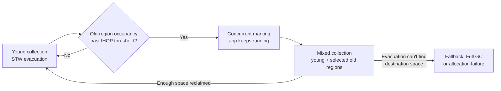
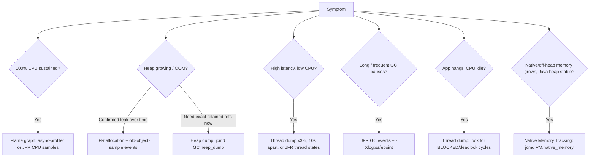

# Java: Exceptions, Generics, I/O, Serialization and Garbage Collection

This companion guide gathers topics from the larger Core Java notes and expands generics using the user-provided `Generics.pdf`. It also develops the Core guide's JVM/GC introduction into a practical guide to collector evolution and performance diagnosis. The PDF's useful concepts are restated in a Java 21 context; misleading shortcuts are corrected rather than copied as rules.

**Reading path:** start with the exception hierarchy and contracts, then use generics to understand type-safe APIs, follow bytes through I/O wrappers, treat serialization as a legacy compatibility and trust-boundary topic, and finish with garbage collection and evidence-based performance diagnosis. The Java Core guide remains the home for language foundations and the version timeline.

Examples target Java 21 unless a historical version boundary is stated. Some examples are fragments to place in a class; imports are included where useful. Do not treat native Java deserialization as a new protocol recommendation.

## Contents

1. Exceptions: contracts, propagation and cleanup
2. Generics: type-safe APIs and the limits of erasure
3. I/O: bytes, characters and resource boundaries
4. Serialization: legacy mechanism, explicit trust boundary
5. Garbage collection and JVM performance


## 1. Exceptions: contracts, propagation and cleanup

### Stable hierarchy, improved resource syntax

`Throwable` is the superclass of `Exception` and `Error`. `RuntimeException` and `Error` hierarchies are unchecked; other exception types are generally checked. "Unchecked" means the compiler does not require catch-or-declare, not "safe to ignore".

### Foundation: throw an object, declare a possibility, unwind a stack

```text
Object
  Throwable
    Error                         unchecked, e.g. OutOfMemoryError
    Exception
      RuntimeException            unchecked, e.g. IllegalArgumentException
      other Exception subclasses  checked, e.g. IOException
```

`throw` performs the exceptional transfer using a Throwable object. `throws` declares possible exception types in a method/constructor signature; it does not throw anything by itself. A custom type extending `Exception` but not `RuntimeException` is checked; extending `RuntimeException` makes it unchecked.

If `controller -> service -> readFile` throws an IOException, Java looks for a matching catch starting at the throwing point and moving outward through callers. Intervening cleanup runs as the stack unwinds. It does not resume at the failed statement after a catch finishes.

Each method through which a checked exception can escape must declare an appropriate checked type or catch it. A caller of a declaring method must satisfy the same rule even if that particular run happens not to fail. An overriding method may declare fewer or narrower checked exceptions, but cannot broaden the checked-exception contract of the method it overrides.

An ordinary try must have catch and/or finally. Catch clauses follow the try and an optional finally follows them. A catch for a superclass handles its subclasses, so `catch (Exception e)` before `catch (IOException e)` would make the latter unreachable. Java 7 multi-catch uses `catch (IOException | SQLException e)` for unrelated alternatives; a superclass and its subclass cannot appear together in that union.

### Java 7 builds automatic closing on that propagation model

Java 7 added multi-catch, try-with-resources and suppressed exceptions. Java 9 allowed an existing final/effectively-final resource variable in try-with-resources. The older rule "try requires catch or finally" applies to an ordinary try; a **try-with-resources** can omit both.

#### Java 7 declaration versus Java 9 existing resource

Java 7 requires the resource to be declared inside the parentheses:

```java
try (java.io.BufferedReader reader =
             java.nio.file.Files.newBufferedReader(path)) {
    System.out.println(reader.readLine());
}
```

Since Java 9, an already-declared final or effectively-final variable can be placed there by itself:

```java
java.io.BufferedReader reader =
        java.nio.file.Files.newBufferedReader(path);

try (reader) {
    System.out.println(reader.readLine());
} // reader is closed automatically here, including when reading throws.
```

Here `reader` is **effectively final** because it is assigned once and never reassigned. Calling `readLine()` changes the reader's position/state, but does not reassign the local variable, so it remains effectively final. If you later wrote `reader = anotherReader;`, the `try (reader)` form would no longer compile. The older `try (BufferedReader reader = ...)` form remains valid.

Catch specific recoverable cases before broader types. Preserve the cause when translating an exception. Choose checked versus unchecked based on the API's recovery/usage contract, not on whether the error is important.

### The interview question: when checked, when unchecked?

There is no rule that "business errors must be checked" or "unexpected errors must be unchecked." Start with the **caller contract**:

| Ask | Checked exception is a reasonable fit when... | Unchecked exception is often a better fit when... |
| --- | --- | --- |
| Can the caller take a useful, documented action at this boundary? | Yes: the API wants callers to handle or deliberately propagate a recoverable condition, such as a file being unavailable. | No: forcing every caller to catch it would add ceremony without a sensible recovery action. |
| Is the condition an ordinary outcome or a violated precondition? | It may be an expected operational outcome that callers can respond to, such as a user's uploaded file failing format validation. | It often indicates invalid arguments, broken invariants or a programming error, such as passing a negative page size or violating a method's valid-format precondition. |
| Will adding this exception burden downstream APIs? | The obligation is worth making explicit and is stable enough for callers to handle. | It would spread `throws` declarations through many layers, especially when those layers cannot recover. |

These are design heuristics, not a severity scale. A database outage can be important but unchecked can still be appropriate if a caller cannot recover locally; a checked exception is not automatically handled safely just because the compiler forces a catch.

**Import-format example:** if a method's contract requires a well-formed document and a caller passes malformed data, treating that as an invalid argument with `IllegalArgumentException` can be appropriate. If the operation is specifically validating a user's uploaded file, invalid format is an expected validation outcome; return structured validation details or use an exception only when the caller can meaningfully report, correct or reject that upload. The word "format" alone does not determine checked versus unchecked.

```java
import java.io.IOException;
import java.nio.file.Files;
import java.nio.file.Path;

class ImportService {
    // The caller can choose another path, prompt for a file, or report
    // an import-specific failure. The checked contract makes handling explicit.
    static String readImport(Path path) throws IOException {
        return Files.readString(path);
    }

    // A negative limit is a caller programming error, not an operational
    // condition that a caller should retry by catching an exception.
    static void validateLimit(int limit) {
        if (limit < 0) {
            throw new IllegalArgumentException("limit must not be negative");
        }
    }
}
```

Translate an exception only when the new layer can add useful meaning; preserve the cause:

```java
class ImportFailure extends Exception {
    ImportFailure(String message, Throwable cause) {
        super(message, cause);
    }
}

static String readRequiredImport(Path path) throws ImportFailure {
    try {
        return Files.readString(path);
    } catch (IOException e) {
        throw new ImportFailure("Could not read the required import", e);
    }
}
```

Here the service boundary translates a low-level I/O failure into an import-specific checked contract. If it added no context or policy, allowing `IOException` to propagate could be clearer. Do not catch an exception merely to rethrow the same object, wrap every exception in `RuntimeException`, or return an empty/success-shaped result that hides failure.

**Interview answer:** "I choose based on whether callers can take meaningful action and whether the API should enforce that handling at compile time. Checked exceptions suit recoverable conditions that the caller is expected to address or propagate; unchecked exceptions suit violated preconditions and failures callers cannot usefully handle at that layer. I preserve causes when translating, and I don't swallow failures just to satisfy either choice."

### What if the operation and close both fail?

```java
class ResourceFailures {
    static class Resource implements AutoCloseable {
        @Override
        public void close() {
            throw new IllegalStateException("close failed");
        }
    }

    static void run() {
        try (var resource = new Resource()) {
            throw new IllegalArgumentException("operation failed");
        }
    }
}
```

The caller receives `IllegalArgumentException("operation failed")`; the close failure is available through `getSuppressed()`. Resources close in reverse declaration order, including already-initialized resources if a later resource's initialization fails. If only close fails, that failure is not suppressed behind a nonexistent primary exception.

**Practical implication:** log/report the full exception, including causes and suppressed exceptions. Do not replace it with a message-only string that loses the cleanup failure.

### Finally is not a universal success guarantee

`finally` normally runs as control leaves the try/catch, including during return. It is not guaranteed after forced process termination, JVM failure or a path that never completes. An exception or return from finally can override an earlier exception/return, hiding the real failure. Do not return from cleanup blocks.

An uncaught exception ordinarily terminates the **thread** whose stack it escapes. An exception escaping `main` does not necessarily terminate other non-daemon threads immediately. Task executors may capture failures into futures rather than deliver them like uncaught raw-thread exceptions.

#### Foundation: return values are evaluated before finally runs

```java
class FinallyRecall {
    static int primitiveResult() {
        int value = 1;
        try {
            return value;
        } finally {
            value = 2;
        }
    }

    static StringBuilder referenceResult() {
        var value = new StringBuilder("before");
        try {
            return value;
        } finally {
            value.append("-cleanup");
        }
    }
}
```

`primitiveResult()` returns 1: the return expression was already evaluated, so assigning the local value afterward does not replace it. `referenceResult().toString()` is `"before-cleanup"`: the evaluated return value is a reference to the same builder that finally mutates. These are execution-order illustrations, not recommendations to mutate a result during cleanup.

If finally itself returns, its return can replace the pending return. If it throws, it can replace the pending exception. Try-with-resources has a deliberate suppression rule to preserve the operation's primary failure instead; that distinction is why manually putting close in finally is not equivalent in every failure case.

**Interview follow-up:** "Should a service catch `Exception` and return an empty list?" Only if that empty result truly means the documented degraded outcome and the failure is surfaced appropriately. A database outage is not normally indistinguishable from "no records". Retry only appropriate transient failures with bounded attempts, deadlines and idempotency awareness.

## 2. Generics: type-safe APIs and the limits of erasure


### Version journey

Java 5 introduced generics. Java 7 added diamond inference (`new ArrayList<>()`); Java 8 improved target-type inference. Java 9 allowed diamond with anonymous classes subject to restrictions. Through Java 21, ordinary generics still use reference types: `List<int>` is not supported.

`List<Integer>` is **not** a subtype of `List<Number>`. Otherwise code accepting a number list could insert a `Double` into an integer list. Arrays are covariant instead and enforce their component type at runtime; generics prevent many of those mistakes at compilation.

### Producer extends, consumer super

```java
import java.util.List;

class GenericTransfer {
    static <T> void copy(List<? extends T> source, List<? super T> target) {
        for (T value : source) {
            target.add(value);
        }
    }
}
```

An integer source can feed a number/object target. `? extends Number` lets you read values as `Number`, but does not let you add arbitrary numbers because the actual list might be an integer list. `? super Integer` lets you add integers, but reading is only safely typed as `Object`. An unknown wildcard does not mean "any type can be inserted".

**Interview follow-up:** "Is `List<? extends Number>` immutable?" No. Wildcards restrict what this reference can express; operations such as clearing/removing may still be possible, and another reference may mutate the list. It is not an unmodifiable wrapper.

### Erasure explains real compiler restrictions

Most generic type arguments are erased at runtime, although declarations can retain generic signature metadata for reflection. This is not equivalent to saying all generic information disappears everywhere.

| Temptation | Why it fails or is unsafe |
| --- | --- |
| Overload `handle(List<String>)` and `handle(List<Integer>)` | Both erase to the same parameter signature |
| Test `value instanceof List<String>` for an arbitrary object | Runtime cannot generally validate the element argument; use `List<?>` and validate elements where necessary |
| `new T()` | The erased type parameter does not provide a usable constructor; pass a factory |
| `new List<String>[10]` | Generic array creation cannot enforce that parameterized element type |
| Convert a raw list to a typed list with an unchecked cast | It can defer a `ClassCastException` until a later read |

Raw types exist for migration compatibility, not as the default for new APIs. Keep unchecked operations narrowly isolated and justified; `@SuppressWarnings` does not make the data safe. Generic varargs can also create heap pollution; use `@SafeVarargs` only after verifying that the implementation really is safe.

### Generics from the ground up: parameterize a contract

A type parameter is a placeholder for a reference type chosen by a caller or by a subclass. It lets the compiler check relationships once, rather than forcing each caller to cast:

```java
final class Box<T> {
    private final T value;

    Box(T value) {
        this.value = value;
    }

    T value() {
        return value;
    }
}
```

`Box<String>` and `Box<Integer>` are parameterized uses of the same generic declaration. `T` is not a special runtime class; it is a compile-time type variable. Common declaration names are `T` (type), `E` (element), `K`/`V` (key/value), and `R` (result).

A generic method declares its own type parameters before its result type. Its type variable need not belong to the enclosing class:

```java
import java.util.List;

static <T> T firstOrNull(List<T> values) {
    return values.isEmpty() ? null : values.get(0);
}
```

The `<T>` before `T` is the declaration; the `T` after it is the return type. A generic constructor can similarly declare a type parameter independent of the class:

```java
final class Token {
    <T> Token(T source) {
        System.out.println(source);
    }
}
```

### Invariance: why `List<Integer>` is not `List<Number>`

`Integer` is a subtype of `Number`, but `List<Integer>` is not a subtype of `List<Number>`. If it were, code holding a `List<Number>` reference could insert a `Double` into an underlying list intended for Integers. Invariance prevents that invalid write at compile time.

Arrays take a different approach: `Integer[]` is assignable to `Number[]`, but the runtime array remembers it is an Integer array and rejects an incompatible store with `ArrayStoreException`. Generic collections generally reject the analogous assignment earlier, at compile time.

### Wildcards: use the producer/consumer relationship

Use `? extends T` when an input produces values for you to read as `T`; use `? super T` when it consumes values you want to supply. A method that both reads and writes a type usually needs a named type parameter rather than a wildcard.

```java
static <T> void copy(List<? extends T> source, List<? super T> destination) {
    for (T value : source) {
        destination.add(value);
    }
}
```

The source might be `List<Integer>` and the destination `List<Number>`: each produced Integer is a Number and can be added. This is PECS: **producer extends, consumer super**.

```java
import java.util.ArrayList;
import java.util.List;

List<? extends Number> numbers = List.of(1, 2.5);
Number first = numbers.get(0); // Safe to read as Number.
// numbers.add(3);             // Not safe: actual list might be List<Integer>.

List<? super Integer> sink = new ArrayList<Number>();
sink.add(3);                   // Safe to put an Integer.
Object value = sink.get(0);    // Only Object is guaranteed on read.
```

An upper-bounded reference is not an immutable collection: removal, clearing, or mutation through another alias can still be possible. Likewise, a lower-bounded reference is not write-only; reads are simply typed as Object. Wildcards are generally most useful for **input parameters**, not return types, where they can unnecessarily restrict what callers can do.

When a `List<?>` must be safely modified in a way that preserves its unknown element type, a helper method can capture that one unknown type:

```java
import java.util.List;

static void replaceFirstWithItself(List<?> values) {
    replaceFirstWithItselfCaptured(values);
}

private static <T> void replaceFirstWithItselfCaptured(List<T> values) {
    if (!values.isEmpty()) {
        T first = values.get(0);
        values.set(0, first);
    }
}
```

The compiler gives the captured element type a temporary name `T`; therefore the value read from the list can safely be written back. The wildcard does not mean the list is immutable—it means this call site does not know the element type.

### Three similar-looking declarations with different contracts

| Declaration | What it means | Can add an arbitrary non-null value? |
| --- | --- | --- |
| `List` | Raw type; legacy unchecked escape hatch | Often compiles with warnings; may corrupt a typed list and fail later |
| `List<?>` | A list of some unknown element type | No; only `null` is accepted by the type system |
| `List<Object>` | A list whose elements are Object | Yes, but `List<String>` is not assignable to it |

`List<?>` is not equivalent to `List<Object>` or to a raw `List`. Use raw types only at legacy boundaries and isolate the unchecked operation. A `Collections.checkedList` wrapper can add runtime insertion checks when interoperating with non-generic code, but does not restore compile-time safety inside that legacy code.

### Bounds and static contexts

An upper bound gives a type variable the operations of its bound:

```java
static <T extends Number> double asDouble(T value) {
    return value.doubleValue();
}
```

Multiple bounds use `&`; if a class appears, it must come first:

```java
static <T extends Number & Comparable<T>> T maximum(T left, T right) {
    return left.compareTo(right) >= 0 ? left : right;
}
```

A class's type parameter is not in scope for static members because there is one static member per class, not one per parameterization. A static method introduces its own parameter instead:

```java
class Cache<T> {
    // static T defaultValue; // Illegal: which Cache<T>?

    static <U> U identity(U value) {
        return value;
    }
}
```

A static nested class can be generic in its **own** type parameter; it cannot refer to an outer class's `T` unless it declares an independent parameter of its own.

### Erasure: compile-time checks, runtime consequences

Java uses erasure for most generic type arguments: for example, `List<String>` and `List<Integer>` share the same runtime class. This explains why these are illegal or unsafe:

| Attempt | Reason |
| --- | --- |
| `value instanceof List<String>` | Runtime cannot test an arbitrary element type; `instanceof List<?>` is legal, followed by element validation as needed |
| `List<String>.class` | Parameterized class literals do not exist; `List.class` is legal |
| `new T()` | The erased type variable does not identify a constructor; pass a factory or constructor reference |
| `new List<String>[size]` | A generic array cannot enforce the parameterized component type at runtime |
| Overload `handle(List<String>)` and `handle(List<Integer>)` | Both signatures erase to `handle(List)` |

Prefer lists to arrays when a design depends on a parameterized element type; their covariance/erasure rules differ, so mixing them tends to require unchecked workarounds. Reflection can still expose generic signature metadata in declarations, but that does not make arbitrary object instances retain or validate their type arguments.

### Bridge methods preserve overriding after erasure

Consider a generic parent and a specialized child:

```java
class Node<T> {
    void setData(T data) { }
}

class IntegerNode extends Node<Integer> {
    @Override
    void setData(Integer data) { }
}
```

After erasure, the parent method has the effective signature `setData(Object)`, while the child source method takes `Integer`. To preserve overriding and runtime dispatch, the compiler emits a synthetic **bridge method** on `IntegerNode` with the erased signature; it checks/casts the argument and delegates to `setData(Integer)`. Raw-type misuse can therefore fail at that bridge cast, potentially at the call rather than a later read. Bridge methods are normally compiler machinery, but may appear in reflection output or stack traces.

### Where generics pay off

Generics are especially useful for reusable algorithms and data structures, type-safe containers, and utility methods that accept related input/output types. They remove repeated caller casts and move many type errors to compilation. They do not validate untrusted runtime data: parsing, raw interop and unchecked casts still need validation and narrow containment.


## 3. I/O: bytes, characters and resource boundaries

### Foundation: a stream is a sequence, a wrapper adds one responsibility

`InputStream` and `OutputStream` are abstract byte-oriented base classes. Input supplies bytes from a source; output sends bytes to a destination. They are not necessarily files: the source/destination can be memory, a socket or another stream.

The original hierarchy becomes easier to remember as **source -> optional wrappers -> consumer**:

```text
FileInputStream       supplies file bytes
  BufferedInputStream batches underlying reads
    DataInputStream   interprets bytes as typed binary values

FileOutputStream       accepts file bytes
  BufferedOutputStream batches underlying writes
    DataOutputStream   encodes typed binary values
```

In code the outer wrapper is constructed last and called first: `new DataInputStream(new BufferedInputStream(new FileInputStream(file)))`. `FilterInputStream`/`FilterOutputStream` are delegating bases for such wrappers; they do not supply a file themselves. Buffering and interpretation are independent responsibilities.

| Original API family | Detail to retain | Recall scenario |
| --- | --- | --- |
| `FileInputStream` / `FileOutputStream` | Raw file bytes; output may create/truncate depending on opening mode | Images and binary formats, not automatic text decoding |
| `ByteArrayInputStream` | Reads an existing byte buffer; current position is tracked | Parse already-received bytes |
| `ByteArrayOutputStream` | Grows an in-memory buffer; `toByteArray()` copies its current bytes | Assemble a known-bounded binary payload |
| Buffered streams | Reduce underlying calls; supported mark/reset has read-limit constraints | Many small reads/writes |
| Data streams | Preserve typed primitive encodings and field order | An int followed by a double is not interchangeable with text `"1,2.0"` |
| Pushback stream | Places recently consumed bytes back into its pushback buffer | Parser reads one delimiter too far |
| Sequence stream | Finishes one input then advances to the next | Treat several sources as one logical byte sequence |
| Piped streams | Connect writer/reader with a bounded byte buffer, usually across threads | The writer can block if nobody drains the pipe |
| Object streams | Encode/restore supported object graphs | Legacy serialization; see the Serialization section below |
| Print streams/writers | Format text; inspect their recorded error state | Output convenience is not delivery confirmation |

Both byte-array streams can be used after close because their close has no effect; that does not make them memory-bounded. `ByteArrayOutputStream.toString()` decodes bytes, so choose the charset rather than guessing it. Deprecated `StringBufferInputStream`/`LineNumberInputStream` from the old diagrams are not recommended text APIs; use character readers, including `LineNumberReader` when that feature is needed.

### Foundation: bytes become text only through an encoding

`Reader`/`Writer` operate on characters. `InputStreamReader` decodes bytes to characters; `OutputStreamWriter` encodes characters to bytes. A `BufferedReader`/`BufferedWriter` adds buffering around character operations. A FileReader is not a universal encoding detector; use an explicit charset at the boundary.

```text
file bytes -> InputStreamReader(UTF-8) -> BufferedReader -> lines of text
text -> BufferedWriter -> OutputStreamWriter(UTF-8) -> file bytes
```

Closing an owning outer wrapper normally closes its wrapped stream. Flushing pushes buffered output toward the underlying destination; it neither closes the stream nor proves bytes are durable on disk or consumed remotely. A print API can be constructed with an explicit charset; the original blanket claim that it must always use the platform default is too broad.

### Foundation: binary writing and reading must agree

```java
import java.io.ByteArrayInputStream;
import java.io.ByteArrayOutputStream;
import java.io.DataInputStream;
import java.io.DataOutputStream;
import java.io.IOException;

class BinaryRoundTrip {
    static void show() throws IOException {
        var buffer = new ByteArrayOutputStream();
        try (var output = new DataOutputStream(buffer)) {
            output.writeInt(7);
            output.writeDouble(19.5);
        }
        try (var input = new DataInputStream(
                new ByteArrayInputStream(buffer.toByteArray()))) {
            System.out.println(input.readInt()); // 7
            System.out.println(input.readDouble()); // 19.5
            System.out.println(input.read()); // -1
        }
    }
}
```

The Data streams make matching machine-independent binary encodings; an arbitrary `readDouble()` at the beginning would interpret the wrong bytes. After the payload, byte-oriented `read()` returns -1, but another `readInt()` would throw EOFException because a complete int is unavailable. Shared stream position also means these wrappers are not a free concurrent-reader protocol.

### From stream hierarchies to purpose-driven choices

Byte streams and character readers/writers predate Java 5. Java 7 added NIO.2's `Path`/`Files` APIs and try-with-resources. Java 11 added convenient `readString`/`writeString` and `Path.of`. Java 18 made UTF-8 the default charset for most standard APIs; console I/O can still have separate encoding considerations.

| Requirement | API family | Important contract |
| --- | --- | --- |
| Raw binary data | `InputStream` / `OutputStream` | `read()` returns an int in 0–255 or -1 at EOF, not a byte with ambiguous -1 |
| Text with an encoding | `Reader` / `Writer`, `Files.newBufferedReader` | Bytes become characters through an explicit charset |
| Buffered transfer | Buffered stream/reader/writer decorators | Buffering reduces underlying calls; flush is not a durable-storage guarantee |
| Binary primitives | `DataInputStream` / `DataOutputStream` | Read fields in the same format/order; premature end may throw `EOFException` |
| In-memory bytes | Byte-array streams | Closing has no effect; memory usage still grows with content |
| Look-ahead parsing | `PushbackInputStream`, supported mark/reset APIs | Mark/reset support and buffer limits are stream-specific |
| Concatenated sources | `SequenceInputStream` | Reads inputs sequentially, not concurrently |
| Inter-thread byte pipe | Piped streams | Same-thread use can deadlock; higher-level queues often express the requirement better |
| Paths, traversal and metadata | `Path`, `Files` | File permissions, links and concurrent changes still matter |

`FilterInputStream`/`FilterOutputStream` and their subclasses illustrate decoration: wrap a stream to add behavior. Normally close the owning outer wrapper; verify ownership for caller-supplied streams that must remain open. `PrintStream`/`PrintWriter` can record I/O errors rather than throwing them normally; check `checkError()` when correctness depends on delivery.

### Bounded-memory processing and deterministic closing

```java
import java.io.IOException;
import java.nio.charset.StandardCharsets;
import java.nio.file.Files;
import java.nio.file.Path;

class LogLineCount {
    static long countErrors(Path file) throws IOException {
        try (var lines = Files.lines(file, StandardCharsets.UTF_8)) {
            return lines.filter(line -> line.startsWith("ERROR ")).count();
        }
    }
}
```

This avoids loading all lines at once, but memory is still affected by the maximum line length and downstream operations. `Files.lines` holds an open resource and must close. `readAllBytes`/`readString` are fine for known-small files, not arbitrary multi-gigabyte inputs.

**Partial read trap:** `read(buffer)` can return fewer bytes than the buffer size without reaching EOF. Process only the returned count and loop until -1, or use an appropriate higher-level transfer/read API. `available()` is not the total file or message size.

**Filesystem follow-up:** "Does `normalize()` stop path traversal?" Not alone. Validate against an intended root and account for absolute paths, symbolic links and time-of-check/time-of-use races. Do not treat string prefix checks as a complete filesystem security policy.

### Network I/O is still an external dependency

The standard HTTP client was finalized in Java 11. Configure connection/request deadlines, body-size policies, connection reuse and interruption/cancellation behavior. Async calls or virtual threads do not remove timeouts, rate limits, retries or response validation.

**Interview scenario:** a large download succeeds locally but exhausts production heap. Inspect whether a byte-array/string body handler buffers the entire response, how many downloads run concurrently, and whether streaming destinations have bounded buffering. Faster threads do not make an unbounded body safe.

## 4. Serialization: legacy mechanism, explicit trust boundary

### What the old rules actually mean

Ordinary Java object serialization uses `Serializable`, object streams and the reachable serializable graph. It tracks references/cycles; it is **not** a universal deep-copy mechanism. A reachable non-serializable object can cause `NotSerializableException` unless deliberately excluded or otherwise handled.

Default serialization includes applicable non-static, non-transient instance fields. Static state belongs to the class, not the serialized instance. `transient` omits a field from default serialization; it does not encrypt data or guarantee that custom serialization cannot write it.

| Topic | Correct rule | Source claim to avoid |
| --- | --- | --- |
| Transient field restoration | Default value unless custom reconstruction/restoration supplies it | `defaultReadObject()` alone restores transient fields |
| Ordinary Serializable constructors | Serializable-class constructors/field initializers are bypassed; the first non-serializable superclass's accessible no-arg constructor runs | Every class constructor runs normally |
| Superclass state | Reinitialized by that constructor's logic | Necessarily identical to the original object's state |
| Custom `writeObject/readObject` | Must preserve ordering, validation and propagated failure | Catching I/O failures and continuing is harmless |
| `serialVersionUID` | Controls a class-version compatibility check | Matching UID proves semantic compatibility or input safety |

`Externalizable` is a different contract: the public no-arg constructor runs and the implementation explicitly reads/writes its external form. Enum deserialization restores the named constant. Serializable records use their canonical constructor during deserialization; do not apply the ordinary-class constructor-bypass rule indiscriminately to records.

### Foundation: the graph, transient fields and custom hooks

If a serialized object references two other objects, default serialization follows their applicable fields too. If two fields point to the same object, deserializing that graph preserves their shared-reference relationship; it does not independently clone every occurrence. Cycles are supported. A default-included non-serializable object causes failure rather than automatically becoming serializable.

The original custom-hook example was about excluding an object from the default graph but saving enough data to reconstruct it. Here a non-serializable attachment is transient, and the hooks explicitly write/read its code:

```java
import java.io.IOException;
import java.io.InvalidObjectException;
import java.io.ObjectInputStream;
import java.io.ObjectOutputStream;
import java.io.Serializable;

final class AttachmentInfo {
    private final int code;

    AttachmentInfo(int code) {
        if (code <= 0) {
            throw new IllegalArgumentException("code must be positive");
        }
        this.code = code;
    }

    int code() { return code; }
}

final class SavedMessage implements Serializable {
    private static final long serialVersionUID = 1L;
    private String text;
    private transient AttachmentInfo attachment;

    SavedMessage(String text, int code) {
        this.text = java.util.Objects.requireNonNull(text, "text");
        this.attachment = new AttachmentInfo(code);
    }

    private void writeObject(ObjectOutputStream output) throws IOException {
        output.defaultWriteObject();
        output.writeInt(attachment.code());
    }

    private void readObject(ObjectInputStream input)
            throws IOException, ClassNotFoundException {
        input.defaultReadObject();
        int code = input.readInt();
        if (text == null || code <= 0) {
            throw new InvalidObjectException("Invalid saved message");
        }
        attachment = new AttachmentInfo(code);
    }

    String text() { return text; }
    int attachmentCode() { return attachment.code(); }
}
```

`writeObject/readObject` here are serialization-specific private hooks, not public methods to call on `SavedMessage`. The caller uses `ObjectOutputStream.writeObject(message)` and `ObjectInputStream.readObject()`. `defaultWriteObject` saves the eligible fields of this class, and `defaultReadObject` restores them; the extra int is handled separately in matching order. Declaring and propagating failures avoids accepting a partially restored object.

Without the explicit reconstruction, `attachment` would remain null: **defaultReadObject does not restore transient fields.** The constructor's validation is repeated on deserialization because an ordinary Serializable constructor is bypassed. This is a controlled legacy-mechanism illustration, not a recommendation to accept arbitrary serialized input.

If a superclass is not serializable, its accessible no-arg constructor initializes its part of the restored object. That is construction logic, not recovery of its historical field values. Enum serialization instead records the constant's name and resolves the existing constant; its instance fields are not saved as per-object payload, and ordinary enum custom serialization hooks are ignored.

`readObjectNoData` is a specialized evolution hook for when the stream lacks data for a class now present in the receiver's hierarchy. It is not the normal hook for restoring a transient field or reading an empty file.

### The modern recommendation is not "deserialize everything with a filter"

Java 9 introduced deserialization filtering (JEP 290), and Java 17 added context-specific filter factories (JEP 415). Filters can restrict classes and resource metrics such as depth, references and array lengths. They reduce risk but do not validate all business invariants or make arbitrary object graphs trustworthy.

**Practical choice:** avoid native Java deserialization for untrusted network input or as a new cross-service protocol. Prefer explicit schemas and validated DTOs with controlled polymorphism. JSON is not automatically safe either: size limits, allowed types and validation still matter.

**Interview follow-up:** "Can I use serialization to copy an object or persist it long-term?" It may work for a deliberately controlled legacy graph, but couples data to class evolution and invokes deserialization machinery. Prefer explicit copying for domain state and versioned persistence/message schemas for durable data.

## 5. Garbage collection and JVM performance

The Core guide's initialization section introduces the heap, reachability and GC roots. This section develops that mental model into collector trade-offs and a production investigation method. Examples use HotSpot terminology; exact defaults and options depend on the JDK build and release.

### Start with reachability, not "which objects are old?"

The collector asks whether an object can still be reached from a **GC root** by following references. Typical roots include references held by live threads, static fields, JNI handles and active synchronization structures. If an object is unreachable, it is eligible for reclamation; that does not mean collection happens immediately or at the instant its lexical scope ends.

```text
GC roots
   |
   v
request -> response -> cached result
               |
               +----> child objects

unreachable object graph -> eligible for reclamation
```

In the example, the request object can become unreachable after a call finishes, but the cached result and its children remain live while the cache refers to them. GC cannot infer that the cache entry is no longer useful. A **memory leak in a garbage-collected program** is commonly unintended retention, not necessarily a lost pointer to manually allocated memory.

GC primarily reclaims heap objects. A JVM process also consumes memory outside the Java heap: thread stacks, Metaspace, JIT code cache, direct/native buffers, JNI libraries and other native allocations. Therefore a process can exceed a container limit or fail with a native-memory error while Java heap usage is below `-Xmx`. Class metadata can be unloaded when the relevant classes and class loaders become unreachable, but a class-loader reference leak can prevent that.

GC is not deterministic cleanup for files, sockets or database connections. Use try-with-resources and explicit ownership; do not wait for an object to become unreachable to release external resources.

### The algorithm building blocks

Collectors combine variations of these ideas; no single algorithm description is a complete description of a production collector.

| Building block | What it does | Main trade-off |
| --- | --- | --- |
| Mark-sweep | Trace live objects, then reclaim unmarked space | Sweeping can leave fragmented free space |
| Copying / evacuation | Move live objects into another region or space; reclaim the source | Fast reclamation and compacted survivors, but destination space and copying work are required |
| Mark-compact | Mark survivors, then move them together | Reduces fragmentation, but moving/adjusting references can cost time |
| Generational collection | Collect a young area frequently and older areas less often | Works well when many objects die young; long-lived objects and cross-generation references add work |
| Concurrent work | Do some marking/relocation alongside application threads | Shorter pauses are possible, but application threads and GC compete for CPU and memory bandwidth |

Generational collection is based on a useful workload tendency, not a law: many short-lived objects die quickly, while some objects survive. Surviving young objects may be promoted or retained in older regions. Remembered sets/card tables help a collector find references from one region/generation into another without rescanning the entire heap every time.

**Parallel and concurrent are different words.** Parallel GC work uses multiple GC threads; a Parallel GC collection is still stop-the-world (STW), so application threads pause. A concurrent collector overlaps some GC work with application execution, but still has pauses and consumes resources while the application runs.

### Collector evolution: additions and trade-offs, not a simple replacement chain

The names "Serial", "Parallel", "CMS", "G1", "ZGC" and "Shenandoah" describe collector choices, not Java language features. The timeline matters because older interview material can make removed collectors sound like current defaults.

| Era / milestone | What changed | Practical takeaway |
| --- | --- | --- |
| Early HotSpot collectors | Serial GC provided a simple STW design; Parallel GC used multiple threads to prioritize throughput | Small/simple workloads and throughput-heavy batch jobs have different goals |
| CMS era | Concurrent Mark Sweep reduced some old-generation pauses but could fragment the heap and suffer concurrent-mode failure | CMS is historical: deprecated in JDK 9 and removed in JDK 14 |
| G1 | Became the default for server-class configurations in JDK 9, then the default in all HotSpot environments in JDK 25 | A strong general-purpose starting point, not a guarantee of meeting every latency SLO |
| ZGC | Production-ready in JDK 15; generational ZGC previewed in JDK 21, became the default ZGC mode in JDK 23, and non-generational mode was removed in JDK 24 | Designed for low pauses, including large heaps; validate CPU, memory headroom and throughput for the actual workload |
| Shenandoah | Production-ready in JDK 15; generational mode became a product feature in JDK 25 | Another concurrent low-pause option; JEP 535 targets making generational mode its default in JDK 28, which is a planned change rather than a released JDK 25 behavior |

These are HotSpot/OpenJDK milestones; vendors may package builds and defaults differently. G1 is therefore the mainstream default and a common production starting point: it became the default for server-class configurations in JDK 9 and for all HotSpot environments in JDK 25. That supports calling it the broadly prevalent default, but does not establish a measured market-share ranking across every vendor and deployment. The JDK 25 default does not remove the other collectors. On Java 21, G1 is normally the default in server-class HotSpot configurations; small environments may select Serial. Always check the actual runtime and flags rather than infer the collector from a generic Java-version rule.

### What the main collectors optimize for

Here, **application throughput** means completed work per unit time—for a service, often successful requests per second (or operations/records per second for other workloads). It is different from latency: a system can complete many requests overall while some individual requests experience long pauses. GC discussions also use **GC throughput** to mean the proportion of elapsed time the JVM spends running application code rather than doing GC. The two are related, but not identical: more GC time can reduce application capacity, while request throughput also depends on CPU, dependencies, concurrency and workload.

| Collector | Mental model | Consider it when... | Trade-off to measure |
| --- | --- | --- | --- |
| Serial | One GC thread; STW | The heap/workload is small and simplicity matters | Pause duration can grow with the amount of live data |
| Parallel | Multiple GC threads; STW | Batch throughput is more important than pause latency | Longer pauses and competition for CPU during collection |
| G1 | Region-based, generational collector balancing throughput and pause goals | You need a general-purpose default and observable pause behavior | Pause goals are targets, not hard guarantees; evacuation needs free-region headroom |
| ZGC | Concurrent, low-latency collector | Long pauses are unacceptable and the application can afford concurrent GC work | CPU, memory headroom and throughput can differ from G1; test under realistic load |
| Shenandoah | Concurrent evacuation/compaction with a low-pause focus | You want to evaluate a low-pause alternative supported by your JDK distribution | Availability, defaults and operational behavior are JDK/build-specific; benchmark it |
| Epsilon | No-op collector; does not reclaim memory | Short-lived tests or measuring allocation behavior in a controlled run | Not a production solution for a long-lived service |

Do not select a collector because its name sounds newer or because a benchmark used a different workload. Compare the same application, runtime, heap/container limits and load profile, and assess latency, throughput, CPU and memory together.

### G1: connect its regions to what you see in logs

G1 divides the heap into regions rather than using only fixed contiguous young/old spaces. Regions can serve young or old roles over time. A typical lifecycle includes:

1. **Young collections:** STW evacuations copy live young objects into survivor/old regions and reclaim the source regions.
2. **Concurrent marking:** as old-region occupancy warrants it, G1 identifies live data across the heap while the application continues, with required pause phases around that work.
3. **Mixed collections:** after marking, G1 may collect young regions and selected old regions together, choosing regions with useful reclaimable space.
4. **Fallback pressure:** if evacuation cannot find sufficient destination space, the JVM may need a costly Full GC or fail to recover enough memory.



This is a conceptual lifecycle, not a promise that every log contains the same sequence or that "minor" and "major" classify every event consistently. In G1, an object larger than half a region is treated as **humongous** and allocated directly in humongous regions. Large transient payloads can consume region capacity and increase reclamation pressure; investigate allocation size and lifetime before assuming a collector defect.

**If GC logs show evacuation failure specifically** (not just a long pause), the usual levers—in order of how directly they address the mechanism—are: start concurrent marking earlier with `-XX:InitiatingHeapOccupancyPercent` (default 45; lowering it, e.g. to 30–35, gives G1 more lead time before old-gen occupancy forces a scramble), reserve more headroom for evacuation with `-XX:G1ReservePercent` (default 10; raising it, e.g. to 15–20, keeps destination space available even when the heap is nearly full), and reconsider `-XX:G1HeapRegionSize` (16–32 MB) if humongous allocations are fragmenting regions. These are measured responses to an observed failure, not defaults to pre-tune—verify with GC logs before and after any change.

### Diagnose the symptom before tuning a flag

Start with a service objective and a baseline: request p95/p99 latency, throughput, CPU, allocation rate, GC pause count/duration, heap occupancy before and after collection, and process/container RSS. A single `used heap` number does not tell you whether the problem is short-lived allocation, retained objects, long pauses or native memory.

| Production symptom | Likely direction to investigate | Evidence and first response |
| --- | --- | --- |
| Heap rises during traffic, then falls substantially after collections; GC CPU is high | Allocation churn / high allocation rate | Use JFR allocation profiling to find hot allocation paths; check request volume and temporary buffers. Optimize measured hotspots, not every allocation by intuition. |
| Post-collection live occupancy rises across comparable load windows | Retained objects / leak-like growth | Compare class histograms and heap dumps; inspect dominator/retention paths for unbounded caches, static collections, listeners, `ThreadLocal`s, queues or request data captured by long-lived tasks. |
| p99 spikes align with long STW pauses | Pause cost or insufficient headroom | Correlate unified GC logs and safepoints with request latency. Check live set, heap sizing, evacuation pressure and CPU contention; evaluate a different collector only against the same SLO/load. |
| Frequent collections with little memory reclaimed | High live set relative to heap, or allocation pressure | Measure post-GC occupancy and allocation rate. Increasing `-Xmx` may buy time only if the container has safe headroom and live data is legitimate. |
| G1 has humongous allocation or evacuation warnings | Large objects or insufficient evacuation space | Inspect object sizes, payload buffering and concurrent peaks; stream large bodies and leave region/heap headroom. |
| Memory rises after redeploy/reload or plugin refresh | Class-loader retention | Check loaded class counts and whether application threads, static registries, logging, drivers or thread locals still reference the old loader. |

(Native/process memory exceeding `-Xmx` despite a stable Java heap is a distinct failure mode, covered in the broader symptom table under "Choosing the right diagnostic tool" below, alongside deadlocks, thread leaks and JIT warm-up.)

**Retention is a graph question.** A heap dump can show which object dominates retained memory, but it does not by itself prove why the object is still needed. Find the path from a root to the retained object, then trace that owner back to the lifecycle that should have removed it.

**GC overhead is not always the root cause.** A saturated service may allocate more because queues and retries grow under downstream latency. GC then reports the symptom—more objects and pressure—while the cause is overload, unbounded buffering or a slow dependency. Check request rate, queue depth, retries and dependency latency alongside GC data.

### A ThreadLocal leak, traced end to end

`ThreadLocal` retention is a specific, recurring version of the "retention is a graph question" problem above, and worth knowing as a concrete reference chain: each pooled thread holds a `ThreadLocalMap`; an entry's value references its class; the class references its `ClassLoader`. If that value is a request-scoped object loaded by the **application's** class loader (common in app servers and most container platforms doing hot redeploy or per-webapp isolation), the chain becomes `pooled Thread → ThreadLocalMap → value → Class → ClassLoader`. Because the thread is pooled and long-lived, the whole class loader—and every class and static field it loaded—cannot be unloaded, even though the request that created the value finished long ago. This is why ThreadLocal leaks show up as **Metaspace growth or a rising class count**, not just heap growth, and why they are easy to miss: heap occupancy can look stable while retained class metadata climbs.

```
GC root
  │
  ▼
pooled Thread  ──────────────┐  (lives for the pool's lifetime,
  │                          │   survives past any single request)
  ▼                          │
ThreadLocalMap               │
  │                          │
  ▼                          │
Entry.value (request object) │
  │                          │
  ▼                          │
value.getClass()             │
  │                          │
  ▼                          │
ClassLoader  ◄────────────────┘  (entire app class loader pinned:
  │                                every class + static field it
  ▼                                loaded is now unreclaimable)
Metaspace / class-metadata growth
```

**A STAR-format version of this incident, worth having ready for an interview:**

- **Situation:** A service handling roughly 15,000 requests/minute was being OOMKilled by Kubernetes every 36–48 hours, always on the same deployment, with heap usage looking unremarkable in dashboards right before the kill.
- **Task:** Find the retention source before the next scheduled restart masked it again, without adding broad heap headroom as a stopgap.
- **Action:** Captured a heap dump just before a scheduled restart and opened it in Eclipse MAT. Ran the **Dominator Tree** view and grouped the result by class loader (MAT's "group by class loader" option) rather than by class—this surfaced that one class loader instance retained an outsized share of the heap. Tracing its dominating path led to a `ThreadLocal<UserContext>` set by an authentication filter and never removed on the response path, holding a reference back to the deployment's own class loader through pooled worker threads.
- **Result:** Added `ThreadLocal.remove()` in a `finally` block on the request-completion path; pod restarts stopped recurring on the 36–48 hour cadence. Followed up with a SonarQube rule to flag `ThreadLocal.set()` calls without a matching `remove()` in the same method, to catch the pattern before it reached production again.

A related, often-missed symptom: because the leaked class loader also pins thread-local-held locks and synchronization structures, a cascading hot-redeploy can show **thread-pool exhaustion or STW pause growth** as a secondary effect—worth checking class-loader retention even when the primary complaint is about threads or pauses, not just memory.

### A practical evidence-first workflow

1. **Confirm the failure mode.** Distinguish a Java `OutOfMemoryError`, a container/process kill, rising latency, and high GC CPU. They are not interchangeable.
2. **Capture a baseline under representative load.** Include JDK vendor/version, collector and flags, container limit, heap maximum, workload rate and service SLO.
3. **Enable or inspect unified GC logs.** On Java 9+, `-Xlog:gc*` provides structured JVM logging. Include timestamps and safepoint information when correlating pauses with application latency.
4. **Profile allocation and pauses.** Java Flight Recorder (JFR) can show allocation pressure, GC events, thread activity and CPU. Use `jcmd` for targeted runtime information; heap histograms/dumps can be expensive and should be used with production impact in mind.
5. **Classify before changing configuration.** Separate high allocation from retained live data, STW pause cost, CPU contention and native-memory growth.
6. **Change one variable at a time and repeat the same workload.** Compare throughput, p99/p999, pause distribution, CPU, post-GC live set and process RSS. Keep the change only if it improves the intended objective without breaking another one.

Example Java 21+ startup configuration for collecting useful GC/safepoint logs:

```shell
java -Xms2g -Xmx2g -XX:+UseG1GC -Xlog:gc*,safepoint:file=gc.log:time,uptime,level,tags -jar service.jar
```

`-Xms`/`-Xmx` set initial/maximum Java heap, not total process memory. Equal values can make capacity more predictable in some deployments but reserve/commit behavior and container limits still need validation. `-XX:+UseG1GC` is explicit here for a repeatable comparison; on newer HotSpot releases G1 may already be the default. Do not copy these sample sizes without measuring the service and its container.

### What production diagnostics look like in AKS

JFR and `jcmd` are production-usable, but **not guaranteed to be available or enabled in every pod**. JFR is part of modern JDKs and can be started at JVM launch or on demand. `jcmd` is a JDK diagnostic utility, not a cloud service: it must be available in the container (or a deliberately designed diagnostic environment), able to see the target JVM, and run with the same effective user/group. Attach-based commands can also be disabled with `-XX:+DisableAttachMechanism`. Minimal or distroless images may omit `jcmd`, a shell, or even the JFR module in a custom runtime image; production access policies may intentionally restrict `kubectl exec`.

In AKS, teams typically combine layers rather than expect one tool to explain every symptom:

| Layer | Common tools | What they answer |
| --- | --- | --- |
| Kubernetes / pod | `kubectl get`, `describe`, `logs` (including `--previous`), `top pods`, events and probe/restart status | Is the pod restarting, OOM-killed, CPU-throttled, under-provisioned or failing health checks? |
| Azure cluster monitoring | Azure Monitor Container Insights / Log Analytics for container logs and cluster events; Managed Prometheus with Azure Managed Grafana for time-series metrics and alerts | Is the issue isolated to one pod, shared across replicas, or correlated with node/cluster pressure? |
| Application observability | OpenTelemetry instrumentation with Application Insights (or the organization’s equivalent APM) for request/dependency traces, application metrics and correlated exceptions | Which endpoint, dependency or code path has rising latency/errors, and is the problem distributed across services? |
| JVM evidence | GC/safepoint logs, JFR recordings and targeted `jcmd` commands; JDK Mission Control to inspect JFR | Is the bottleneck allocation, GC pauses, threads/locks, compilation or another JVM-level activity? |

This separation matters: container CPU/memory and Kubernetes events do not show object-retention paths; a heap dump does not explain a slow downstream dependency; traces alone may not identify GC pause time. Correlate timestamps, pod/replica identity, deployment version and request latency across the layers.

**A practical incident sequence** — this is the same evidence-first workflow above, applied to Kubernetes: steps 1–2 (confirm the failure mode, establish a baseline) map to the cluster/pod and APM layers below, before steps 3–6 (GC logs, JFR, classify, change one variable) bring in JVM evidence. Start with pod restarts, OOM events, CPU/memory usage and application SLO dashboards; compare affected replicas with healthy ones; use traces and logs to narrow the endpoint/dependency; then collect JVM evidence if the pattern points to GC, allocation, thread contention or heap retention. If `jcmd` is available and permitted, a bounded JFR recording can be started and written to a volume or temporary path, then copied out for offline analysis:

```shell
kubectl exec -n <namespace> <pod> -- jcmd 1 JFR.start name=incident settings=default duration=120s filename=/tmp/incident.jfr
kubectl cp <namespace>/<pod>:/tmp/incident.jfr .\incident.jfr
```

Wait for the 120-second recording to finish before copying the file. The PID `1` example applies only when the JVM is PID 1 in that container; verify the target PID and command support in the actual image. A temporary file disappears with the container and may fill ephemeral storage, so plan where it is written and how it is retrieved. Recordings and especially heap dumps can contain sensitive application data; restrict access, retention and transfer, and assess collection overhead. Heap histograms/dumps can be high-impact operations—use them deliberately, not as routine probes. If pods are immutable or omit diagnostic tools, plan the approach in advance: for example, bounded startup JFR with controlled file export, or an approved diagnostic image/process-access design. An ephemeral Kubernetes debug container does not automatically have access to another container's JVM attach socket or filesystem.

**This on-demand recording is really "Tier 2"—a deeper, longer dive once a pattern is already suspected.** Many teams also run a low-overhead "Tier 1" recording continuously, as a standing baseline, by starting it at JVM launch rather than only reacting to an incident:

```shell
java -XX:StartFlightRecording=disk=true,dumponexit=true,dumponexitpath=/var/log/jfr/,maxsize=100m,maxage=1h -jar service.jar
```

`disk=true` with a bounded `maxsize`/`maxage` keeps a rolling window of recent activity on local disk at roughly 1–2% CPU overhead; `dumponexit=true,dumponexitpath=...` means that if the pod crashes or is OOMKilled, the recording leading up to the crash is flushed to disk before exit—mountable as a volume or pulled from a sidecar—instead of being lost with the container. This converts "the incident already happened and I have no data" into "the evidence from right before the kill is already on disk." Tier 2 (an explicit, longer, higher-detail `jcmd JFR.start` or an async-profiler attach) is then reserved for confirming a specific hypothesis the Tier 1 baseline raised.

Do not expose JMX or remote debugging ports publicly just to make diagnosis easier. Prefer approved, authenticated and network-restricted operational paths, and follow the cluster's least-privilege and incident-data handling policies.

### Choosing the right diagnostic tool

Heap dumps, thread dumps, JFR and flame graphs are not interchangeable, and the once-common reflex of "reach for a heap dump" is really a special case of a broader question: is the symptom about **memory or CPU/time**, and do you need a **snapshot of one moment** or **behavior across a window**? A snapshot tool shows the aftermath; a time-series tool shows the mechanism that produced it.

| | Snapshot (one moment) | Time-series (a window) |
| --- | --- | --- |
| Memory | Heap dump — exact retained objects and the reference graph holding them | JFR allocation / old-object-sample events — what is allocating, and what survives GC over time |
| CPU / time | Thread dump — what every thread is doing right now | Flame graph (async-profiler or JFR CPU samples) — where CPU time accumulated over a window |



A heap dump answers "what's alive and what's pinning it," which only explains a **confirmed, already-identified** leak. It costs a real stop-the-world pause, produces a large file, and may contain sensitive data — use it to confirm a specific hypothesis, not as the first probe. JFR/flame graphs are low-overhead enough to run continuously, so by the time an incident fires you often already have the causal evidence (allocation site, hot stack frames, GC trend) rather than only a snapshot of the aftermath.

**A caveat worth knowing before trusting a CPU flame graph:** JFR's CPU-time sampling is traditionally **safepoint-biased**—older JFR builds can only take a stack sample when a thread reaches a JVM safepoint, so code paths that don't hit safepoints often (tight loops without allocation or method calls, some JIT-compiled hot loops) can be under-represented, making the flame graph look "thinner" there than the true CPU cost. async-profiler instead uses OS-level signals (`perf_events` on Linux, or `AsyncGetCallTrace`) to sample at arbitrary points, including inside safepoint-free loops, giving an unbiased profile at the cost of being a separate agent to attach rather than a built-in JFR event. Newer JDKs have reduced JFR's safepoint bias, but when a flame graph and a manual code-reading hunch disagree about where time is going, this is the first thing to check before trusting either.

**The fuller symptom reference, beyond GC/heap tuning:** the table in "Diagnose the symptom before tuning a flag" above covers allocation, retention, pause cost and class-loader symptoms you tune GC flags against. The table below covers everything else production incidents commonly surface—deadlocks, native memory, thread leaks, JIT warm-up and non-GC pauses—so between the two you have one comprehensive symptom → cause → tool reference instead of re-deriving it per incident.

| Symptom | Likely cause | First tool |
| --- | --- | --- |
| Application appears hung, CPU is idle or low | Deadlock or indefinite lock wait | Thread dump (`jcmd Thread.print` flags cycles automatically) |
| Off-heap/native/RSS memory grows while Java heap stays flat, or container kills the process although heap is below `-Xmx` | Direct buffer leak, native library leak, or Metaspace growth; `-Xmx` is not a process-wide memory cap | Native Memory Tracking (`-XX:NativeMemoryTracking=summary`, `jcmd VM.native_memory diff`) |
| Thread count keeps climbing under load | Thread leak or unbounded pool (e.g. unbounded `ExecutorService`) | JFR thread-lifecycle events; check pool configuration and Micrometer thread metrics |
| High latency right after deploy/restart, then settles | JIT warm-up, not a defect | JFR compiler/inlining events; consider AppCDS if warm-up itself is the problem |
| CPU is high but the flame graph is dominated by GC threads | The collector itself can't keep up with allocation/live-set pressure | Revisit GC tuning and allocation rate, not application code |
| A pause has no matching GC log entry | Non-GC safepoint operation (deoptimization, class redefinition, etc.) | `-Xlog:safepoint` to see the actual reason, not just "GC" |

### Tuning principles and common traps

- **Fix retention before enlarging the heap.** More heap can delay an unbounded-cache failure while increasing footprint and eventual collection work.
- **Do not tune to a single average pause.** Inspect pause percentiles, maximums, frequency and total time, alongside application latency.
- **Set heap with the whole container in mind.** Leave room for non-heap memory, native allocations, thread stacks and runtime overhead; account for concurrent old/new instances during deployments.
- **Avoid premature object pooling.** Pools can keep objects live longer, add synchronization and increase complexity. Use allocation profiles to establish that allocation is a real bottleneck.
- **Do not use `System.gc()` as a fix.** It is a request that may be ignored or trigger disruptive work; it does not repair retention or establish a resource-lifecycle boundary.
- **Do not assume `finalize()` will run.** Finalization is deprecated and not a reliable cleanup protocol. Prefer explicit close/ownership; a `Cleaner` is only a fallback.
- **Do not assume low pause means free.** Concurrent collectors trade some pause work for CPU, memory bandwidth and headroom. A service already CPU-saturated can regress.
- **Do not compare different JDKs/flags/load tests as if only the collector changed.** Keep the environment and workload controlled.

### Interview questions with production reasoning

**"How can a Java application leak memory if it has GC?"** GC reclaims unreachable objects, not objects that are still reachable but no longer useful. I would compare post-GC live-set trends, then inspect heap-dump retention paths for unbounded caches, listeners, thread locals, queues or captured request state.

**"Does a young GC mean the JVM is healthy?"** Not by itself. Frequent young collections can be normal under high allocation; I would measure allocation rate, time spent in GC, pause distribution, promotion/old-generation behavior and request latency before deciding.

**"Why can raising `-Xmx` make an incident worse?"** It can delay an OOM when live data is legitimate, but it can also consume container headroom, increase process RSS and allow a larger live set/collection to accumulate. If the cause is retained objects or overload, it postpones rather than fixes it.

**"When would you move from G1 to ZGC or Shenandoah?"** When measured pauses are violating a latency SLO after checking workload, headroom and G1 pressure. I would benchmark the candidate on the same JDK/build and production-like traffic, then compare p99/p999, throughput, CPU and memory—not just the minimum pause in a microbenchmark.

**"What would you do for `OutOfMemoryError: Java heap space`?"** First capture the exact error, GC logs and occupancy trend. If post-GC live data grows, find the retention path; if allocation spikes, profile the source; if the live set is expected and stable, validate heap sizing against the container and workload. I would not start by adding memory or calling `System.gc()` without that evidence.

## Official references

- [Java 21 language specification: exceptions](https://docs.oracle.com/javase/specs/jls/se21/html/jls-11.html)
- [Java 21 language specification: type parameters and generics](https://docs.oracle.com/javase/specs/jls/se21/html/jls-4.html#jls-4.4)
- [Java 21 language specification: type erasure](https://docs.oracle.com/javase/specs/jls/se21/html/jls-4.html#jls-4.6)
- [Java 21 language specification: method invocation conversions](https://docs.oracle.com/javase/specs/jls/se21/html/jls-5.html#jls-5.3)
- [Java 21 language specification: type argument containment and wildcards](https://docs.oracle.com/javase/specs/jls/se21/html/jls-4.html#jls-4.5.1)
- [Java 21 Files API](https://docs.oracle.com/en/java/javase/21/docs/api/java.base/java/nio/file/Files.html)
- [Java 21 I/O APIs](https://docs.oracle.com/en/java/javase/21/docs/api/java.base/java/io/package-summary.html)
- [Java serialization specification: object input](https://docs.oracle.com/en/java/javase/21/docs/specs/serialization/input.html)
- [JEP 290: serialization filtering, Java 9](https://openjdk.org/jeps/290)
- [JEP 415: context-specific deserialization filters, Java 17](https://openjdk.org/jeps/415)
- [Oracle Java 25 GC tuning guide: available collectors](https://docs.oracle.com/en/java/javase/25/gctuning/available-collectors.html)
- [JEP 248: make G1 the default garbage collector](https://openjdk.org/jeps/248)
- [JEP 291: deprecate CMS](https://openjdk.org/jeps/291)
- [JEP 363: remove CMS](https://openjdk.org/jeps/363)
- [JEP 377: ZGC production-ready](https://openjdk.org/jeps/377)
- [JEP 379: Shenandoah production-ready](https://openjdk.org/jeps/379)
- [JEP 439: generational ZGC](https://openjdk.org/jeps/439)
- [JEP 474: generational ZGC by default](https://openjdk.org/jeps/474)
- [JEP 490: remove the non-generational ZGC mode](https://openjdk.org/jeps/490)
- [JEP 521: generational Shenandoah](https://openjdk.org/jeps/521)
- [JEP 523: G1 as default in all environments](https://openjdk.org/jeps/523)
- [JEP 535: generational Shenandoah mode by default (targeted for JDK 28)](https://openjdk.org/jeps/535)
- [Java 21 `jcmd` documentation](https://docs.oracle.com/en/java/javase/21/docs/specs/man/jcmd.html)
- [Java 21 Flight Recorder configurations](https://docs.oracle.com/en/java/javase/21/jfapi/flight-recorder-configurations.html)
- [Microsoft Learn: enable monitoring for AKS clusters](https://learn.microsoft.com/en-us/azure/azure-monitor/containers/kubernetes-monitoring-enable)
- [Microsoft Learn: monitor AKS applications with OpenTelemetry](https://learn.microsoft.com/en-us/azure/azure-monitor/containers/kubernetes-open-protocol)
