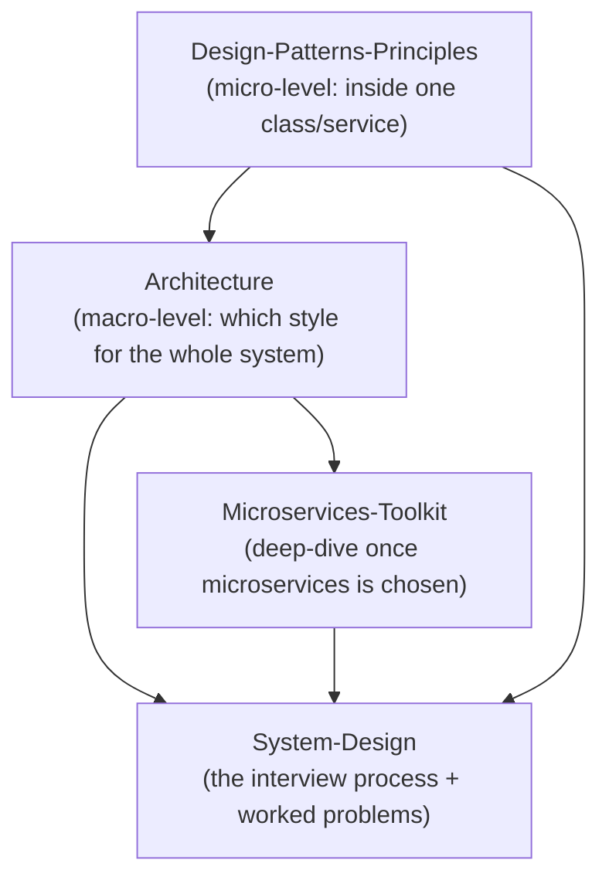

# System Design Prep: Navigation Index

Reviewed: November 20, 2026. Purpose: a thin cross-linking map tying together the four files that make up the HLD/LLD/System-Design prep track — [Design-Patterns-Principles-Notes.md](Design-Patterns-Principles-Notes.md), [Architecture-Notes.md](Architecture-Notes.md), [Microservices-Toolkit-Notes.md](Microservices-Toolkit-Notes.md), and [System-Design-Notes.md](System-Design-Notes.md). This file has no new content of its own — it exists purely so that "if asked about X, go to file Y, section Z" is a 10-second lookup instead of a guessing game under interview pressure. Once this content is read, switch to [System-Design-Practice-Log.md](System-Design-Practice-Log.md) for the deliberate-practice loop and tracking template — imbibing this track is a practice problem, not a reading problem.

## How the four files relate

- **Design-Patterns-Principles** = the vocabulary you apply *inside* a service (SOLID, GoF patterns, CQRS, Event Sourcing, idempotency).
- **Architecture** = the decision layer above that: which architecture *style* fits this system, and the CAP/PACELC trade-offs that constrain every choice below it.
- **Microservices-Toolkit** = the deep-dive reference *once* "microservices" is the chosen style — decomposition, resilience, scalability, data, deployment, observability, testing.
- **System-Design** = the thing you actually perform in the interview: the 5-step process, capacity math, and worked problems that pull from all three of the above.

## "If asked about X, go to..." lookup table

| If the interviewer asks about... | Go to | Section |
|---|---|---|
| SOLID principles, a specific GoF pattern | Design-Patterns-Principles | §§ 1, 4–6 |
| Inheritance vs. composition, why a design broke LSP | Design-Patterns-Principles | §§ 1, 7 |
| CQRS, Event Sourcing | Design-Patterns-Principles | §§ 8–9 |
| Idempotency, at-least-once delivery, event ordering | Design-Patterns-Principles | § 10 |
| CAP theorem, PACELC, consistency vs. availability trade-off | Architecture | § CAP/PACELC |
| Which architecture style fits this system (layered/modular monolith/microservices/event-driven) | Architecture | § 1 |
| Modular monolith internals, "don't share tables" | Architecture | § 4 |
| gRPC vs. REST | Architecture | gRPC vs. REST section |
| Should this even *be* microservices (YAGNI argument) | Microservices-Toolkit | § 1 |
| Service boundaries, DDD (bounded context, aggregate), Strangler Fig | Microservices-Toolkit | § 1 |
| Sync vs. async communication, API Gateway trade-offs | Microservices-Toolkit | § 2 |
| Circuit breaker, retries, bulkhead, timeout patterns | Microservices-Toolkit | Resilience Patterns section |
| Horizontal scaling patterns, load shedding | Microservices-Toolkit | Scalability Patterns section |
| Distributed transactions, Saga, data consistency across services | Microservices-Toolkit | Data & Consistency section |
| Deployment strategies (blue-green, canary), service mesh | Microservices-Toolkit | Deployment & Operational Concerns |
| Distributed tracing, observability across services | Microservices-Toolkit | Observability section |
| Testing strategy for microservices (contract tests, etc.) | Microservices-Toolkit | Testing section |
| "Walk me through your interview process/framework" | System-Design | § 1 |
| Back-of-envelope capacity estimation | System-Design | § 3 |
| URL shortener, rate limiter, chat system, news feed worked examples | System-Design | § 5 |
| Caching strategy mechanics (cache-aside, write-through, eviction) | [Caching-Notes.md](../data/Caching-Notes.md) | whole file |
| Message broker specifics (Kafka vs. RabbitMQ) | [Message-Middleware-Notes.md](../cloud/Message-Middleware-Notes.md) | whole file |
| Search/relevance ranking at scale | [Elasticsearch-Notes.md](../data/Elasticsearch-Notes.md) | whole file |
| NoSQL partition-key design, consistency tuning | [Cosmos-DB-Notes.md](../data/Cosmos-DB-Notes.md) | whole file |

## Suggested study order

1. Design-Patterns-Principles (foundation vocabulary).
2. Architecture (macro decision layer — builds on #1).
3. Microservices-Toolkit (deep-dive, read once decomposition/resilience/scalability concepts from Architecture are solid).
4. System-Design (process + worked problems — the integration/practice layer; revisit after #1-3 are comfortable, and keep re-practicing the worked problems out loud).
5. [System-Design-Practice-Log.md](System-Design-Practice-Log.md) — switch from reading to logged, timed reps here; this is the ongoing step, not a one-time read.
